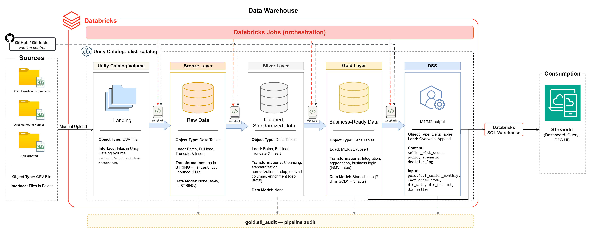
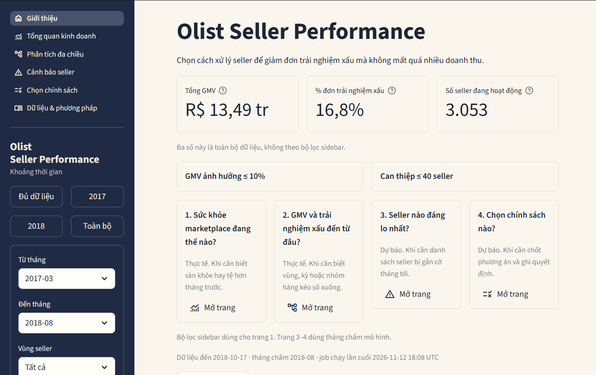
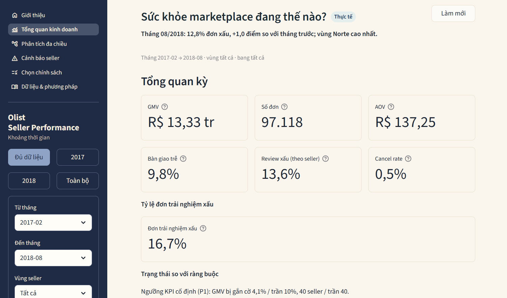
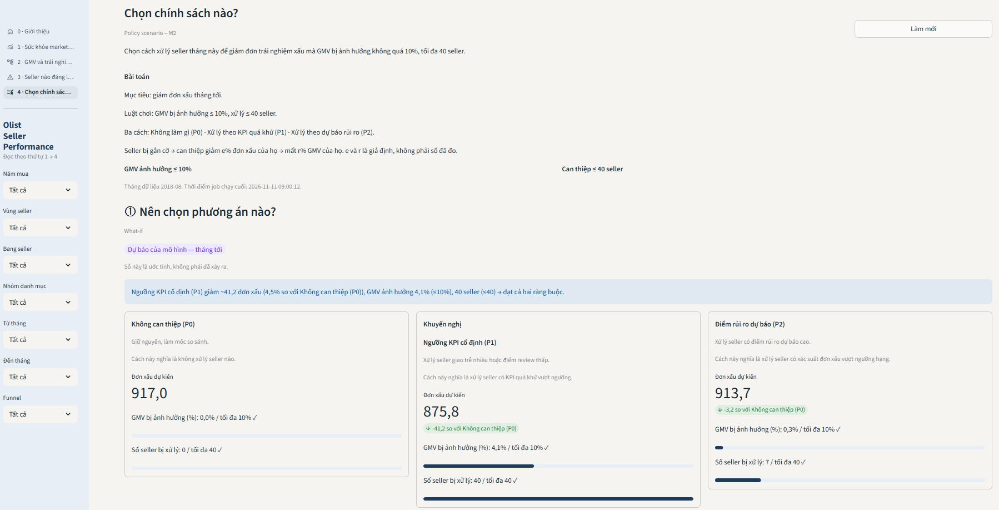

# olist-dw-dss

A seller-performance data warehouse and decision support system for the Olist marketplace. It ranks sellers by predicted bad-experience risk and compares intervention policies so the Seller Quality manager can cut bad orders without giving up too much GMV.

## Architecture



CSV files from Kaggle are uploaded by hand into a Unity Catalog Volume. Databricks serverless jobs load them as Bronze (raw overwrite) → Silver (clean overwrite) → Gold (Kimball star, `MERGE`). A **separate** DSS job scores sellers (M1) and simulates policies (M2) into schema `dss`. One local Streamlit app reads `gold` and `dss` through a Databricks SQL Warehouse and appends `dss.decision_log`. Power BI is future work.

The layer contract is in [docs/architecture.md](docs/architecture.md). The ERD and mappings are in [docs/DESIGN.md](docs/DESIGN.md).

## Decision problem

Each month the Seller Quality manager chooses an intervention policy (no action, fixed KPI thresholds, or predicted-risk thresholds) under two locked caps: at most **10%** of GMV affected and at most **40** sellers.

| Phase | What the app answers |
|---|---|
| Intelligence | How healthy is the marketplace, and where do GMV and bad experience come from? |
| Design | Which sellers look risky next month, and which policy shapes (P0 / P1 / P2) exist? |
| Choice | Which policy stays inside X and N, and should that choice be written to `dss.decision_log`? |

## Data

- Main source: [Brazilian E-Commerce Public Dataset by Olist](https://www.kaggle.com/datasets/olistbr/brazilian-ecommerce) (Kaggle), license [CC BY-NC-SA 4.0](https://creativecommons.org/licenses/by-nc-sa/4.0/). Nine order/item/customer/seller tables.
- Extra source: [Marketing Funnel by Olist](https://www.kaggle.com/datasets/olistbr/marketing-funnel-olist), same license, two files joined on `seller_id`.
- Window on Gold (queried 11/11/2026): purchase dates **2016-09-04 → 2018-10-17**, **99,441** orders. Sparse months stay in the warehouse. Details: [data/README.md](data/README.md).

## Medallion and data model

Catalog: `olist_catalog`. Schemas: `bronze`, `silver`, `gold`, `dss`. Gold is the only warehouse. OLAP and DSS read Gold (and `dss` outputs), not Bronze or Silver.

| Layer | Load | Objects |
|---|---|---|
| Volume | Manual CSV upload | `/Volumes/olist_catalog/bronze/raw/` (`olist/`, `funnel/`, `ref/`) |
| Bronze | Batch full-load overwrite | 12 Delta tables, every business column `STRING`, plus `_ingest_ts`, `_source_file` |
| Silver | Batch full-load overwrite (truncate then insert) | Typed, deduped, IBGE region, geo and review rules |
| Gold | `MERGE` upsert only (`WHEN MATCHED THEN UPDATE`, `WHEN NOT MATCHED THEN INSERT`) | 7 dimensions (SCD Type 1, Unknown member `-1`) + `fact_order_item`, `fact_order`, `fact_seller_monthly`. Item fact is merged before the order fact. `gold.etl_audit` logs each load |
| `dss` | Separate job overwrite + Streamlit append | View `v_seller_features`; job writes `seller_risk_score`, `policy_scenario`, and eval/contrib tables when filled; Streamlit appends `decision_log` |

ETL job order: **setup → bronze → silver → gold dims → gold facts → fact_seller_monthly**. The DSS job is **not** a task of that job.

## DSS

- **M1** is a **forecast**: logistic regression on the seller×month panel from Gold. It estimates the probability that a seller’s next-month order is a bad-experience order (review ≤ 2 **or** late to the customer). Train/test split is by time, not random. It is a classifier, not a time-series model. Scoring month `AS_OF_MONTH` = **2018-08** (`src/dss/params.py`). 2018-09 has too few sellers.
- **M2** is a **simulation**, not a forecast of GMV. It applies policies P0 (do nothing), P1 (fixed KPI thresholds), P2 (predicted-risk tiers) with assumed effects `e_k` and transfer rate `r`, then checks GMV share ≤ 10% and sellers ≤ 40. The UI also runs goal seeking and a tornado (±20% on `e_k`, `r`, `s`).

## Streamlit app

One local app (`src/frontend/app.py`) is both the dashboard and the DSS UI. Five pages:

| # | Page title | Role |
|---|---|---|
| 0 | Giới thiệu | Home: problem, scale, how to read numbers |
| 1 | Sức khỏe marketplace đang thế nào? | Actual KPIs |
| 2 | GMV và trải nghiệm xấu đến từ đâu? | Five OLAP operations + Brazil map |
| 3 | Seller nào đáng lo nhất? | M1 scores for 2018-08 |
| 4 | Chọn chính sách nào? | M2 what-if, goal seek, tornado, `decision_log` |







Terms: [docs/glossary.md](docs/glossary.md). Brazil GeoJSON source and MIT license: see the map note at the end of this file.

## How to run

**Prerequisites:** a Databricks Free Edition workspace, catalog `olist_catalog`, a SQL Warehouse, Python 3 with the repo venv, and the CSVs listed in [data/README.md](data/README.md).

1. Provide `DATABRICKS_SERVER_HOSTNAME` (or `DATABRICKS_HOST`), `DATABRICKS_HTTP_PATH`, and `DATABRICKS_TOKEN`. The app reads `st.secrets`, then the process environment, then `.env` if that file exists. Copy `.env.example` to `.env` for a local run. Leave the token empty in `.env.example`. Do not commit `.env` or `.streamlit/secrets.toml`.
2. Upload the CSVs to `/Volumes/olist_catalog/bronze/raw/` (`olist/`, `funnel/`, `ref/`).
3. In the workspace UI, create serverless job `olist_etl` from `src/etl/olist_etl.job.yml` (skeleton, not a DAB deploy). Run setup → bronze → silver → gold dims → gold facts → `fact_seller_monthly`. Notebooks under `src/etl/` do not read `data/sample/`.
4. Create a **separate** serverless job from `src/dss/dss_job.yml` and run `src/dss/dss_job.py`. It writes `dss.seller_risk_score` and `dss.policy_scenario` for month **2018-08**.
5. Streamlit, from the repo root:

```powershell
python -m streamlit run src\frontend\app.py
```

A local warehouse replay on `data/sample/` (`USE_SAMPLE=1`, pyspark + delta-spark) is R46 (S6, Phase 6, Phase 7). It is not the Phase 3 path.

## Repository layout

```
olist-dw-dss/
├── README.md, .gitignore, .env.example
├── docs/                  SPEC, PLAN, DESIGN, architecture, glossary, PROGRESS_LOG
├── data/                  README, raw (gitignored), external, sample
└── src/
    ├── etl/               Databricks notebooks + olist_etl.job.yml
    ├── sql/               olap_queries/ and views/v_seller_features.sql
    ├── dss/               M1, M2, dss_job.py
    ├── frontend/          Streamlit app.py and pages
    ├── notebooks/         profiling and sample builder
    └── tests/             pytest on insights/stats (not Phase 3 DoD)
```

Read order: this file → [docs/SPEC.md](docs/SPEC.md) → [docs/PLAN.md](docs/PLAN.md) → [docs/PROGRESS_LOG.md](docs/PROGRESS_LOG.md).

## Main results (measured, not invented)

From SQL Warehouse, empty sidebar filters, recorded 11/11/2026 in `docs/PROGRESS_LOG.md`:

| Measure | Value |
|---|---|
| GMV (`SUM(price)`, exclude canceled/unavailable) | R$ 13,494,400.74 |
| Bad-experience rate (marketplace flag) | 16,8% (16,444 / 98,079) |
| Active sellers with ≥ 1 valid order | 3,053 |
| Orders on `fact_order` | 99,441 |
| Scoring month | 2018-08 (`AS_OF_MONTH`) |

Rates on the app are always **SUM(numerator) / SUM(denominator)**. Seller late ship is not the same as late delivery to the customer. See [docs/glossary.md](docs/glossary.md).

## Limits and future work

- Historical 2016–2018 window; “next month” in M1 is a one-step-ahead simulation on 2018-08, not live operations.
- Sparse months (2016-09, 2016-10, 2016-12, 2017-01, 2018-09, 2018-10) stay in Gold.
- `e_k` and `r` in M2 are assumed, not measured.
- **Power BI**, incremental/watermark load, append Bronze, CDF, Auto Loader, CDC, streaming, and CI for the warehouse job are **future work**.
- Local pyspark + delta-spark on `data/sample/` remains R46 (S6).

## Tech stack

Databricks Free Edition, Unity Catalog, Delta Lake, PySpark / Spark SQL, serverless Jobs, Databricks SQL Warehouse. Python: scikit-learn (M1), Streamlit, `databricks-sql-connector`, pandas, Plotly.

## Brazil state map

The KPI tab `Xảy ra ở đâu` uses `src/frontend/assets/brazil_states.geojson`.

- Source: [click_that_hood](https://github.com/codeforamerica/click_that_hood/blob/master/public/data/brazil-states.geojson) `public/data/brazil-states.geojson` (Code for America), fetched 11/11/2026.
- License: MIT, Copyright (c) 2013-2021 Code for America.
- Join key: feature property `sigla`, the same 2-letter code as `state_code` on Gold.

## License of the data excerpt

Olist and Marketing Funnel are CC BY-NC-SA 4.0. Cite Olist/Kaggle when sharing `data/sample/`. Do not present the sample as the full dataset.
