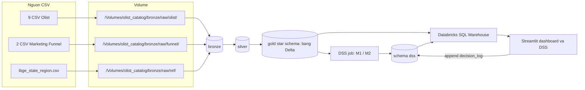
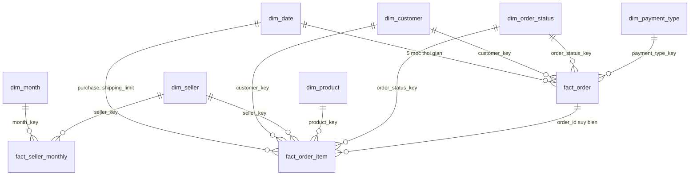
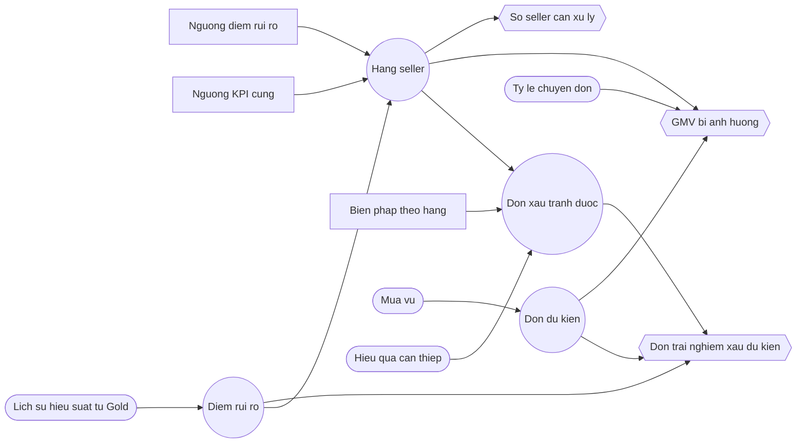

# DESIGN — Thiết kế DW, ETL mapping, data dictionary

> **Trạng thái: thiết kế Phase 2 đã khóa 22/10/2026.** Load 26/10/2026 và sửa hợp đồng 05/11/2026 nằm ở hai mục dưới. DDL Phase 3 nằm trong notebook `src/etl/`. ~~Job chưa chạy trên workspace~~ (đổi 11/11: Gold đã có số đo trên SQL Warehouse; xem `PROGRESS_LOG`). SPEC §5–6 là bản tóm tắt; file này là hợp đồng vật lý. Tháng chấm DSS = **2018-08**.
>
> Nguồn dùng khi viết: `docs/SPEC.md` (số đo Volume trong §3; quyết định Phase 2 ở v0.5, bổ sung v0.6 ngày 22/10/2026), `docs/PLAN.md` Phase 2, `docs/PROGRESS_LOG.md`, `docs/TOPIC_EVALUATION.md` §1.2–1.4, header CSV trong `data/sample/` và `data/external/` (cùng tên cột với `data/raw/`). Không dùng `data/sample/` để ước lượng số dòng.
>
> Số đo chưa có trong SPEC §3 ghi **pending** ở §11. Phase 3 không được điền số đó từ trí nhớ. Luật biến đổi thì đã đủ để code.

Grain đã khóa (SPEC §5, SPEC §10). Không đổi ở file này:

- `fact_order_item`: một dòng = một item của một đơn (`order_id`, `order_item_id`). Transaction fact.
- `fact_order`: một dòng = một đơn. Accumulating snapshot.
- `fact_seller_monthly`: một dòng = một seller × một tháng có ít nhất một item. Periodic snapshot.

---

## Decision update 26/10/2026

Dataset trong phạm vi bài là tập tĩnh: không có đơn mới sau cửa sổ đã đo. Nhóm ưu tiên tiến độ Phase 3. Kỹ thuật cốt lõi giữ nguyên: star schema, `MERGE` theo grain, và kiểm tra chất lượng dữ liệu.

Không đổi: grain ba fact, star schema (7 dimension + 3 fact), measure, SCD, surrogate key.

| Hạng mục | Từ 26/10/2026 |
|---|---|
| Bronze | Batch. FULL LOAD, OVERWRITE (truncate rồi insert). Mọi cột nghiệp vụ `STRING`, as-is. Thêm `_ingest_ts`, `_source_file`. Không có `_batch_id` |
| Silver | Batch. FULL LOAD, OVERWRITE. Không lọc theo `watermark_cutoff_ts`. Không chọn bản giữa các lần nạp theo `_ingest_ts`. Giữ dedup trong file: `order_reviews` bằng `ROW_NUMBER`, `order_reviews_dedup`, `geolocation_zip` một dòng mỗi prefix. Giữ mọi luật làm sạch §7 |
| Gold | Bảng Delta, không phải view. `MERGE` theo grain, idempotent: chỉ `WHEN MATCHED THEN UPDATE` và `WHEN NOT MATCHED THEN INSERT`. Không `WHEN NOT MATCHED BY SOURCE THEN DELETE`. 7 dimension + 3 fact |
| `snapshot_date` | Hằng số `DATE '2018-10-17'` trong config. Không suy từ watermark |
| `gold.etl_audit` | `audit_id`, `run_id`, `layer`, `target_table`, `source_name`, `rows_read`, `rows_loaded`, `rows_rejected`, `rows_unknown_fk`, `loaded_at`. Cảnh báo geo, translation, conflict và các đếm cùng loại là DQ check trong notebook: in kết quả, không lưu cột riêng |
| Orchestration | Job ETL: setup → bronze → silver → gold dims → gold facts → `fact_seller_monthly`. Job DSS tách riêng |
| Frontend | Một app Streamlit: dashboard, OLAP và DSS, đọc Gold và `dss` qua SQL Warehouse. Power BI là future work. `dss.decision_log` do Streamlit append. OLAP = ROLAP qua SQL Warehouse. Job ETL Gold không ghi bảng này |
| Future work | Incremental, append, CDF, Auto Loader (R28) |

Sơ đồ cùng các mục Object Type / Load / Transformations / Data Model: `docs/architecture.md`.

---

## Sửa hợp đồng 05/11/2026

Bốn luật dưới đây là bản hiện hành. Câu bị thay nằm ở SPEC §10, mục lịch sử. Grain, SCD và surrogate key không đổi.

1. **MERGE Gold.** Trên 7 dimension và 3 fact chỉ có `WHEN MATCHED THEN UPDATE` và `WHEN NOT MATCHED THEN INSERT`. Không viết `WHEN NOT MATCHED BY SOURCE THEN DELETE`. Khóa đã nạp nhưng không còn trong ảnh Silver hiện tại được giữ. Member `-1` không cần mệnh đề ngoại lệ vì không có nhánh xóa.
2. **`dss.decision_log`.** Streamlit ghi thêm một dòng (append qua SQL Warehouse) cho mỗi quyết định đã chốt. Streamlit không sở hữu schema `dss` ngoài các dòng đó. Job ETL Gold không ghi bảng này. Job DSS (Phase 5) ghi `dss.seller_risk_score` và `dss.policy_scenario`, không ghi `decision_log`.
3. **GMV của seller.** `fact_seller_monthly.gmv` = `sum(price)` của item thuộc seller trong tháng mua, loại đơn `canceled` và `unavailable`. `freight_value` và `freight_total` là measure riêng, không cộng vào `gmv`.
4. **Review dùng chung — luật tạm, [GIẢ ĐỊNH].** Olist chưa xác nhận nguyên nhân. Giữ grain (`review_id`, `order_id`). Sau dedupe, mỗi `order_id` một review mới nhất. Thêm `shared_review_type` với giá trị `none`, `same_seller`, `cross_seller`. Measure review của seller loại `cross_seller` (và đơn `n_sellers` > 1). KPI sàn giữ `cross_seller`. Mẫu tỷ lệ review là `COUNT(DISTINCT order_id)`. Review bị loại khỏi measure seller không tắt `late_flag`. Số đã đo: 789 `review_id` gắn nhiều đơn, 814 dòng thừa trên file thô. Đỉnh tháng 3/2018 khoảng 1,6% review là [GIẢ ĐỊNH], không đo lại ở phiên này. Luật cuối chờ sensitivity top-40 sau khi Gold có số.

X = 10% GMV và N = 40 seller/tháng giữ nguyên từ 15/10/2026.

---

## 1. Kiến trúc (R22, R02, R45)

Sơ đồ đầy đủ, gồm GitHub và thứ tự Job, nằm ở `docs/architecture.md`.

File IBGE đã có ở `data/external/ibge_state_region.csv` (27 dòng, đếm file local 15/10/2026). Nhóm xác nhận file đã nằm ở `/Volumes/olist_catalog/bronze/raw/ref/`. Phiên thiết kế này không đọc Volume, nên không ghi số dòng mới trên Volume. Không đặt file này vào `funnel/`.

**Vì sao là data mart bottom-up, không phải EDW top-down.** Nhóm có một quyết định lặp lại: mỗi tháng chọn chính sách phân hạng seller (SPEC §1, T1 đã chốt 15/10/2026). Kimball bottom-up dựng một data mart cho đúng chủ đề đó, dimension conformed để thêm mart sau. EDW top-down phủ mọi quy trình của sàn thì quá rộng so với 2–3 người và khoảng năm tuần. Gold vẫn là star schema / fact constellation, nên vẫn là DW phục vụ OLAP và DSS (điều kiện 3.1(a) của đề).

| Schema | Vai trò | Hợp đồng vào / ra |
|---|---|---|
| `bronze` | Staging. Bản sao CSV của lần nạp hiện tại. Bảng Delta | Vào: file trên Volume, mọi cột `string`, giữ nguyên chuỗi. Ra: cùng các cột đó cộng `_ingest_ts`, `_source_file`. Không join, không ép kiểu nghiệp vụ, không `trim`, không xóa dòng trong file. Load: FULL LOAD, OVERWRITE |
| `silver` | Integration. Làm sạch, ép kiểu, chuẩn hóa, dedupe trong file. Bảng Delta | Vào: Bronze. Ra: bảng grain đã nêu ở §2. Không publish fact. Load: FULL LOAD, OVERWRITE |
| `gold` | Data mart Kimball. Chỉ fact, dimension, và `etl_audit`. Bảng Delta, không phải view | Vào: Silver. Ra: 3 fact + 7 dimension. `MERGE` theo grain: `WHEN MATCHED THEN UPDATE`, `WHEN NOT MATCHED THEN INSERT` (§2). Không xóa khóa vắng mặt trong ảnh hiện tại. Streamlit đọc Gold qua SQL Warehouse |
| `dss` | Đầu ra mô hình Phase 5 | View `dss.v_seller_features` chỉ đọc `gold.*`. Job DSS ghi đè `dss.seller_risk_score` và `dss.policy_scenario` cho tháng chấm. `dss.decision_log` do Streamlit append qua SQL Warehouse. Job ETL Gold không ghi `dss`. Cột ở §6.6 |

Ánh xạ slide: Bronze = staging, Silver = integration, Gold = data mart / DW, `gold.etl_audit` = metadata vận hành, comment Unity Catalog trên bảng Gold = metadata mô tả (R47, làm lúc DDL). Presentation: một app Streamlit (dashboard, OLAP và DSS, ROLAP qua SQL Warehouse). Power BI là future work.

Mô hình DSS sau này huấn luyện trên Gold, không trên Silver (SPEC §4, lệch có chủ đích).

---

## 2. Vật lý Delta và hợp đồng layer

Catalog: `olist_catalog` (S1, 13/10/2026). Schema: `bronze`, `silver`, `gold`, `dss`. Định dạng: Delta. Không `PARTITIONED BY`.

**Vì sao không partition.** Mart khoảng 100 nghìn đơn (đo 99.441 dòng `orders`). Partition theo `seller_id` hoặc `order_id` tạo quá nhiều file nhỏ. Nếu sau này có partition, chỉ theo cột lọc (ví dụ tháng mua), và phải sửa mục này trước khi thêm mệnh đề.

Load: batch. Bronze và Silver: FULL LOAD, OVERWRITE (truncate rồi insert ảnh hiện tại). Gold: bảng Delta, `MERGE` theo grain, idempotent. Chạy lại cùng grain không được nhân đôi dòng.

`MERGE` của 3 fact và của 7 dimension chỉ có hai nhánh: `WHEN MATCHED THEN UPDATE` và `WHEN NOT MATCHED THEN INSERT`. Không có `WHEN NOT MATCHED BY SOURCE THEN DELETE`. Khóa đã có trên Gold nhưng không còn trong ảnh Silver hiện tại được giữ. Dataset tĩnh không phát sinh đơn mới sau cửa sổ đã đo, nên nhánh xóa không thuộc hợp đồng Phase 3. Member `-1` vẫn được chèn trước fact và không bị MERGE xóa, vì không có nhánh xóa.

### 2.1 Hai cột ingest trên mọi bảng Bronze

| Cột | Kiểu | Null | Quy tắc |
|---|---|---|---|
| `_ingest_ts` | TIMESTAMP | không | `current_timestamp()` lúc đọc file |
| `_source_file` | STRING | không | Đường dẫn Volume của file |

Mọi cột nghiệp vụ Bronze: `STRING`, giữ nguyên dữ liệu thô đúng như file CSV (không `trim`, không biến chuỗi toàn dấu cách thành null). Chỉ bỏ BOM và dấu ngoặc kép thừa ở tên cột (cùng quy tắc `normalize_columns` trong `01_profiling.py`). Không cast số. Zip và id giữ nguyên chuỗi, kể cả số 0 đầu.

### 2.2 Bảng Bronze — grain một dòng CSV của lần nạp hiện tại

| Bảng | File | Grain | Dòng nguồn đã đo |
|---|---|---|---|
| `bronze.orders` | `olist/olist_orders_dataset.csv` | 1 dòng file | 99.441 |
| `bronze.order_items` | `olist/olist_order_items_dataset.csv` | 1 dòng file | 112.650 |
| `bronze.order_reviews` | `olist/olist_order_reviews_dataset.csv` | 1 dòng file | 99.224 |
| `bronze.order_payments` | `olist/olist_order_payments_dataset.csv` | 1 dòng file | 103.886 |
| `bronze.customers` | `olist/olist_customers_dataset.csv` | 1 dòng file | 99.441 |
| `bronze.sellers` | `olist/olist_sellers_dataset.csv` | 1 dòng file | 3.095 |
| `bronze.products` | `olist/olist_products_dataset.csv` | 1 dòng file | 32.951 |
| `bronze.geolocation` | `olist/olist_geolocation_dataset.csv` | 1 dòng file | 1.000.163 |
| `bronze.category_translation` | `olist/product_category_name_translation.csv` | 1 dòng file | 71 |
| `bronze.closed_deals` | `funnel/olist_closed_deals_dataset.csv` | 1 dòng file | 842 |
| `bronze.marketing_qualified_leads` | `funnel/olist_marketing_qualified_leads_dataset.csv` | 1 dòng file | 8.000 |
| `bronze.state_region` | `ref/ibge_state_region.csv` | 1 dòng file | 27 (đếm file local 15/10/2026) |

Số trong bảng là kích thước file hiện tại. Nạp lại ghi đè, không cộng dồn dòng.

### 2.3 Bảng Silver — grain sau làm sạch

Không chọn bản giữa các lần nạp. Không dùng `_ingest_ts` để chọn dòng thắng qua hai lần nạp.

Nếu một file nguồn có nhiều dòng cùng khóa grain, ngoài luật review và geolocation ở các dòng dưới, giữ một dòng bằng chuỗi ghép các cột nghiệp vụ lớn nhất theo thứ tự từ điển. Không dừng batch.

| Bảng | Grain | Quy tắc grain |
|---|---|---|
| `silver.orders` | 1 `order_id` | Nếu file có khóa trùng: một dòng theo chuỗi nghiệp vụ ở trên. Số nhóm trùng `order_id` pending (§11) |
| `silver.order_items` | 1 (`order_id`, `order_item_id`) | Cùng quy tắc trong file. 0 item không có order (SPEC §3) |
| `silver.order_reviews` | 1 (`review_id`, `order_id`) | Cast kiểu, bỏ dòng trùng y hệt, rồi nếu cùng khóa còn khác giá trị thì giữ một dòng: `ROW_NUMBER() OVER (PARTITION BY review_id, order_id ORDER BY review_answer_timestamp DESC NULLS LAST, review_creation_date DESC NULLS LAST) = 1`. Số nhóm lệch in ở notebook DQ, chỉ cảnh báo, không fail, không lưu cột audit |
| `silver.order_reviews_dedup` | 1 `order_id` | Từ `silver.order_reviews`: `ROW_NUMBER() OVER (PARTITION BY order_id ORDER BY review_answer_timestamp DESC NULLS LAST, review_creation_date DESC NULLS LAST, review_id) = 1`. `review_id` không ghi DESC nên tăng dần, chỉ để phá hòa. Cùng lần OVERWRITE, sau khi `silver.order_items` đã có, gắn `shared_review_type` (§3.6) |
| `silver.order_payments` | 1 (`order_id`, `payment_sequential`) | Nếu file có khóa trùng: một dòng theo chuỗi nghiệp vụ ở trên. Số nhóm trùng pending |
| `silver.customers` | 1 `customer_id` | 99.441 id trên 99.441 dòng. Chưa gộp `customer_unique_id` |
| `silver.sellers` | 1 `seller_id` | File có 3.095 dòng. Số `seller_id` trùng pending. Trùng trong file thì cùng chuỗi nghiệp vụ ở trên |
| `silver.products` | 1 `product_id` | Số `product_id` trùng pending. Trùng trong file thì cùng chuỗi nghiệp vụ ở trên |
| `silver.geolocation_zip` | 1 `geolocation_zip_code_prefix` | Bỏ điểm ngoài bbox lat [-34, 6], lng [-74, -28], rồi `percentile_approx` 0.5 cho lat/lng và mode `city_norm`/state. Zip không còn điểm trong bbox thì không có dòng. Số zip sau bbox pending |
| `silver.geolocation_city` | 1 (`city_norm`, `state_code`) | Cùng các điểm đã qua bbox. Trung vị lat/lng để fallback khi zip không khớp |
| `silver.category_translation` | 1 `product_category_name` | |
| `silver.closed_deals` | 1 dòng deal | Không gộp theo `seller_id` ở Silver. 842 dòng nguồn. Gold mới chọn một deal (§6.3) |
| `silver.marketing_qualified_leads` | 1 `mql_id` | Giữ để khỏi mất nguồn. Gold `dim_seller` không đọc bảng này. Số `mql_id` trùng pending |
| `silver.state_region` | 1 `state_code` | 27 UF |

`silver.order_reviews` giữ một dòng mỗi (`review_id`, `order_id`). Dòng giống hệt thì bỏ. Dòng cùng khóa nhưng khác giá trị thì giữ bản có `review_answer_timestamp` mới nhất, null xếp sau, rồi `review_creation_date` mới nhất, null xếp sau. Cửa sổ không sắp theo cột ingest. `silver.order_reviews_dedup` là bảng một review mỗi đơn. `fact_order` chỉ đọc review từ `silver.order_reviews_dedup`. Không lấy trung bình điểm. Không xóa review có `review_creation_date` trước ngày nhận hàng (§3.6, §7).

### 2.4 Bảng Gold

| Bảng | Grain | Khóa MERGE |
|---|---|---|
| `gold.dim_date` | 1 ngày | `date_key` |
| `gold.dim_month` | 1 tháng | `month_key` |
| `gold.dim_customer` | 1 `customer_unique_id` | `customer_key` (tra theo natural key) |
| `gold.dim_seller` | 1 `seller_id` | `seller_key`. SCD2-ready (§3.5): vẫn một dòng, chưa lưu lịch sử |
| `gold.dim_product` | 1 `product_id` | `product_key` |
| `gold.dim_order_status` | 1 trạng thái | `order_status_key` |
| `gold.dim_payment_type` | 1 loại thanh toán | `payment_type_key` |
| `gold.fact_order_item` | 1 (`order_id`, `order_item_id`) | hai cột grain |
| `gold.fact_order` | 1 `order_id` | `order_id` |
| `gold.fact_seller_monthly` | 1 seller × 1 tháng có ít nhất một item | (`seller_key`, `month_key`) |
| `gold.etl_audit` | 1 dòng log cho 1 bảng đích của 1 `run_id` | ghi thêm dòng log, không MERGE đè lịch sử |

`dim_date` là một bảng vật lý. Nhiều khóa ngoại trên fact là role-playing, không tạo nhiều bảng ngày.

Tháng thưa (2016-09, 2016-10, 2016-12, 2017-01, 2018-09, 2018-10) **ở lại** trong fact nếu tháng đó có đơn. Không có đơn tháng 2016-11 nên không có dòng fact tháng đó; `dim_date` vẫn có các ngày nằm giữa min và max của lịch. Không tạo dòng seller-tháng bằng 0 cho seller không bán trong tháng. Grain là “tháng có hoạt động”, không phải lưới seller × mọi tháng.

---

## 3. Mô hình Gold

### 3.1 Ba loại fact

| Fact | Nghĩa | Hệ quả khi nạp lại |
|---|---|---|
| `fact_order_item` | Transaction. Một sự kiện dòng hàng, measure cộng được ở mức dòng | MERGE toàn bộ grain từ ảnh Silver hiện tại. Chạy lại không nhân đôi dòng |
| `fact_order` | Accumulating snapshot. Một đơn, nhiều mốc thời gian trên cùng một dòng | MERGE trên `order_id` từ ảnh Silver hiện tại. Review chỉ từ `silver.order_reviews_dedup` |
| `fact_seller_monthly` | Periodic snapshot. Ảnh seller trong tháng mua (`order_purchase_timestamp`) | MERGE tính lại mọi seller-tháng có ít nhất một item |

### 3.2 Khóa và member Unknown

Mọi dimension có surrogate key. Natural key (`seller_id`, `customer_unique_id`, `product_id`, …) là thuộc tính, không phải khóa fact.

Member `-1` cài trước khi nạp fact, trên cả 7 dimension. Fact không bỏ dòng thiếu khóa. Khóa ngoại không khớp trỏ `-1`. Đếm số lần trỏ `-1` trong `gold.etl_audit.rows_unknown_fk`.

Trên dòng `-1`: khóa chính bằng `-1`; natural key (`full_date`, `customer_unique_id`, `seller_id`, `product_id`, `mql_id`, `sdr_id`, `sr_id`) bằng null; cột chữ dùng để nhóm trên OLAP bằng `'Unknown'`; cột số, ngày và cờ bằng null, kể cả `is_weekend` và `has_closed_deal`.

`payment_type` rỗng hoặc `not_defined` thành null ở Silver, rồi fact trỏ `payment_type_key = -1`. Không tạo thêm member dimension có nhãn `'unknown'`. Sản phẩm có `product_id` nhưng thiếu category vẫn là một member dương. `category_pt`, `category_en` và `category_group` của dòng đó bằng `'Unknown'`, cùng nhãn dòng `-1`.

| Dimension | Khóa | Cách sinh |
|---|---|---|
| `dim_date` | `date_key` INT | `year * 10000 + month * 100 + day`. Unknown = `-1` |
| `dim_month` | `month_key` INT | `year * 100 + month`. Unknown = `-1` |
| Các dimension còn lại | `*_key` BIGINT | Tra natural key. Khóa mới cấp theo `ORDER BY` natural key tăng dần, rồi `max(key) + 1` theo thứ tự đó, bắt đầu từ 1. Cùng tập natural key thì rerun ra cùng surrogate. Không hash. Unknown = `-1` |

### 3.3 Role-playing date và `dim_month`

`dim_date` sinh mọi ngày từ ngày nhỏ nhất đến ngày lớn nhất trong các timestamp đã parse và còn lại trên cột chính thức của Silver (purchase, approved, carrier, customer, estimated, shipping limit, review). Không dùng lịch ngày lễ. Thuộc tính: ngày, năm, quý, tháng, ngày trong tháng, thứ (`dayofweek` Spark: 1 = Chủ Nhật … 7 = Thứ Bảy), `is_weekend` khi thứ là 1 hoặc 7.

| Fact | Khóa ngoại tới `dim_date` | Timestamp nguồn |
|---|---|---|
| `fact_order_item` | `purchase_date_key`, `shipping_limit_date_key` | `order_purchase_timestamp`, `shipping_limit_date` |
| `fact_order` | `purchase_date_key`, `approved_date_key`, `delivered_carrier_date_key`, `delivered_customer_date_key`, `estimated_date_key` | Năm mốc chính thức trên `silver.orders` |

Timestamp null hoặc không parse được → khóa `-1`.

Trên `silver.orders`, mốc đảo thứ tự thành null ở cột chính thức. Giá trị đã parse được giữ ở `raw_*`. So sánh đảo trên `raw_*`, không trên cột đã bị xóa, để các nhóm đã đo (carrier trước purchase 166, carrier trước approved 1.359, customer trước carrier 23) không mất vì cascade. `ts_inversion_flag = 1` khi có ít nhất một `raw_*` khác null nhưng cột chính thức tương ứng bị null vì đảo. Lên Gold, mốc đó đã null nên `*_date_key = -1` và measure thời gian bỏ qua. Cờ copy sang `fact_order`. Notebook DQ in số dòng cờ bằng 1 khi nạp `silver.orders` và `fact_order`. Không lưu cột này trên `gold.etl_audit`.

`dim_month` là dimension rút từ `dim_date`: một dòng mỗi `year_month` có trong `dim_date`. `fact_seller_monthly.month_key` là tháng của `order_purchase_timestamp`.

### 3.4 Hierarchy

| Chiều | Cấp | Cột | Nguồn |
|---|---|---|---|
| Thời gian | Năm → Quý → Tháng → Ngày | `dim_date.year`, `quarter`, `month`, `full_date` | Timestamp đơn. Không ngày lễ |
| Tháng | Năm → Quý → Tháng | `dim_month` | Rút từ `dim_date` |
| Địa lý khách | Vùng → Bang → Thành phố | `fact_order.customer_region_name`, `customer_state_code`, `customer_city_name` | Địa chỉ của đúng đơn (`customer_id`), §6.4. IBGE nối `customer_state`. `dim_customer` không giữ địa chỉ |
| Địa lý seller | Vùng → Bang → Thành phố | cùng cấu trúc trên `dim_seller` | `sellers` + IBGE |
| Sản phẩm | Nhóm danh mục → Danh mục → Sản phẩm | `category_group`, `category_en` / `category_pt`, `product_id` | Bảng nhóm bên dưới |
| Seller | Phân khúc → Seller | `business_segment`, `seller_id` | Một dòng deal mỗi seller, §6.3. 380 / 3.095 seller trong items có deal (G6) |

`has_closed_deal` trên `dim_seller` = có ít nhất một dòng `closed_deals` cùng `seller_id`. Segment null trên seller thật nghĩa là deal không ghi segment, hoặc seller không có deal (`has_closed_deal = 0`). Nhãn `'Unknown'` chỉ nằm trên dòng `-1`.

**`category_group`.** Tám nhóm do nhóm đặt, cộng nhãn `'Unknown'` khi sản phẩm không có tên category. Category có tên nhưng không nằm trong bảy nhóm kia rơi vào `services_others`.

| `category_group` | `category_pt` |
|---|---|
| `home_furniture_decor` | `cama_mesa_banho`, `moveis_decoracao`, `moveis_escritorio`, `moveis_sala`, `moveis_cozinha_area_de_servico_jantar_e_jardim`, `moveis_quarto`, `moveis_colchao_e_estofado`, `utilidades_domesticas`, `casa_conforto`, `casa_conforto_2`, `la_cuisine`, `portateis_cozinha_e_preparadores_de_alimentos`, `climatizacao`, `flores` |
| `health_beauty_fashion` | `beleza_saude`, `perfumaria`, `relogios_presentes`, `fashion_bolsas_e_acessorios`, `fashion_calcados`, `fashion_roupa_masculina`, `fashion_roupa_feminina`, `fashion_roupa_infanto_juvenil`, `fashion_underwear_e_moda_praia`, `fashion_esporte`, `malas_acessorios`, `fraldas_higiene` |
| `electronics_it_telephony` | `informatica_acessorios`, `pcs`, `tablets_impressao_imagem`, `telefonia`, `telefonia_fixa`, `eletronicos`, `audio`, `cine_foto`, `consoles_games`, `eletrodomesticos`, `eletrodomesticos_2`, `portateis_casa_forno_e_cafe`, `eletroportateis` |
| `sports_leisure_toys` | `esporte_lazer`, `brinquedos`, `cool_stuff`, `instrumentos_musicais`, `artes`, `artes_e_artesanato`, `artigos_de_festas`, `artigos_de_natal` |
| `auto_tools_construction` | `automotivo`, `ferramentas_jardim`, `construcao_ferramentas_construcao`, `construcao_ferramentas_iluminacao`, `construcao_ferramentas_jardim`, `construcao_ferramentas_seguranca`, `construcao_ferramentas_ferramentas`, `casa_construcao`, `sinalizacao_e_seguranca`, `agro_industria_e_comercio`, `industria_comercio_e_negocios` |
| `books_stationery_media` | `papelaria`, `livros_interesse_geral`, `livros_tecnicos`, `livros_importados`, `cds_dvds_musicais`, `dvds_blu_ray`, `musica` |
| `baby_pets_food_drinks` | `bebes`, `pet_shop`, `alimentos`, `alimentos_bebidas`, `bebidas` |
| `services_others` | `seguros_e_servicos`, `market_place`, và mọi tên category khác không có trong bảy nhóm trên |

**`size_band`.** Quy ước của nhóm, không phải phân vị đã đo.

| Nhãn | Điều kiện, xét theo thứ tự |
|---|---|
| `'Unknown'` | `weight_g` null hoặc `volume_cm3` null hoặc một trong hai ≤ 0 |
| `'bulky'` | `weight_g` ≥ 10.000 hoặc `volume_cm3` ≥ 30.000 |
| `'medium'` | chưa bulky, và (`weight_g` ≥ 2.000 hoặc `volume_cm3` ≥ 8.000) |
| `'small'` | `weight_g` < 2.000 và `volume_cm3` < 8.000 |

`volume_cm3 = length_cm * height_cm * width_cm` khi cả ba khác null, else null.

### 3.5 SCD

**SCD Type 1** trên mọi dimension. Nguồn Olist và Marketing Funnel không lưu lịch sử đổi thuộc tính, nên mỗi natural key một dòng hiện tại. Nạp lại thì ghi đè thuộc tính.

`dim_seller` **SCD2-ready**. Fact trỏ `seller_key`, không trỏ `seller_id`. Bảng có `effective_from`, `effective_to`, `is_current`. Vì chưa có lịch sử, mỗi `seller_id` vẫn một dòng: `is_current = 1`, `effective_from = DATE '1900-01-01'` (mốc quy ước, không phải ngày đo được), `effective_to` null. Dòng `-1`: ba cột này null. Các dimension khác không có ba cột hiệu lực.

R41 (nhiều phiên bản, fact trỏ bản seller đúng ngày mua) vẫn là điểm cộng, chưa làm. Khi làm R41 phải đổi grain của `dim_seller` và sửa mục này trước.

### 3.6 Measure — công thức

Tiền: `DECIMAL(18,2)`. Số ngày kiểu thời lượng (`delivery_days`, `seller_handling_days`): `DOUBLE` = hiệu timestamp tính bằng giây / 86400. Số ngày kiểu lịch (`estimated_days`, `delay_days`): `DOUBLE` = `DATEDIFF` trên `TO_DATE`. Cờ: `INT` 0/1, null khi không tính được. Tỷ lệ và `aov`: `DOUBLE`, **không SUM**. OLAP tính lại tỷ lệ từ tử số và mẫu số, và tính lại `aov` từ `gmv` / `n_orders_valid`.

Trễ bàn giao của seller so bằng timestamp. Trễ giao cho khách so bằng ngày lịch. Cột `order_estimated_delivery_date` không được ghi là luôn `00:00:00`; SPEC không đo thành phần giờ của cột đó.

**Ngày chốt dữ liệu** là `snapshot_date`, hằng số trong config: `DATE '2018-10-17'`. Không suy từ watermark. Đây là phần ngày của max `order_purchase_timestamp` đã đo (2018-10-17 17:30:18, SPEC §1), không phải cột Gold. Khi carrier thật sự thiếu, hạn có `TO_DATE(shipping_limit_date) < snapshot_date` là quá hạn chưa bàn giao; hạn bằng hoặc sau `snapshot_date` là chưa đến hạn. Mỗi lần MERGE Gold tính lại `seller_ship_late_flag` cho mọi item từ công thức này.

| Measure | Mức | Công thức |
|---|---|---|
| `price`, `freight_value` | item | Cast từ Silver. `gmv` của seller chỉ cộng `price`, và chỉ item của đơn không thuộc `canceled` hoặc `unavailable`. `freight_value` là phí ship khách trả, measure riêng, không vào `gmv` |
| `seller_ship_late_flag` | item | `NULL` khi `order_status` thuộc `canceled` hoặc `unavailable`: đơn này chỉ vào `cancel_rate`, vì dataset không có ngày hủy. Đơn không thuộc hai trạng thái đó: `NULL` nếu `shipping_limit_date` null, hoặc `shipping_limit_date` < `order_purchase_timestamp`, hoặc carrier chính thức null vì đảo (raw carrier khác null). Carrier chính thức khác null: `1` nếu timestamp carrier > `shipping_limit_date`, else `0`. Carrier thật sự thiếu (official và raw đều null): `1` nếu `TO_DATE(shipping_limit_date) < snapshot_date` (quá hạn chưa bàn giao), else `NULL`. Mốc carrier là của cả đơn. Đơn nhiều seller dùng chung một mốc này nên cờ kém tin cậy hơn đơn một seller |
| `seller_handling_days` | item | `(official carrier − official approved)` giây / 86400 khi cả hai khác null. Ngược lại null |
| `delivery_days` | item và đơn | `(official customer − purchase)` giây / 86400 khi official customer khác null. Ngược lại null. Cờ trễ không dùng số này |
| `estimated_days` | đơn | `DATEDIFF(TO_DATE(official estimated), TO_DATE(purchase))` khi official estimated khác null. Ngược lại null |
| `delay_days` | item và đơn | `DATEDIFF(TO_DATE(official customer), TO_DATE(official estimated))` khi cả hai official khác null. Ngược lại null |
| `late_delivery_flag` / `late_flag` | đơn; bản copy trên item | Grain của cờ là đơn. `NULL` khi `order_status` thuộc `canceled` hoặc `unavailable`, nên đơn này ở ngoài mẫu `late_delivery_eligible`. Đơn còn lại: 1 khi `delay_days` > 0; 0 khi `delay_days` ≤ 0; null khi thiếu official customer hoặc official estimated (`delay_days` null). Trên item, cờ chỉ lặp từ đơn. Không SUM |
| `distance_km` | item | Haversine (km) giữa tọa độ seller và tọa độ khách của đúng đơn, sau fallback §6.2. Bán kính 6371 km. Đổi độ sang radian. Null nếu một trong hai bên thiếu tọa độ. Không điền 0. Trung bình theo seller-tháng bỏ qua null và không lưu trên `fact_seller_monthly` |
| `items_value`, `freight_total` | đơn | `sum(price)`, `sum(freight_value)` của item thuộc đơn, mọi `order_status`. Đơn không có item: 0. Bộ lọc `canceled` / `unavailable` chỉ áp khi cộng `gmv`, không xóa `items_value` của đơn hủy |
| `payment_total` | đơn | `sum(payment_value)`. Không xóa 387 đơn lệch quá 0,01 so với price+freight; chỉ ghi nhận ở §7 |
| `n_items` | đơn | Số dòng item của đơn, mọi status. Khác `n_items_placed` và `n_items_valid` |
| `n_sellers` | đơn | `count distinct seller_id` trên item. `n_sellers` > 1 là cờ đơn nhiều seller. Không thêm `is_multi_seller`. Không xóa đơn |
| `review_score` | đơn | Điểm trên `silver.order_reviews_dedup`. Không trung bình. Giữ review có `review_creation_date` trước ngày nhận: cột đó là ngày gửi khảo sát, `review_answer_timestamp` là lúc khách trả lời. Null chỉ khi không có review. Không null vì `n_sellers` > 1 hay vì `shared_review_type`. KPI sàn đọc cột này |
| `shared_review_type` | đơn | [GIẢ ĐỊNH] Olist chưa xác nhận vì sao một `review_id` gắn nhiều đơn. Luật tạm đến sensitivity top-40 trên Gold. Null khi không có review. `none`: sau dedupe, `review_id` chỉ một `order_id`. `same_seller`: từ hai `order_id` trở lên và đúng một `seller_id` trên item của các đơn đó. `cross_seller`: từ hai `order_id` trở lên và số `seller_id` phân biệt khác 1. Gắn trên `silver.order_reviews_dedup` sau khi `silver.order_items` của cùng lần nạp đã có, rồi copy sang `fact_order` |
| `negative_review_flag` | đơn | Null khi không có điểm. Ngược lại: 1 nếu điểm ≤ 2, 0 nếu điểm > 2. Không null chỉ vì `cross_seller` hoặc đơn nhiều seller |
| `bad_experience_flag` | đơn | Cờ mức đơn cho KPI sàn. Nhánh review dùng `negative_review_flag` khi cờ đó khác null, kể cả `cross_seller` và đơn nhiều seller. Nhánh `late_flag` tính cho mọi đơn. 1 nếu `negative_review_flag` = 1 hoặc `late_flag` = 1. 0 nếu `late_flag` = 0 và không có review xấu được tính. Null nếu `late_flag` null và không có review xấu được tính. Đơn `canceled` hoặc `unavailable` đã có `late_flag` null. Snapshot seller không copy cờ này |
| `gmv` | seller-tháng | `sum(price)` item của seller trong tháng mua, loại đơn có `order_status` thuộc `canceled` hoặc `unavailable`. Kể cả đơn nhiều seller, vì `price` nằm trên từng dòng item. Không cộng `freight_value`. GMV đo nhu cầu đặt mua; dataset không có dữ liệu hoàn hoặc trả hàng |
| `n_orders_placed` | seller-tháng | Số đơn phân biệt của seller trong tháng mua, mọi `order_status`. Kể cả đơn nhiều seller. Mẫu số của `cancel_rate` |
| `n_orders_valid` | seller-tháng | Cùng cách đếm `n_orders_placed`, loại `order_status` thuộc `canceled` hoặc `unavailable`. Mẫu số của `aov` |
| `n_items_placed` | seller-tháng | Số dòng item của seller trong tháng mua, mọi `order_status`. Kể cả đơn nhiều seller |
| `n_items_valid` | seller-tháng | Cùng cách đếm `n_items_placed`, loại đơn `canceled` hoặc `unavailable`. Cùng tập item với `gmv` |
| `aov` | seller-tháng | `gmv / n_orders_valid` khi `n_orders_valid` > 0, else null. Không SUM |
| `late_ship_count` | seller-tháng | Item của seller trong tháng có `seller_ship_late_flag` = 1. Kể cả đơn nhiều seller |
| `late_ship_eligible` | seller-tháng | Item có cờ này khác null, gồm cả 0 và 1 |
| `late_ship_rate` | seller-tháng | `late_ship_count / late_ship_eligible` khi mẫu > 0, else null |
| `late_delivery_count`, `late_delivery_eligible`, `late_delivery_rate` | seller-tháng | Theo đơn phân biệt của seller, dùng `late_flag`. Đơn `canceled` hoặc `unavailable` có cờ null nên không vào tử và không vào mẫu. Kể cả đơn nhiều seller không thuộc hai trạng thái đó. Đây không phải measure trải nghiệm xấu |
| `review_score_sum`, `review_count`, `avg_review` | seller-tháng | Chỉ đơn có điểm, `n_sellers` = 1, và `shared_review_type` thuộc `none` hoặc `same_seller`. Loại `cross_seller`. `review_count` = `COUNT(DISTINCT order_id)`, không đếm `review_id`. `avg_review` = sum/count khi count > 0, else null |
| `negative_review_count`, `negative_review_eligible`, `negative_review_rate` | seller-tháng | Cùng tập đơn đó. Tử là `negative_review_flag` = 1, đếm `order_id` phân biệt. Mẫu bằng `review_count`, tức `COUNT(DISTINCT order_id)` |
| `bad_experience_count`, `bad_experience_eligible`, `bad_experience_rate` | seller-tháng | Không copy `fact_order.bad_experience_flag`. Nhánh review chỉ đơn thuộc tập review seller ở dòng trên. Nhánh `late_flag` vẫn vào mẫu khi cờ khác null, kể cả đơn nhiều seller và `cross_seller`. Tử: review xấu của seller hoặc `late_flag` = 1. Mẫu: đơn còn lại sau hai nhánh, đếm `order_id` phân biệt |
| `cancel_count`, `cancel_eligible`, `cancel_rate` | seller-tháng | Tử: đơn phân biệt có `order_status` thuộc `canceled` hoặc `unavailable` (TOPIC_EVALUATION §1.2). `cancel_eligible` = `n_orders_placed`. `cancel_rate` = `cancel_count / n_orders_placed` khi `n_orders_placed` > 0, else null. Đơn này có `seller_ship_late_flag` null vì không có ngày hủy, và được ghi nhận qua tỷ lệ này |
| `handling_days_sum`, `handling_days_count`, `avg_handling_days` | seller-tháng | Tổng và số item có `seller_handling_days` khác null. Trung bình = sum/count khi count > 0, else null |

Tháng của snapshot là tháng `order_purchase_timestamp`. Một dòng seller-tháng tồn tại khi seller có ít nhất một item trong tháng đó (`n_orders_placed` ≥ 1), kể cả khi mọi đơn đều `canceled` hoặc `unavailable` và `gmv` = 0. Gold không lọc seller theo số đơn: mọi seller-tháng có item đều có dòng. Ngưỡng xếp hạng `min_orders` (mặc định 5 trên `n_orders_valid`) áp ở lớp DSS, trên `dss.v_seller_features` hoặc UI, không phải điều kiện nạp fact. Ngưỡng G1 (≥ 10 item/tháng trong ≥ 6 tháng) chỉ dùng để chọn tập train M1, không xóa dòng Gold.

`fact_seller_monthly` lưu cả tử số, mẫu số và tỷ lệ. Cột tỷ lệ và `aov` chỉ để đọc nhanh. Mọi roll-up phải cộng tử và mẫu rồi chia lại. `aov` tính lại từ `gmv` và `n_orders_valid`.

**Cộng được và không cộng được.**

- `price`, `freight_value`, `gmv`, `items_value`, `freight_total`, `payment_total` cộng được ở đúng grain của chúng. `n_items_placed` và `n_items_valid` cộng được qua seller, vì mỗi item thuộc một seller.
- `late_delivery_flag` trên `fact_order_item` lặp cờ của đơn. Không `SUM` theo item. Lấy từ `fact_order`, hoặc `MAX` trong một đơn.
- `n_orders_placed` và `n_orders_valid` không cộng qua seller. Đơn nhiều seller nằm ở nhiều seller, cộng ngang sẽ đếm đơn hai lần. Cùng lý do với `late_delivery_count`, `late_delivery_eligible`, các cột đếm review, trải nghiệm xấu và `cancel_count` / `cancel_eligible`. `aov` không SUM.
- 1.278 đơn nhiều seller dùng chung một `order_delivered_carrier_date` cấp đơn. Không xóa các đơn đó. Hạn chế này ghi ở §7.

**Câu 4 (drill-across).** Địa chỉ khách nằm trên `fact_order`, không trên `dim_customer`. Bước 1: từ `fact_order` lọc `customer_region_name` thuộc Norte hoặc Nordeste và quý mua, lấy `order_id`. Bước 2: nối `fact_order_item`, giữ `size_band = 'bulky'`, rồi `SELECT DISTINCT order_id, seller_key`. Bước 3: nối lại `fact_order` và `dim_seller`. Tỷ lệ `late_flag` lấy mẫu là đơn có cờ khác null, kể cả đơn nhiều seller. Đơn `canceled` hoặc `unavailable` đã null nên ra khỏi mẫu. Tỷ lệ review ≤ 2 ở câu này là measure theo seller: mẫu là đơn có điểm, `n_sellers` = 1, và `shared_review_type` thuộc `none` hoặc `same_seller`, đếm `COUNT(DISTINCT order_id)`. `cross_seller` ở ngoài mẫu seller. KPI sàn (câu 2) không dùng bộ lọc đó.

### 3.7 Thanh toán chính của đơn

`fact_order.payment_type_key` là một loại thanh toán cho cả đơn.

1. Bỏ dòng Silver có `payment_type` null.
2. Nhóm các dòng còn lại theo (`order_id`, `payment_type`).
3. Hạng nhóm: `SUM(payment_value)` giảm dần, rồi `MIN(CAST(payment_sequential AS INT))` tăng dần (cast lỗi xếp sau), rồi `payment_type` tăng dần.
4. Nhóm hạng 1 là loại chính. Không còn dòng hợp lệ thì `payment_type_key = -1`.

`payment_total` vẫn là tổng mọi `payment_value` của đơn, kể cả dòng loại null.

---

## 4. ERD và bus matrix (R04, R23, R24)

Cardinality trên hình là “một thành viên dimension — nhiều dòng fact”. Thành viên `-1` vẫn là một dòng dimension. `order_id` trên cả hai fact là khóa suy biến để nối chòm sao, không phải surrogate của `fact_order`.

`dim_month` không nối `fact_order_item`. Muốn tháng thì lấy từ `purchase_date_key` → `dim_date.month_key`.

### 4.1 Bus matrix

| Fact | dim_date | dim_month | dim_customer | dim_seller | dim_product | dim_order_status | dim_payment_type |
|---|---|---|---|---|---|---|---|
| `fact_order_item` | Có — mua và hạn giao | Qua `dim_date` | Có | Có | Có | Có | Không |
| `fact_order` | Có — 5 vai | Qua `dim_date` | Có | Không | Không | Có | Có |
| `fact_seller_monthly` | Không | Có | Không | Có | Không | Không | Không |

Ma trận khớp câu hỏi đã chốt (SPEC §3):

| Câu | Fact dùng | Dimension |
|---|---|---|
| 1. Bàn giao trễ theo vùng → bang → thành phố | `fact_order_item` | seller, ngày mua hoặc hạn giao. Tỷ lệ lấy tử/mẫu, không cộng cờ |
| 2. Review ≤ 2 theo năm → quý → tháng → ngày | `fact_order` | `purchase_date_key` |
| 3. Giao trễ trong một nhóm danh mục, theo seller | `fact_order_item` | product, seller. Lọc `category_group` §3.4. Cờ giao trễ không SUM theo item |
| 4. Khách Norte/Nordeste, quý, hàng cồng kềnh | Drill-across §3.6 | địa chỉ khách trên `fact_order`, date, product (`size_band`), rồi seller |
| 5. Bang seller × quý, xoay sang nhóm danh mục × quý | `fact_order_item` | seller, date, product |
| 6. Trải nghiệm xấu theo seller-tháng | `fact_seller_monthly` | seller, month |
| 7–8. GMV và số seller so với X=10, N=40 | `fact_seller_monthly` cung cấp GMV và danh sách seller-tháng. Danh sách “bị gắn cờ” là kết quả chính sách ở Phase 5, không phải cột Gold | |
| 9. Có `closed_deals` hay không | `fact_seller_monthly` × `dim_seller.has_closed_deal` | |
| 10. Tháng thưa so với 2017-02 → 2018-08 | `fact_order` hoặc `fact_seller_monthly` × `dim_month` | |

---

## 5. Ước lượng số dòng

Nguồn: file đầy đủ, script 10/10/2026 (`data/README.md`) và profiling Volume 15/10/2026 (SPEC §3, PROGRESS_LOG). Không lấy từ sample 5.000 đơn.

| Đối tượng | Đã đo | Kỳ vọng sau biến đổi | Ghi chú |
|---|---|---|---|
| `bronze.orders` / `silver.orders` | 99.441 dòng | Silver pending nếu `order_id` trùng | SPEC không ghi số nhóm trùng |
| `bronze.order_items` / `fact_order_item` | 112.650 | Pending nếu (`order_id`, `order_item_id`) trùng. 0 item mồ côi | |
| `bronze.order_reviews` | 99.224 | 99.224 − 814 = **98.410** `review_id` nếu chỉ khử theo `review_id` | 789 `review_id` gắn nhiều đơn, 814 dòng thừa trên file thô |
| Đơn có hơn một dòng review trên file thô | 547 đơn | Đây là số trước dedupe | `silver.order_reviews_dedup` còn một dòng mỗi `order_id`. Số dòng pending |
| `silver.order_reviews` grain (`review_id`, `order_id`) | | **Pending** | Một dòng sau cửa sổ khóa. Số nhóm lệch giá trị chưa đo; lúc nạp in trong DQ check của notebook, chỉ cảnh báo, không ghi `gold.etl_audit`, không suy từ 98.410 |
| `silver.order_reviews_dedup` | | **Pending** | Một `order_id`. Không suy từ 547 |
| `bronze.order_payments` | 103.886 | Silver pending nếu `payment_sequential` trùng trong đơn | |
| `bronze.customers` | 99.441 | Silver 99.441 dòng `customer_id` | 96.096 `customer_unique_id` |
| `gold.dim_customer` | 96.096 người | 96.097 kể cả `-1` | Một người một dòng. Địa chỉ của đơn nằm trên `fact_order` (§6.4) |
| `bronze.sellers` / `dim_seller` | 3.095 | **3.096 kể cả `-1` nếu `seller_id` duy nhất, else pending** | 380 seller khớp deal. 3.095 − 380 = 2.715 là hiệu số, không phải số đo riêng |
| `bronze.products` / `dim_product` | 32.951 | **32.952 kể cả `-1` nếu `product_id` duy nhất, else pending** | 610 thiếu category |
| `bronze.geolocation` | 1.000.163 | Silver zip **pending**. Trần trước bbox: 19.015 zip | 31 điểm ngoài bbox. Chưa đếm zip mất hết điểm |
| `bronze.category_translation` | 71 | 71 | 2 category không có bản dịch. Một tên đã thấy ở sample: `portateis_cozinha_e_preparadores_de_alimentos`. Tên kia không ghi vì không có trong repo |
| `bronze.closed_deals` | 842 | Silver 842 | Không suy ra 842 seller |
| `bronze.marketing_qualified_leads` | 8.000 | Silver pending nếu `mql_id` trùng | |
| `bronze.state_region` | 27 | 27 | Số local. Không đo lại trên Volume trong phiên này |
| `fact_order` | 99.441 đơn nguồn | 99.441 nếu `order_id` duy nhất, else pending | Trong đó 98.666 đơn có item (mẫu số G3). 775 đơn không item vẫn là một dòng fact, tiền item = 0 |
| `fact_seller_monthly` | 173 seller đạt ngưỡng G1 | **Pending** số cặp seller-tháng | G1 không phải số dòng fact |
| `dim_date` / `dim_month` | Mua hàng 2016-09-04 → 2018-10-17 | **Pending** độ dài lịch | Max của mốc giao và ngày hẹn không được ghi trong SPEC |

`98.665` trong SPEC §3 là số đơn vừa có item vừa có payment (inner join trong `01_profiling.py`). Không dùng số đó làm số đơn có payment.

---

## 6. Source-to-target và từ điển cột

Một dòng dưới đây là một cột đích. Kiểu, nguồn, quy tắc, null, vai trò khóa nằm cùng dòng. Cột ingest Bronze dùng chung §2.1, có trên cả 12 bảng, không lặp lại từng bảng.

Quy ước ép kiểu Silver:

- Id và zip: STRING. `trim`, chuỗi rỗng → null. Không cast số.
- Timestamp: `to_timestamp(chuỗi, 'yyyy-MM-dd HH:mm:ss')`. Lỗi parse → null. Parse lỗi không bật `ts_inversion_flag`.
- Tiền và số đo: cast sau khi chuỗi rỗng đã thành null. Lỗi cast, hoặc giá trị ngoài miền, thì set null và vẫn ghi dòng. Không cộng `rows_rejected`. Notebook in số dòng đó trong DQ check. `rows_rejected` chỉ đếm dòng bị bỏ hẳn, không ghi vào đích, trước khi ghi.
- Thành phố, gọi là `city_norm`: `trim`, lowercase, rồi `translate` với đúng bảng trong `01_profiling.py`: `áàâãäåéèêëíìîïóòôõöúùûüçñ` → `aaaaaaeeeeiiiiooooouuuucn`. Mọi cột city của khách, seller, geolocation và Gold dùng chuỗi này.
- Bang: `trim`, uppercase, nối `silver.state_region.state_code`. Không khớp → `region_name` null.

### 6.1 Bronze — cột nghiệp vụ

Mỗi cột dưới đây là STRING, được phép null, không phải khóa bảng Delta. Nguồn là cột cùng tên trong file §2.2. Quy tắc: giữ nguyên chuỗi gốc từ CSV. `trim` và chuỗi rỗng thành null chỉ xảy ra khi sang Silver.

`bronze.orders`: `order_id`, `customer_id`, `order_status`, `order_purchase_timestamp`, `order_approved_at`, `order_delivered_carrier_date`, `order_delivered_customer_date`, `order_estimated_delivery_date`.

`bronze.order_items`: `order_id`, `order_item_id`, `product_id`, `seller_id`, `shipping_limit_date`, `price`, `freight_value`.

`bronze.order_reviews`: `review_id`, `order_id`, `review_score`, `review_comment_title`, `review_comment_message`, `review_creation_date`, `review_answer_timestamp`.

`bronze.order_payments`: `order_id`, `payment_sequential`, `payment_type`, `payment_installments`, `payment_value`.

`bronze.customers`: `customer_id`, `customer_unique_id`, `customer_zip_code_prefix`, `customer_city`, `customer_state`.

`bronze.sellers`: `seller_id`, `seller_zip_code_prefix`, `seller_city`, `seller_state`.

`bronze.products`: `product_id`, `product_category_name`, `product_name_lenght`, `product_description_lenght`, `product_photos_qty`, `product_weight_g`, `product_length_cm`, `product_height_cm`, `product_width_cm`. Giữ lỗi chính tả `lenght` của file nguồn.

`bronze.geolocation`: `geolocation_zip_code_prefix`, `geolocation_lat`, `geolocation_lng`, `geolocation_city`, `geolocation_state`. Header file raw có ngoặc kép; bỏ trước khi đặt tên cột.

`bronze.category_translation`: `product_category_name`, `product_category_name_english`.

`bronze.closed_deals`: `mql_id`, `seller_id`, `sdr_id`, `sr_id`, `won_date`, `business_segment`, `lead_type`, `lead_behaviour_profile`, `has_company`, `has_gtin`, `average_stock`, `business_type`, `declared_product_catalog_size`, `declared_monthly_revenue`.

`bronze.marketing_qualified_leads`: `mql_id`, `first_contact_date`, `landing_page_id`, `origin`.

`bronze.state_region`: `state_id`, `state_code`, `state_name`, `region_id`, `region_code`, `region_name`. Header đối chiếu file local 15/10/2026.

### 6.2 Silver

Cột cùng tên với Bronze, sau ép kiểu. Mỗi cột một dòng.

| Bảng | Cột | Kiểu | Null | Vai trò | Quy tắc |
|---|---|---|---|---|---|
| `orders` | `order_id` | STRING | không | grain | `trim`. Rỗng thì dòng không vào grain, đếm `rows_rejected` |
| `orders` | `customer_id` | STRING | có | FK logic | `trim`, rỗng → null |
| `orders` | `order_status` | STRING | có | thuộc tính | `trim`, lowercase. Không suy ra trạng thái khác |
| `orders` | `order_purchase_timestamp` | TIMESTAMP | có | mốc gốc | Parse. Script local 10/10/2026 ghi non-null 99.441/99.441 (`PROGRESS_LOG`) |
| `orders` | `raw_approved_at` | TIMESTAMP | có | vết | Giá trị parse, kể cả khi cột chính thức bị xóa |
| `orders` | `raw_delivered_carrier_date` | TIMESTAMP | có | vết | Giá trị parse |
| `orders` | `raw_delivered_customer_date` | TIMESTAMP | có | vết | Giá trị parse |
| `orders` | `raw_estimated_delivery_date` | TIMESTAMP | có | vết | Giá trị parse |
| `orders` | `order_approved_at` | TIMESTAMP | có | mốc chính thức | `raw_approved_at` nếu `raw_approved_at` ≥ purchase, else null |
| `orders` | `order_delivered_carrier_date` | TIMESTAMP | có | mốc chính thức | `raw_delivered_carrier_date` nếu ≥ purchase và (`raw_approved_at` null hoặc raw carrier ≥ `raw_approved_at`). Else null. Bắt 166 và 1.359 dòng đã đo |
| `orders` | `order_delivered_customer_date` | TIMESTAMP | có | mốc chính thức | `raw_delivered_customer_date` nếu ≥ purchase và (`raw_delivered_carrier_date` null hoặc raw customer ≥ raw carrier). Else null. So với raw carrier, không với cột carrier đã null. Bắt 23 dòng đã đo |
| `orders` | `order_estimated_delivery_date` | TIMESTAMP | có | mốc chính thức | `raw_estimated_delivery_date` nếu ≥ purchase, else null. SPEC không ghi số dòng estimated trước purchase |
| `orders` | `ts_inversion_flag` | INT | không | cờ | 1 nếu một `raw_*` khác null mà cột chính thức tương ứng bị null vì đảo. Else 0 |
| `order_items` | `order_id` | STRING | không | grain | `trim` |
| `order_items` | `order_item_id` | STRING | không | grain | `trim`. Giữ STRING |
| `order_items` | `product_id` | STRING | có | FK logic | `trim`, rỗng → null |
| `order_items` | `seller_id` | STRING | có | FK logic | `trim`, rỗng → null |
| `order_items` | `shipping_limit_date` | TIMESTAMP | có | mốc | Parse |
| `order_items` | `price` | DECIMAL(18,2) | có | measure | Cast. Âm → null, giữ dòng, in DQ. Không cộng `rows_rejected` |
| `order_items` | `freight_value` | DECIMAL(18,2) | có | measure | Cast. Âm → null, giữ dòng, in DQ. Không cộng `rows_rejected` |
| `order_reviews` | `review_id` | STRING | không | grain | `trim`. Rỗng → reject. Grain cặp với `order_id` |
| `order_reviews` | `order_id` | STRING | không | grain | `trim`. Rỗng → reject. Grain là (`review_id`, `order_id`) |
| `order_reviews` | `review_score` | INT | có | measure | Cast. Ngoài 1–5 → null, giữ dòng, in DQ. Không cộng `rows_rejected` |
| `order_reviews` | `review_comment_title` | STRING | có | thuộc tính Silver | `trim`. Gold không có cột này |
| `order_reviews` | `review_comment_message` | STRING | có | thuộc tính Silver | `trim`. Gold không có cột này (SPEC §1: không NLP) |
| `order_reviews` | `review_creation_date` | TIMESTAMP | có | ngày gửi khảo sát | Parse. Olist gửi khảo sát khi khách đã nhận hoặc khi tới ngày hẹn. Không phải lúc khách trả lời. Không xóa dòng vì mốc này sớm hơn ngày nhận |
| `order_reviews` | `review_answer_timestamp` | TIMESTAMP | có | lúc khách trả lời | Parse. Khóa sắp xếp đầu của `silver.order_reviews_dedup` (§2.3) |
| `order_payments` | `order_id` | STRING | không | grain | `trim` |
| `order_payments` | `payment_sequential` | STRING | không | grain | `trim`. Giữ STRING |
| `order_payments` | `payment_type` | STRING | có | thuộc tính | `trim`, lowercase. Rỗng hoặc `not_defined` → null. Không điền `'unknown'` |
| `order_payments` | `payment_installments` | INT | có | thuộc tính | Cast. Giá trị 0 giữ nguyên |
| `order_payments` | `payment_value` | DECIMAL(18,2) | có | measure | Cast. Giá trị 0 giữ nguyên. Âm → null, giữ dòng, in DQ. Không cộng `rows_rejected` |
| `customers` | `customer_id` | STRING | không | grain | `trim` |
| `customers` | `customer_unique_id` | STRING | có | natural key của dim | `trim`, rỗng → null |
| `customers` | `customer_zip_code_prefix` | STRING | có | zip | `trim`, rỗng → null. Không cast số |
| `customers` | `customer_city` | STRING | có | thành phố | Quy tắc thành phố ở đầu §6 |
| `customers` | `customer_state` | STRING | có | bang | Uppercase |
| `customers` | `lat` | DOUBLE | có | tọa độ | Fallback §6.2: zip, rồi (`city_norm`, state), rồi null. Không điền 0 |
| `customers` | `lng` | DOUBLE | có | tọa độ | Cùng mức với `lat` |
| `customers` | `geo_match_level` | STRING | không | mức khớp | `zip`, `city`, hoặc `none` |
| `customers` | `region_id` | STRING | có | vùng | Left join `state_region`. Không khớp → null |
| `customers` | `region_code` | STRING | có | vùng | Left join `state_region` |
| `customers` | `region_name` | STRING | có | vùng | Left join `state_region` |
| `sellers` | `seller_id` | STRING | không | grain | `trim` |
| `sellers` | `seller_zip_code_prefix` | STRING | có | zip | `trim`, rỗng → null |
| `sellers` | `seller_city` | STRING | có | thành phố | Cùng quy tắc khách |
| `sellers` | `seller_state` | STRING | có | bang | Uppercase |
| `sellers` | `lat` | DOUBLE | có | tọa độ | Cùng fallback khách. Không điền 0 |
| `sellers` | `lng` | DOUBLE | có | tọa độ | Cùng mức với `lat` |
| `sellers` | `geo_match_level` | STRING | không | mức khớp | `zip`, `city`, hoặc `none` |
| `sellers` | `region_id` | STRING | có | vùng | Left join IBGE |
| `sellers` | `region_code` | STRING | có | vùng | Left join IBGE |
| `sellers` | `region_name` | STRING | có | vùng | Left join IBGE |
| `products` | `product_id` | STRING | không | grain | `trim` |
| `products` | `product_category_name` | STRING | có | danh mục PT | `trim`, rỗng → null. Chưa điền `'Unknown'` ở Silver |
| `products` | `product_name_lenght` | INT | có | thuộc tính | Cast. Giữ tên cột nguồn |
| `products` | `product_description_lenght` | INT | có | thuộc tính | Cast. Giữ tên cột nguồn |
| `products` | `product_photos_qty` | INT | có | thuộc tính | Cast |
| `products` | `product_weight_g` | INT | có | khối lượng | Cast |
| `products` | `product_length_cm` | INT | có | kích thước | Cast |
| `products` | `product_height_cm` | INT | có | kích thước | Cast |
| `products` | `product_width_cm` | INT | có | kích thước | Cast |
| `products` | `category_name_en` | STRING | có | bản dịch | Left join translation trên `product_category_name`. Không có dòng dịch → null. Nhãn `'Unknown'` chỉ điền khi nạp `dim_product` |
| `geolocation_zip` | `zip_prefix` | STRING | không | grain | `geolocation_zip_code_prefix` sau `trim` |
| `geolocation_zip` | `lat` | DOUBLE | có | tọa độ | Bỏ điểm lat/lng null hoặc ngoài bbox lat [-34, 6], lng [-74, -28], cùng hằng số `01_profiling.py`. Trung vị `percentile_approx(col, 0.5)` trên điểm còn lại. 31 điểm ngoài bbox đã đo, vào `rows_rejected` |
| `geolocation_zip` | `lng` | DOUBLE | có | tọa độ | Cùng tập điểm với `lat` |
| `geolocation_zip` | `city_name` | STRING | có | mode | Mode của `city_norm`. Nhiều giá trị cùng tần suất cao nhất: chuỗi nhỏ nhất theo thứ tự từ điển |
| `geolocation_zip` | `state_code` | STRING | có | mode | Mode của state uppercase. Hòa giống `city_name` |
| `geolocation_city` | `city_norm` | STRING | không | grain | `city_norm` của điểm đã qua bbox |
| `geolocation_city` | `state_code` | STRING | không | grain | State uppercase của cùng điểm |
| `geolocation_city` | `lat` | DOUBLE | có | tọa độ | `percentile_approx` 0.5. Không điền 0 |
| `geolocation_city` | `lng` | DOUBLE | có | tọa độ | Cùng tập điểm với `lat` |
| `category_translation` | `product_category_name` | STRING | không | grain | `trim` |
| `category_translation` | `product_category_name_english` | STRING | có | thuộc tính | `trim`, rỗng → null |
| `closed_deals` | `mql_id` | STRING | có | thuộc tính | `trim` |
| `closed_deals` | `seller_id` | STRING | có | FK logic | `trim`, rỗng → null |
| `closed_deals` | `sdr_id` | STRING | có | thuộc tính | `trim` |
| `closed_deals` | `sr_id` | STRING | có | thuộc tính | `trim` |
| `closed_deals` | `won_date` | TIMESTAMP | có | mốc | Parse |
| `closed_deals` | `business_segment` | STRING | có | thuộc tính | `trim`, rỗng → null |
| `closed_deals` | `lead_type` | STRING | có | thuộc tính | `trim`, rỗng → null |
| `closed_deals` | `lead_behaviour_profile` | STRING | có | thuộc tính | `trim`, rỗng → null |
| `closed_deals` | `has_company` | STRING | có | thuộc tính | Giữ STRING. Không đoán mã yes/no |
| `closed_deals` | `has_gtin` | STRING | có | thuộc tính | Giữ STRING |
| `closed_deals` | `average_stock` | STRING | có | thuộc tính | Giữ STRING |
| `closed_deals` | `business_type` | STRING | có | thuộc tính | `trim`, rỗng → null |
| `closed_deals` | `declared_product_catalog_size` | STRING | có | thuộc tính | Giữ STRING |
| `closed_deals` | `declared_monthly_revenue` | STRING | có | thuộc tính | Giữ STRING |
| `marketing_qualified_leads` | `mql_id` | STRING | không | grain | `trim` |
| `marketing_qualified_leads` | `first_contact_date` | TIMESTAMP | có | mốc | Parse. Không đưa lên `dim_seller` |
| `marketing_qualified_leads` | `landing_page_id` | STRING | có | thuộc tính | `trim` |
| `marketing_qualified_leads` | `origin` | STRING | có | thuộc tính | `trim` |
| `state_region` | `state_id` | STRING | có | tra cứu | `trim` |
| `state_region` | `state_code` | STRING | không | grain | `trim`, uppercase. 27 giá trị trên file local |
| `state_region` | `state_name` | STRING | có | tra cứu | `trim` |
| `state_region` | `region_id` | STRING | có | tra cứu | `trim` |
| `state_region` | `region_code` | STRING | có | tra cứu | `trim` |
| `state_region` | `region_name` | STRING | có | tra cứu | `trim` |

`silver.order_reviews` cast kiểu, bỏ dòng trùng y hệt, và chọn một dòng khi cùng (`review_id`, `order_id`) khác giá trị, theo cửa sổ ở §2.3. `silver.order_reviews_dedup` lấy các cột nghiệp vụ còn lại, đúng một dòng mỗi `order_id`, cũng theo §2.3, rồi gắn `shared_review_type` (§3.6) sau khi `silver.order_items` của cùng lần OVERWRITE đã có. `fact_order` không đọc `silver.order_reviews`.

Tọa độ khách và seller, trên `silver.customers` và `silver.sellers`: khớp `geolocation_zip` theo zip; không có thì khớp `geolocation_city` theo (`city_norm`, state); không có thì lat/lng null và `geo_match_level = 'none'`. Không điền 0. Hai bảng tra cứu đúng một dòng mỗi khóa nên join không được nhân dòng.

### 6.3 Dimension Gold

Dòng `-1` theo §3.2. SCD Type 1 theo §3.5. `rows_loaded` của audit không cộng dòng `-1`.

| Bảng | Cột | Kiểu | Null | Vai trò | Nguồn và quy tắc |
|---|---|---|---|---|---|
| `dim_date` | `date_key` | INT | không | PK | §3.2. Dòng `-1` giữ `-1` |
| `dim_date` | `full_date` | DATE | có | natural | Ngày lịch. Null chỉ trên dòng `-1` |
| `dim_date` | `year` | INT | có | hierarchy | Năm của `full_date`. Null trên `-1` |
| `dim_date` | `quarter` | INT | có | hierarchy | 1–4. Null trên `-1` |
| `dim_date` | `month` | INT | có | hierarchy | 1–12. Null trên `-1` |
| `dim_date` | `day_of_month` | INT | có | thuộc tính | Null trên `-1` |
| `dim_date` | `day_of_week` | INT | có | thứ | Spark `dayofweek`, 1 = Chủ Nhật. Null trên `-1` |
| `dim_date` | `is_weekend` | INT | có | cờ | 1 khi `day_of_week` thuộc {1, 7}, else 0. Null trên `-1` |
| `dim_date` | `month_key` | INT | có | FK logic | Cùng công thức `dim_month`. Null trên `-1` |
| `dim_month` | `month_key` | INT | không | PK | §3.2 |
| `dim_month` | `year` | INT | có | hierarchy | Null trên `-1` |
| `dim_month` | `quarter` | INT | có | hierarchy | Null trên `-1` |
| `dim_month` | `month` | INT | có | hierarchy | Null trên `-1` |
| `dim_month` | `year_month` | STRING | không | nhãn | `yyyy-MM`. Dòng `-1`: `'Unknown'` |
| `dim_customer` | `customer_key` | BIGINT | không | PK | §3.2 |
| `dim_customer` | `customer_unique_id` | STRING | có | natural | Một dòng một người. Null trên `-1`. Địa chỉ không nằm ở bảng này |
| `dim_seller` | `seller_key` | BIGINT | không | PK | §3.2 |
| `dim_seller` | `seller_id` | STRING | có | natural | `silver.sellers`. Null trên `-1` |
| `dim_seller` | `effective_from` | DATE | có | SCD2-ready | §3.5. Dòng seller thật: `DATE '1900-01-01'`. Dòng `-1`: null |
| `dim_seller` | `effective_to` | DATE | có | SCD2-ready | Null trên dòng hiện tại và trên dòng `-1` |
| `dim_seller` | `is_current` | INT | có | SCD2-ready | `1` trên dòng seller thật. Null trên `-1` |
| `dim_seller` | `zip_prefix` | STRING | có | hierarchy | Từ Silver sau khi một dòng một `seller_id`. Dòng `-1`: `'Unknown'` |
| `dim_seller` | `city_name` | STRING | có | hierarchy | Từ Silver. Dòng `-1`: `'Unknown'` |
| `dim_seller` | `state_code` | STRING | có | hierarchy | Từ Silver. Dòng `-1`: `'Unknown'` |
| `dim_seller` | `region_id` | STRING | có | hierarchy | Từ Silver. Dòng `-1`: `'Unknown'` |
| `dim_seller` | `region_code` | STRING | có | hierarchy | Từ Silver. Dòng `-1`: `'Unknown'` |
| `dim_seller` | `region_name` | STRING | có | hierarchy | Từ Silver. Dòng `-1`: `'Unknown'` |
| `dim_seller` | `has_closed_deal` | INT | có | cờ | 1 nếu có ≥ 1 dòng deal cùng `seller_id`, else 0. Null trên `-1` |
| `dim_seller` | `mql_id` | STRING | có | deal | Dòng deal có `won_date` sớm nhất, hòa thì `mql_id` tăng dần. Không deal → null. Null trên `-1` |
| `dim_seller` | `sdr_id` | STRING | có | deal | Cùng dòng deal vừa chọn |
| `dim_seller` | `sr_id` | STRING | có | deal | Cùng dòng deal vừa chọn |
| `dim_seller` | `won_date` | DATE | có | ngày ký | Phần ngày của `won_date` trên dòng deal vừa chọn. `dss.v_seller_features.seller_age_days` = ngày đầu tháng mua trừ `won_date`. Không có deal thì null. Không lưu tuổi trên dim |
| `dim_seller` | `business_segment` | STRING | có | phân khúc | Cùng dòng deal. Không deal → null, không điền `'Unknown'`. Dòng `-1`: `'Unknown'` |
| `dim_seller` | `lead_type` | STRING | có | deal | Cùng dòng deal. Dòng `-1`: `'Unknown'` |
| `dim_seller` | `business_type` | STRING | có | deal | Cùng dòng deal. Dòng `-1`: `'Unknown'` |
| `dim_seller` | `lead_behaviour_profile` | STRING | có | deal | Cùng dòng deal. Dòng `-1`: `'Unknown'` |
| `dim_seller` | `has_company` | STRING | có | deal | Cùng dòng deal, giữ STRING |
| `dim_seller` | `has_gtin` | STRING | có | deal | Cùng dòng deal, giữ STRING |
| `dim_seller` | `average_stock` | STRING | có | deal | Cùng dòng deal, giữ STRING |
| `dim_seller` | `declared_product_catalog_size` | STRING | có | deal | Cùng dòng deal, giữ STRING |
| `dim_seller` | `declared_monthly_revenue` | STRING | có | deal | Cùng dòng deal, giữ STRING |
| `dim_product` | `product_key` | BIGINT | không | PK | §3.2 |
| `dim_product` | `product_id` | STRING | có | natural | Null trên `-1`. Thiếu category không đổi khóa này |
| `dim_product` | `category_pt` | STRING | không | danh mục | `COALESCE(product_category_name, 'Unknown')`. Tên null → `'Unknown'`, cùng dòng `-1` |
| `dim_product` | `category_en` | STRING | không | danh mục EN | `COALESCE(product_category_name_english, product_category_name, 'Unknown')` sau LEFT JOIN translation. `pc_gamer` là ví dụ minh họa, chưa đo trên Volume: thiếu bản dịch → `'pc_gamer'`; tên null → `'Unknown'`. Không còn null. Dòng `-1`: `'Unknown'` |
| `dim_product` | `category_group` | STRING | không | nhóm | §3.4. Thiếu tên category: `'Unknown'` |
| `dim_product` | `weight_g` | INT | có | khối lượng | `product_weight_g` |
| `dim_product` | `length_cm` | INT | có | kích thước | `product_length_cm` |
| `dim_product` | `height_cm` | INT | có | kích thước | `product_height_cm` |
| `dim_product` | `width_cm` | INT | có | kích thước | `product_width_cm` |
| `dim_product` | `name_length` | INT | có | thuộc tính | Đổi tên từ `product_name_lenght` |
| `dim_product` | `description_length` | INT | có | thuộc tính | Đổi tên từ `product_description_lenght` |
| `dim_product` | `photos_qty` | INT | có | thuộc tính | `product_photos_qty` |
| `dim_product` | `volume_cm3` | INT | có | thể tích | §3.4 |
| `dim_product` | `size_band` | STRING | không | cồng kềnh | §3.4. Dòng `-1`: `'Unknown'` |
| `dim_order_status` | `order_status_key` | BIGINT | không | PK | §3.2 |
| `dim_order_status` | `order_status` | STRING | không | natural | Distinct lowercase từ Silver, cộng dòng `-1` = `'Unknown'`. SPEC không liệt kê danh sách giá trị, file này cũng không liệt kê |
| `dim_payment_type` | `payment_type_key` | BIGINT | không | PK | §3.2 |
| `dim_payment_type` | `payment_type` | STRING | không | natural | Distinct `payment_type` khác null trên Silver, cộng dòng `-1` = `'Unknown'`. Không tạo member `'unknown'`. SPEC không ghi phân bố giá trị, file này không liệt kê tên loại |

### 6.4 Fact Gold

| Bảng | Cột | Kiểu | Null | Vai trò | Nguồn và quy tắc |
|---|---|---|---|---|---|
| `fact_order_item` | `order_id` | STRING | không | grain, khóa suy biến | Silver item |
| `fact_order_item` | `order_item_id` | STRING | không | grain | Silver item |
| `fact_order_item` | `purchase_date_key` | INT | không | FK `dim_date` | Ngày của `order_purchase_timestamp`. Null → `-1` |
| `fact_order_item` | `shipping_limit_date_key` | INT | không | FK `dim_date` | Ngày của `shipping_limit_date`. Null → `-1` |
| `fact_order_item` | `customer_key` | BIGINT | không | FK | `orders.customer_id` → `customer_unique_id` → dim. Đứt khâu nào → `-1` |
| `fact_order_item` | `seller_key` | BIGINT | không | FK | Không khớp → `-1` |
| `fact_order_item` | `product_key` | BIGINT | không | FK | Không khớp → `-1` |
| `fact_order_item` | `order_status_key` | BIGINT | không | FK | Status của đơn, không của item. Không khớp → `-1` |
| `fact_order_item` | `price` | DECIMAL(18,2) | có | measure cộng | Silver |
| `fact_order_item` | `freight_value` | DECIMAL(18,2) | có | measure cộng | Silver |
| `fact_order_item` | `seller_ship_late_flag` | INT | có | cờ 0/1 | §3.6. Carrier lấy từ đơn, hạn giao lấy từ item. `snapshot_date` = `DATE '2018-10-17'` trong config. Mỗi lần MERGE Gold tính lại cờ cho mọi item |
| `fact_order_item` | `seller_handling_days` | DOUBLE | có | thời lượng | §3.6. Trung bình, không SUM |
| `fact_order_item` | `delivery_days` | DOUBLE | có | thời lượng | §3.6. Lặp từ đơn |
| `fact_order_item` | `delay_days` | DOUBLE | có | số ngày lịch | §3.6. Lặp từ đơn. Không SUM |
| `fact_order_item` | `late_delivery_flag` | INT | có | cờ | Cùng `late_flag` của đơn, lặp trên mỗi item. Null khi đơn `canceled` hoặc `unavailable`. Không SUM |
| `fact_order_item` | `distance_km` | DOUBLE | có | khoảng cách | §3.6. Trung bình, không SUM |
| `fact_order` | `order_id` | STRING | không | grain | Mọi đơn Silver, kể cả đơn không item |
| `fact_order` | `purchase_date_key` | INT | không | FK | Ngày purchase. Null → `-1` |
| `fact_order` | `approved_date_key` | INT | không | FK | Ngày official approved. Null → `-1` |
| `fact_order` | `delivered_carrier_date_key` | INT | không | FK | Ngày official carrier. Null → `-1` |
| `fact_order` | `delivered_customer_date_key` | INT | không | FK | Ngày official customer. Null → `-1` |
| `fact_order` | `estimated_date_key` | INT | không | FK | Ngày official estimated. Null → `-1` |
| `fact_order` | `customer_key` | BIGINT | không | FK | Người mua (`customer_unique_id`). Không khớp → `-1`. Địa chỉ không lấy từ dim |
| `fact_order` | `customer_zip_prefix` | STRING | có | địa chỉ đơn | Zip của `customer_id` trên đơn này. `trim`, rỗng → null. Không cast số |
| `fact_order` | `customer_city_name` | STRING | có | địa chỉ đơn | Thành phố của `customer_id` trên đơn, sau quy tắc thành phố ở đầu §6 |
| `fact_order` | `customer_state_code` | STRING | có | địa chỉ đơn | Bang của `customer_id` trên đơn. `trim`, uppercase |
| `fact_order` | `customer_region_id` | STRING | có | địa chỉ đơn | IBGE theo `customer_state_code`. Không khớp → null |
| `fact_order` | `customer_region_code` | STRING | có | địa chỉ đơn | Cùng dòng IBGE. Không khớp → null |
| `fact_order` | `customer_region_name` | STRING | có | địa chỉ đơn | Cùng dòng IBGE. Không khớp → null. Dice vùng khách dùng cột này |
| `fact_order` | `order_status_key` | BIGINT | không | FK | Không khớp → `-1` |
| `fact_order` | `payment_type_key` | BIGINT | không | FK | §3.7. Không có dòng hợp lệ → `-1` |
| `fact_order` | `items_value` | DECIMAL(18,2) | không | measure cộng | §3.6. Mọi status. Không có item thì 0. Không áp bộ lọc `gmv` |
| `fact_order` | `freight_total` | DECIMAL(18,2) | không | measure cộng | §3.6. Không có item thì 0 |
| `fact_order` | `payment_total` | DECIMAL(18,2) | không | measure cộng | §3.6. Không có payment thì 0 |
| `fact_order` | `n_items` | INT | không | đếm | Số dòng item của đơn, mọi status. 0 nếu không có item. Khác `n_items_placed` và `n_items_valid` trên snapshot seller-tháng |
| `fact_order` | `n_sellers` | INT | không | đếm | 0 nếu không có item |
| `fact_order` | `delivery_days` | DOUBLE | có | thời lượng | §3.6 |
| `fact_order` | `estimated_days` | DOUBLE | có | số ngày lịch | §3.6 |
| `fact_order` | `delay_days` | DOUBLE | có | số ngày lịch | §3.6 |
| `fact_order` | `late_flag` | INT | có | cờ | §3.6. Null khi đơn `canceled` hoặc `unavailable`, hoặc thiếu một mốc so ngày |
| `fact_order` | `review_score` | INT | có | điểm | Chỉ từ `silver.order_reviews_dedup`. §2.3 và §3.6. Không trung bình. Không loại review tạo trước ngày nhận. Null chỉ khi không có review |
| `fact_order` | `shared_review_type` | STRING | có | phân loại | §3.6. `none`, `same_seller`, hoặc `cross_seller`. Null khi không có review. Copy từ `silver.order_reviews_dedup` |
| `fact_order` | `negative_review_flag` | INT | có | cờ | §3.6. Theo điểm, kể cả `cross_seller` |
| `fact_order` | `bad_experience_flag` | INT | có | cờ | §3.6 |
| `fact_order` | `ts_inversion_flag` | INT | không | cờ | Copy `silver.orders.ts_inversion_flag` |
| `fact_seller_monthly` | `seller_key` | BIGINT | không | grain FK | Seller có ≥ 1 item trong tháng mua |
| `fact_seller_monthly` | `month_key` | INT | không | grain FK | Tháng của `order_purchase_timestamp`. Gold không bỏ seller-tháng dưới `min_orders` |
| `fact_seller_monthly` | `seller_id` | STRING | không | khóa suy biến | Để đối soát không phụ thuộc surrogate |
| `fact_seller_monthly` | `year_month` | STRING | không | khóa suy biến | `yyyy-MM` của tháng mua |
| `fact_seller_monthly` | `n_orders_placed` | INT | không | đếm | Mọi đơn phân biệt, mọi status. Mẫu của `cancel_rate`. Không cộng qua seller |
| `fact_seller_monthly` | `n_orders_valid` | INT | không | đếm | Loại `canceled` và `unavailable`. Mẫu của `aov`. Không cộng qua seller |
| `fact_seller_monthly` | `n_items_placed` | INT | không | đếm | Mọi dòng item, mọi status. Cộng được qua seller |
| `fact_seller_monthly` | `n_items_valid` | INT | không | đếm | Cùng tập item với `gmv`. Cộng được qua seller |
| `fact_seller_monthly` | `gmv` | DECIMAL(18,2) | không | GMV | `sum(price)` item của đơn không thuộc `canceled` hoặc `unavailable`. Kể cả đơn nhiều seller. Không cộng freight |
| `fact_seller_monthly` | `aov` | DOUBLE | có | trung bình | `gmv / n_orders_valid` khi mẫu > 0, else null. Không SUM |
| `fact_seller_monthly` | `late_ship_count` | INT | không | tử | §3.6 |
| `fact_seller_monthly` | `late_ship_eligible` | INT | không | mẫu | §3.6. Gồm cờ 0 và cờ 1 |
| `fact_seller_monthly` | `late_ship_rate` | DOUBLE | có | tỷ lệ | Chia khi mẫu > 0, else null |
| `fact_seller_monthly` | `late_delivery_count` | INT | không | tử | Đơn phân biệt, `late_flag` = 1. Đơn `canceled` hoặc `unavailable` không vào |
| `fact_seller_monthly` | `late_delivery_eligible` | INT | không | mẫu | Đơn phân biệt, `late_flag` khác null. Đơn `canceled` hoặc `unavailable` ở ngoài mẫu |
| `fact_seller_monthly` | `late_delivery_rate` | DOUBLE | có | tỷ lệ | Chia khi mẫu > 0, else null. Không cộng qua seller |
| `fact_seller_monthly` | `review_score_sum` | INT | không | tử | Đơn có điểm, `n_sellers` = 1, `shared_review_type` thuộc `none` hoặc `same_seller`. Một lần mỗi `order_id` |
| `fact_seller_monthly` | `review_count` | INT | không | mẫu | `COUNT(DISTINCT order_id)` của tập đó. Không đếm `review_id` |
| `fact_seller_monthly` | `avg_review` | DOUBLE | có | tỷ lệ | sum/count khi count > 0, else null |
| `fact_seller_monthly` | `negative_review_count` | INT | không | tử | `negative_review_flag` = 1, đếm `order_id` phân biệt |
| `fact_seller_monthly` | `negative_review_eligible` | INT | không | mẫu | Bằng `review_count`. `COUNT(DISTINCT order_id)` |
| `fact_seller_monthly` | `negative_review_rate` | DOUBLE | có | tỷ lệ | Chia khi mẫu > 0, else null |
| `fact_seller_monthly` | `bad_experience_count` | INT | không | tử | §3.6. Review xấu của seller hoặc `late_flag` = 1. Không copy cờ mức đơn |
| `fact_seller_monthly` | `bad_experience_eligible` | INT | không | mẫu | §3.6. `COUNT(DISTINCT order_id)`. Gồm đơn có `late_flag` khác null dù review bị loại khỏi measure seller |
| `fact_seller_monthly` | `bad_experience_rate` | DOUBLE | có | tỷ lệ | Chia khi mẫu > 0, else null |
| `fact_seller_monthly` | `cancel_count` | INT | không | tử | Đơn `canceled` hoặc `unavailable` |
| `fact_seller_monthly` | `cancel_eligible` | INT | không | mẫu | Bằng `n_orders_placed` |
| `fact_seller_monthly` | `cancel_rate` | DOUBLE | có | tỷ lệ | `cancel_count / n_orders_placed` khi mẫu > 0, else null |
| `fact_seller_monthly` | `handling_days_sum` | DOUBLE | không | tử | Tổng `seller_handling_days` khác null. 0 khi không có item hợp lệ |
| `fact_seller_monthly` | `handling_days_count` | INT | không | mẫu | Số item có handling days |
| `fact_seller_monthly` | `avg_handling_days` | DOUBLE | có | trung bình | sum/count khi count > 0, else null |

### 6.5 `gold.etl_audit`

Một dòng cho mỗi bảng đích trong một lần chạy. Mỗi lần chạy ghi thêm dòng log, không MERGE đè lịch sử.

| Cột | Kiểu | Null | Quy tắc |
|---|---|---|---|
| `audit_id` | BIGINT | không | `max + 1` trong lần ghi |
| `run_id` | STRING | không | Định danh lần chạy. Trên Databricks Jobs lấy run id của job. Không suy từ nội dung CSV |
| `layer` | STRING | không | `bronze`, `silver`, hoặc `gold` |
| `target_table` | STRING | không | Tên bảng đích |
| `source_name` | STRING | không | Tên file hoặc bảng nguồn. Fact: xem bên dưới |
| `rows_read` | BIGINT | không | Dòng đọc ở grain nguồn của bước đó |
| `rows_loaded` | BIGINT | không | Dòng ghi vào đích ở grain đích. Dimension không cộng dòng `-1` |
| `rows_rejected` | BIGINT | không | Số dòng bị bỏ hẳn, không ghi vào đích. Không gồm dedupe. Giá trị ngoài miền bị set null mà dòng vẫn được ghi thì không đếm ở đây, chỉ in DQ. 31 điểm ngoài bbox bị bỏ khỏi `geolocation` là số đã đo |
| `rows_unknown_fk` | BIGINT | có | Số khóa ngoại `-1` trên fact của lần chạy. Null nếu đích không phải fact |
| `loaded_at` | TIMESTAMP | không | Thời điểm ghi audit |

`rows_read` của ba fact:

- `fact_order_item`: `source_name = 'silver.order_items'`. `rows_read` = số dòng item trên ảnh Silver hiện tại.
- `fact_order`: `source_name = 'silver.orders'`. `rows_read` = số đơn trên ảnh Silver hiện tại. Review lấy từ `silver.order_reviews_dedup`, không cộng vào `rows_read` của fact này.
- `fact_seller_monthly`: `source_name = 'gold.fact_order_item'`. `rows_read` = số dòng item. `rows_loaded` = số cặp (`seller_key`, `month_key`).

Đối soát in ở notebook, không lưu cột thứ mười một: `rows_read = rows_loaded + rows_dropped_by_dedup + rows_rejected`. `rows_dropped_by_dedup` là số dòng khử trùng hoặc gộp grain trong cùng `run_id`.

Các kiểm cảnh báo không có cột riêng. Notebook in kết quả, không làm lần chạy fail trừ khi mục §9 ghi fail:

- Số dòng `ts_inversion_flag` = 1 trên `silver.orders` và `fact_order`.
- Số nhóm (`review_id`, `order_id`) khác giá trị trước khi chọn một bản.
- Số dòng khử trùng hoặc gộp grain.
- `silver.geolocation_zip` còn prefix trùng (kỳ vọng 0). Join khách hoặc seller với geolocation làm tăng dòng (kỳ vọng 0). Tỷ lệ `geo_match_level` bằng `zip`, `city`, `none`.
- Translation trùng `product_category_name` (kỳ vọng 0). `dim_product` trừ dòng `-1` lệch `silver.products` (kỳ vọng 0). Số sản phẩm `category_pt = 'Unknown'`. Số category thiếu bản dịch.
- `sum(price)` item nguồn và `sum(price)` trên `fact_order_item` sau khi trừ dòng reject.

Không ghi sẵn các hiệu số chưa đo (số dòng review theo grain mới, số zip sau bbox, số seller-tháng).

### 6.6 Schema `dss` (Phase 5)

Nguồn duy nhất của view là `gold.*`. Job DSS tạo view và các bảng dưới đây, rồi ghi đè điểm, kịch bản, và ba bảng đánh giá M1 của tháng chấm **`AS_OF_MONTH` = `2018-08`** (`src/dss/params.py`). ~~Tháng `month_key` lớn nhất trên `fact_seller_monthly`~~ (đổi 11/11: 2018-09/10 thưa nên không dùng `MAX(month)`). Job không xóa `dss.decision_log`. Streamlit chỉ `INSERT` bảng đó. `seller_risk_contrib`, `model_eval`, `model_calibration` được `overwrite` cùng lần chạy với điểm và kịch bản.

`late_ship_rate_3m` là trung bình `late_ship_rate` của dòng seller-tháng hiện tại và hai dòng seller-tháng liền trước trên fact (bỏ rate null). Fact không có dòng seller-tháng rỗng, nên cửa sổ không điền tháng lịch bị thiếu. `category_group` là nhóm có nhiều item nhất trong tháng; hòa thì lấy tên nhỏ hơn theo thứ tự từ điển. `avg_distance_km` là `AVG(distance_km)` của item, bỏ null. `seller_age_days` null khi `won_date` null.

Tham số P0/P1/P2 không nằm trên Gold. Quy ước số (ngưỡng θ, `e_k`, `r`, `s`, ngưỡng KPI cứng) ghi trong `src/dss/params.py`. `X = 10`, `N = 40`, `min_orders = 5` là giá trị đã chốt hoặc mặc định SPEC.

| Cột | Kiểu | Null | Quy tắc |
|---|---|---|---|
| `seller_key` | BIGINT | không | Từ `fact_seller_monthly`. Bỏ member `-1` |
| `seller_id` | STRING | không | Degenerate id trên fact |
| `month_key` | INT | không | Tháng mua `yyyyMM` |
| `year_month` | STRING | không | Nhãn `yyyy-MM` |
| `n_orders_valid` | INT | không | Từ fact. Ngưỡng `min_orders` áp ở mô hình, không lọc view |
| `n_items_valid` | INT | không | Từ fact. Tập train M1 đếm tháng có cột này ≥ 10 |
| `gmv` | DECIMAL(18, 2) | không | Từ fact |
| `late_ship_rate` | DOUBLE | có | Từ fact |
| `avg_review` | DOUBLE | có | Từ fact |
| `bad_experience_count` | INT | không | Từ fact. Nhãn tháng sau của M1 |
| `bad_experience_eligible` | INT | không | Từ fact. Mẫu nhãn tháng sau |
| `region_name` | STRING | có | `dim_seller.region_name` |
| `has_closed_deal` | INT | có | `dim_seller.has_closed_deal` |
| `won_date` | DATE | có | `dim_seller.won_date` |
| `late_ship_rate_3m` | DOUBLE | có | Cửa sổ 3 dòng seller-tháng, bỏ rate null |
| `avg_distance_km` | DOUBLE | có | Trung bình `fact_order_item.distance_km` theo seller và tháng mua |
| `category_group` | STRING | có | Nhóm danh mục đông item nhất trong tháng |
| `seller_age_days` | INT | có | Ngày đầu tháng mua trừ `won_date`. Null nếu không có deal |

`dss.seller_risk_score` — một dòng mỗi seller ở tháng chấm.

| Cột | Kiểu | Null | Quy tắc |
|---|---|---|---|
| `seller_key` | BIGINT | không | Tháng chấm |
| `seller_id` | STRING | không | |
| `as_of_month` | STRING | không | `year_month` của tháng chấm |
| `p_bad` | DOUBLE | có | Xác suất một đơn tháng sau là trải nghiệm xấu. Null khi baseline không có mẫu |
| `q_bar` | DOUBLE | không | `n_orders_valid` của tháng chấm. `Q_i = q_bar * s` |
| `gmv` | DOUBLE | không | GMV tháng chấm |
| `late_ship_rate` | DOUBLE | có | Tháng chấm |
| `avg_review` | DOUBLE | có | Tháng chấm |
| `n_orders_valid` | INT | không | Tháng chấm |
| `model_name` | STRING | không | `logistic` hoặc `baseline_rate` |
| `trained_through_month` | STRING | có | `year_month` cuối của tập train. Null khi không train được |
| `scored_at` | TIMESTAMP | không | Thời điểm job ghi |

`dss.policy_scenario` — một dòng cho mỗi mã `P0`, `P1`, `P2` của tháng chấm.

| Cột | Kiểu | Null | Quy tắc |
|---|---|---|---|
| `as_of_month` | STRING | không | Cùng tháng với bảng điểm |
| `policy_code` | STRING | không | `P0`, `P1`, hoặc `P2` |
| `theta_1`, `theta_2`, `theta_3` | DOUBLE | không | Ngưỡng hạng đã dùng |
| `e1`, `e2`, `e3`, `e_p1` | DOUBLE | không | Hiệu quả giả định theo hạng và của P1 |
| `late_ship_threshold`, `avg_review_threshold` | DOUBLE | không | Ngưỡng KPI cứng của P1 |
| `r`, `s` | DOUBLE | không | Tỷ lệ chuyển đơn và hệ số mùa vụ |
| `min_orders` | INT | không | Ngưỡng `n_orders_valid` để được gắn cờ |
| `x_limit`, `n_limit` | DOUBLE, INT | không | `X` và `N` |
| `expected_bad_orders` | DOUBLE | không | Σ `p_bad * q_bar * s * (1 - e_k)` |
| `gmv_affected_pct` | DOUBLE | có | `100 * Σ gmv * (1 - r)` của seller bị gắn cờ, chia tổng GMV tháng chấm. Null khi tổng GMV = 0 |
| `n_sellers_flagged` | INT | không | Sau khi cắt còn tối đa `N` |
| `meets_x`, `meets_n` | BOOLEAN | không | GMV bị ảnh hưởng ≤ `X` và số seller ≤ `N` |
| `scored_at` | TIMESTAMP | không | Thời điểm job ghi |

`dss.decision_log` — một dòng mỗi quyết định đã chốt. Job tạo bảng rỗng. Streamlit append.

| Cột | Kiểu | Null | Quy tắc |
|---|---|---|---|
| `decision_id` | STRING | không | UUID lúc insert. Migration từ BIGINT: `src/sql/migrations/20261111_decision_id_string.sql` |
| `decided_at` | TIMESTAMP | không | Thời điểm chốt |
| `as_of_month` | STRING | không | Tháng chấm đang xem |
| `policy_code` | STRING | không | `P0`, `P1`, hoặc `P2` |
| `theta_1`, `theta_2`, `theta_3` | DOUBLE | không | Tham số lúc chốt |
| `e1`, `e2`, `e3`, `e_p1` | DOUBLE | không | |
| `late_ship_threshold`, `avg_review_threshold` | DOUBLE | không | |
| `r`, `s` | DOUBLE | không | |
| `min_orders` | INT | không | |
| `x_limit` | DOUBLE | không | |
| `n_limit` | INT | không | |
| `expected_bad_orders` | DOUBLE | không | Kết quả của phương án vừa chốt |
| `gmv_affected_pct` | DOUBLE | có | |
| `n_sellers_flagged` | INT | không | |
| `note` | STRING | có | Ghi chú người dùng. Có thể null |

`dss.model_eval` — một dòng mỗi metric của lần chấm. `as_of_month` là tháng chấm, không phải tháng test.

| Cột | Kiểu | Null | Quy tắc |
|---|---|---|---|
| `as_of_month` | STRING | không | Tháng chấm |
| `metric` | STRING | không | `auc`, `brier`, `n_train_orders`, `n_test_orders`, `base_rate`. Thêm một dòng `test_month` cho mỗi tháng test |
| `value` | DOUBLE | có | Số của metric. `test_month` lưu `yyyyMM` (ví dụ 201806 là tháng 2018-06). Null khi baseline không có metric |

`base_rate` là tỷ lệ đơn xấu trên tập test (mỗi đơn một dòng sau khi bung `label_eligible`). `n_test_orders` đếm cùng các đơn đó.

`dss.model_calibration` — một dòng mỗi bin xác suất trên tập test. `n` là số đơn, không phải số seller-tháng.

| Cột | Kiểu | Null | Quy tắc |
|---|---|---|---|
| `as_of_month` | STRING | không | Tháng chấm |
| `bin` | INT | không | Thứ tự decile sau `qcut` (`duplicates="drop"`), bắt đầu từ 1. Tối đa 10 bin |
| `mean_pred` | DOUBLE | có | Trung bình xác suất trong bin |
| `observed_rate` | DOUBLE | có | Tỷ lệ đơn xấu quan sát trong bin |
| `n` | INT | có | Số đơn trong bin. Tổng `n` = `n_test_orders` |

`dss.seller_risk_contrib` — một dòng mỗi seller của tháng chấm và mỗi cột mô hình. `feature` là nhãn tiếng Việt (`FEATURE_LABELS` trong `src/dss/train.py`). Khóa huấn luyện giữ nguyên.

| Cột | Kiểu | Null | Quy tắc |
|---|---|---|---|
| `as_of_month` | STRING | không | Tháng chấm |
| `seller_id` | STRING | không | Seller được chấm |
| `feature` | STRING | không | Nhãn hiển thị |
| `value` | DOUBLE | có | Giá trị đầu vào sau khi điền median, chưa trừ trung bình train |
| `contribution` | DOUBLE | có | `coef_j * (x_ij - mean_j)` với `mean_j` là trung bình đơn trên ma trận train đã bung. Tổng contribution cộng intercept đã chỉnh (intercept + coef · mean) bằng logit của `predict_proba` |

Baseline (`baseline_rate`) ghi metric null và hai bảng calibration / contribution rỗng.

---

## 7. Quy tắc làm sạch đã đo (R27)

Giữ nguyên số từ profiling Volume 15/10/2026. Không đo lại ở Phase 2.

| Quy tắc | Số đã ghi trong SPEC §3 | Cách nằm trong thiết kế |
|---|---|---|
| Geolocation: bbox, trung vị, mode theo zip | 1.000.163 dòng; 19.015 zip; 17.972 zip nhiều dòng; tối đa 1.146 dòng/zip; 31 điểm ngoài bbox; 0 lat/lng null | `silver.geolocation_zip`: một dòng mỗi prefix, `percentile_approx` 0.5, bbox lat [-34, 6] và lng [-74, -28]. 31 điểm ngoài bbox đã đo với khung này. `silver.geolocation_city` là fallback (`city_norm`, state). Khách và seller: zip → city → null, cột `geo_match_level`. Không điền 0 |
| Bỏ dấu thành phố | Geo city 8.010 → 5.968 distinct; 73.437 dòng có dấu. Customer/seller city không đổi sau bỏ dấu | Vẫn chuẩn hóa cả ba |
| `dim_customer` theo `customer_unique_id` | 99.441 `customer_id`; 96.096 người | Silver giữ `customer_id`. Gold một người một dòng, không địa chỉ. Địa chỉ của từng đơn nằm trên `fact_order` |
| Category thiếu → `'Unknown'` | 610 / 32.951 thiếu tên; 2 category không có bản dịch | Product vẫn giữ khóa dương. `category_pt` và `category_en` = `COALESCE(..., 'Unknown')` ở §6.3, không null. `pc_gamer` là ví dụ minh họa, chưa đo trên Volume: thiếu dịch → `category_en = 'pc_gamer'`. Tên null → `'Unknown'`, cùng `category_group` và dòng `-1`. Không đặt nhãn tiếng Anh riêng cho `portateis_cozinha_e_preparadores_de_alimentos` |
| Timestamp null hoặc đảo | Null approved 160, carrier 1.783, customer 2.965. Đảo trên raw: carrier trước approved 1.359; carrier trước purchase 166; customer trước carrier 23. G2: 9 đơn `delivered` thiếu một trong hai mốc (96.478 − 96.469) | Cột chính thức null, `raw_*` giữ vết, `ts_inversion_flag`. Notebook in số dòng cờ bằng 1. Measure thời gian chỉ dùng cột chính thức |
| Review trùng cùng `review_id` | 789 `review_id` gắn nhiều đơn; 814 dòng thừa; 98.410 `review_id` nếu chỉ khử theo `review_id` (99.224 − 814) | `silver.order_reviews` grain (`review_id`, `order_id`): cast, bỏ dòng trùng y hệt, rồi giữ một dòng nếu cùng khóa khác giá trị: `ROW_NUMBER() OVER (PARTITION BY review_id, order_id ORDER BY review_answer_timestamp DESC NULLS LAST, review_creation_date DESC NULLS LAST) = 1`. Số nhóm lệch in ở notebook, chỉ cảnh báo. [GIẢ ĐỊNH] Olist chưa xác nhận nguyên nhân. Đỉnh tháng 3/2018 khoảng 1,6% review. Cần sensitivity check top-40 sau khi build Gold |
| 547 đơn có nhiều review | 547 đơn trên file thô, trước dedupe | `silver.order_reviews_dedup` giữ một dòng mỗi `order_id`: `ROW_NUMBER() OVER (PARTITION BY order_id ORDER BY review_answer_timestamp DESC NULLS LAST, review_creation_date DESC NULLS LAST, review_id) = 1`. `fact_order` chỉ đọc bảng này. Không lấy trung bình điểm. Chọn bản cuối có thể bỏ một review sớm báo trễ; nhánh `late_flag` của `bad_experience_flag` vẫn tính |
| Review dùng chung nhiều seller | Cùng 789 `review_id` / 814 dòng thừa ở dòng trên. Chưa đo số đơn theo `shared_review_type`. Đỉnh tháng 3/2018 khoảng 1,6% là [GIẢ ĐỊNH] | [GIẢ ĐỊNH] Olist chưa xác nhận nguyên nhân. Luật tạm (§3.6): cột `shared_review_type`. Measure review của seller loại `cross_seller` và đơn `n_sellers` > 1; giữ `none` và `same_seller` khi đơn một seller. KPI sàn giữ `cross_seller` trên `review_score`. Mẫu là `COUNT(DISTINCT order_id)`. `late_flag` vẫn tính khi review bị loại khỏi measure seller. Luật cuối chờ sensitivity top-40 sau Gold |
| Review tạo trước ngày nhận | Chưa đo ở phiên 22/10/2026 | Giữ lại. `review_creation_date` là ngày gửi khảo sát, không phải ngày trả lời. `review_answer_timestamp` là lúc khách trả lời. Olist gửi khảo sát khi khách đã nhận hoặc khi tới ngày hẹn. Review xấu lúc hàng chưa tới là tín hiệu giao trễ; xóa sẽ che các đơn đó |
| Payment lạ | 3 `not_defined`; 9 value 0; 2 installments 0; 387 / 98.665 đơn lệch > 0,01 | `not_defined` và rỗng → null, FK `-1`, nhãn `'Unknown'`. Giữ số 0. Không xóa đơn lệch |
| Zip dạng chuỗi | 0 zip ngắn hơn 5; min length 5 | STRING suốt pipeline |
| Cửa sổ 2016-09-04 → 2018-10-17 | Tháng thưa đã liệt kê ở §2.4. 19 tháng ≥ 1.000 đơn | Không cắt |
| Đơn nhiều seller: review không quy cho seller | 1.278 / 98.666 | Không xóa đơn. `review_score` giữ trên `fact_order` để KPI sàn đọc. Measure review của seller loại `n_sellers` > 1. Nhánh `late_flag` của trải nghiệm xấu trên snapshot seller vẫn tính. `gmv` vẫn là `sum(price)` phần không hủy, không cộng freight. `n_orders_valid`, `n_items_valid` vẫn tính phần không hủy. `n_orders_placed` và `n_items_placed` đếm mọi status. Cờ bàn giao và cờ giao trễ vẫn tính |
| Một mốc bàn giao cho cả đơn | 1.278 đơn nhiều seller | Nguồn chỉ có `order_delivered_carrier_date` ở cấp đơn. Mọi seller trong đơn đó dùng chung mốc này khi tính `seller_ship_late_flag`, nên cờ kém tin cậy hơn đơn một seller |
| Thiếu carrier so với ngày chốt; đơn hủy | Chưa đo ở phiên 22/10/2026 | `seller_ship_late_flag` = 1 khi carrier thật sự thiếu và `TO_DATE(shipping_limit_date) < snapshot_date`. Hạn từ `snapshot_date` trở đi thì null. `snapshot_date` là hằng số `DATE '2018-10-17'` trong config. Mỗi lần MERGE Gold tính lại cờ cho mọi item. `canceled` và `unavailable` thì null, ghi nhận qua `cancel_rate` với mẫu `n_orders_placed`. Carrier null vì đảo timestamp thì cờ null |

---

## 8. Sẵn sàng OLAP và DSS

**Loại OLAP: ROLAP**, chốt 26/10/2026. Databricks SQL Warehouse đọc bảng Gold. Không chọn MOLAP. Không chọn HOLAP.

**Streamlit** dựng dashboard, OLAP và DSS trên **sáu trang**, đọc Gold và schema `dss` qua SQL Warehouse. App đã đọc warehouse 10–11/11/2026; RTM chưa tick S2. Power BI là future work. S3 không còn là cổng của app.

Năm phép OLAP (SPEC §7) viết SQL ở Phase 4. Bus matrix §4.1 cho thấy fact nào chịu từng phép. `category_group` và `size_band` đã có luật, nên slice và dice cắt được.

### 8.1 Influence diagram (bản cuối, R36, 10/11/2026)

Feature view và bảng `dss` nằm ở §6.6. Sơ đồ kiểm tra Gold đã có biến cho DSS. Hình cùng SPEC §8.

| Biến M1 cần | Có trên Gold |
|---|---|
| Tỷ lệ bàn giao trễ | `fact_seller_monthly.late_ship_rate` và tử/mẫu. Cửa sổ 3 tháng do Phase 5 tự cộng, không lưu sẵn |
| Điểm review | `avg_review`, `review_score` |
| GMV | `gmv` = tổng `price` của item thuộc đơn không `canceled` và không `unavailable`, trong tháng mua. Kể cả đơn nhiều seller. Không cộng freight |
| Số đơn | `n_orders_placed` (mọi status, mẫu `cancel_rate`) và `n_orders_valid` (mẫu `aov`). Không cộng hai cột này qua seller. M1 dùng `n_orders_valid` cho volume. `min_orders` mặc định 5 là tham số DSS trên cột này, không phải bộ lọc Gold. Tập train M1 dùng ngưỡng G1 (≥ 10 item/tháng trong ≥ 6 tháng), khác `min_orders` |
| AOV | `aov` = `gmv / n_orders_valid` khi mẫu > 0, else null. Không SUM |
| Vùng | `dim_seller.region_name` |
| Danh mục | `dim_product.category_en` và `category_group` |
| Khoảng cách trung bình | `fact_order_item.distance_km` theo haversine sau fallback. Phase 5 / `dss.v_seller_features` lấy trung bình seller-tháng và bỏ qua null. Không để sẵn trên snapshot tháng |
| Tuổi seller | `dim_seller.won_date` khi có deal. `seller_age_days` = ngày đầu tháng mua trừ `won_date`, null khi không có deal. 380 / 3.095 seller khớp deal. 2.715 là hiệu 3.095 − 380, không phải một lần đếm riêng. Độ phủ `won_date` 12,3% là hạn chế của Marketing Funnel |

X = 10% GMV và N = 40 seller/tháng là tham số chính sách, không phải cột Gold.

---

## 9. Hợp đồng cho người viết DDL và ETL (Phase 3)

Thứ tự Job ETL: setup → bronze → silver → gold dims → gold facts → `fact_seller_monthly`. ~~→ dss~~ (đổi 05/11 và 11/11: Job DSS tách riêng). Job ETL Phase 3 chỉ có 6 task. Không tạo task `dss` trong Job này. Không có nhánh `USE_SAMPLE`.

setup tạo bốn schema và `gold.etl_audit` nếu chưa có, rồi kiểm tra Volume đã có; không tạo lại Volume. DDL Gold nằm trong notebook Gold, `CREATE TABLE IF NOT EXISTS` rồi `MERGE`. DDL Silver nằm trong notebook Silver. Bronze không có DDL riêng: overwrite ghi mọi cột nghiệp vụ `STRING`. `snapshot_date` trong config là hằng số `DATE '2018-10-17'`. Bronze và Silver mỗi bước là FULL LOAD, OVERWRITE của ảnh hiện tại. Silver overwrite không thay schema, để giữ `NOT NULL`. Gold dims chèn member `-1` trước fact. Trong task gold facts: cờ mức đơn tính từ Silver, `MERGE` `fact_order_item` trước (cờ được lặp lên từng item), rồi `MERGE` `fact_order`. `fact_seller_monthly` `MERGE` sau hai fact đó. Cả 3 fact và 7 dimension chỉ dùng `WHEN MATCHED THEN UPDATE` và `WHEN NOT MATCHED THEN INSERT` (§2). Không viết `WHEN NOT MATCHED BY SOURCE THEN DELETE`. Mỗi bước ghi dòng `gold.etl_audit` của bảng đích trong cùng `run_id`. Bước dss thuộc Phase 5: job ghi `dss.seller_risk_score` và `dss.policy_scenario`. `dss.decision_log` do Streamlit ghi qua SQL Warehouse, một dòng mới cho mỗi quyết định đã chốt. Job ETL Gold không ghi `dss.decision_log`.

`silver.order_reviews_dedup` dựng lại từ `silver.order_reviews` trong cùng lần OVERWRITE Silver, rồi gắn `shared_review_type` khi `silver.order_items` của lần đó đã có. `fact_order` chỉ đọc review từ bảng dedupe. `order_status` giữ đúng chuỗi nguồn. Không điền `shipped`, `approved`, hay `created`.

**Future work (R28).** Incremental theo watermark, append, CDF và Auto Loader không thuộc phạm vi hiện tại.

### CHECK miền giá trị

Đây là ràng buộc từng dòng. Ngưỡng tỷ lệ null của `distance_km` và `price` không đặt, vì chưa đo.

| Bảng | Tên | Biểu thức |
|---|---|---|
| `fact_order_item` | `chk_foi_money` | `price IS NULL OR price >= 0`, và `freight_value IS NULL OR freight_value >= 0` |
| `fact_order_item` | `chk_foi_flags` | `seller_ship_late_flag` và `late_delivery_flag` mỗi cờ null hoặc thuộc {0, 1} |
| `fact_order` | `chk_fo_amounts_counts` | `items_value >= 0 AND freight_total >= 0 AND payment_total >= 0 AND n_items >= 0 AND n_sellers >= 0` |
| `fact_order` | `chk_fo_review` | `review_score IS NULL OR review_score BETWEEN 1 AND 5`. `shared_review_type` null hoặc thuộc `none`, `same_seller`, `cross_seller`. Điểm null thì `shared_review_type` null, và ngược lại |
| `fact_order` | `chk_fo_flags` | `late_flag`, `negative_review_flag`, `bad_experience_flag` mỗi cờ null hoặc thuộc {0, 1}, và `ts_inversion_flag IN (0, 1)` |
| `fact_seller_monthly` | `chk_fsm_totals` | `n_orders_placed >= 1 AND n_items_placed >= 1 AND n_orders_valid >= 0 AND n_orders_valid <= n_orders_placed AND n_items_valid >= 0 AND n_items_valid <= n_items_placed AND gmv >= 0 AND cancel_eligible = n_orders_placed AND ((n_orders_valid = 0 AND aov IS NULL) OR (n_orders_valid > 0 AND aov >= 0))` |
| `fact_seller_monthly` | `chk_fsm_num_den` | `late_ship_count >= 0 AND late_ship_eligible >= late_ship_count` và cùng dạng đó cho late delivery, negative review, bad experience, cancel. `review_count >= 0`. `review_score_sum >= 0`. `handling_days_count >= 0 AND handling_days_sum >= 0`. Không ràng `handling_days_sum` ≤ `handling_days_count` vì tổng số ngày có thể lớn hơn số item |
| `fact_seller_monthly` | `chk_fsm_rates` | Mỗi cột `*_rate` null hoặc trong [0, 1]. `avg_review` null hoặc trong [1, 5]. `aov` không nằm trong kiểm này |

Khóa grain và khóa ngoại: `NOT NULL`. Khóa ngoại phải tồn tại trong dimension, kể cả `-1`.

Ngưỡng DQ giữ lại từ G2: trong các đơn `order_status = 'delivered'`, tỷ lệ thiếu một mốc giao (`delivered_carrier_date_key = -1` hoặc `delivered_customer_date_key = -1`) ≤ 5%. Đây là kiểm đếm sau load, không phải `CHECK` một dòng.

Việc Phase 3 phải kiểm:

| Kiểm tra | Kỳ vọng |
|---|---|
| Grain không trùng | 0 dòng trùng khóa MERGE |
| FK | Mọi FK fact khác null và tồn tại trong dimension, kể cả `-1` |
| Unknown | Dòng fact thiếu natural key vẫn còn, đếm ở `rows_unknown_fk`. Không có member `'unknown'` thứ hai |
| SCD | Type 1, ghi đè. `dim_seller` có `effective_from`, `effective_to`, `is_current` nhưng mỗi `seller_id` một dòng, `is_current = 1`. Không sinh lịch sử |
| Timestamp | Mốc đảo null trên cột chính thức, còn ở `raw_*`. Notebook in số dòng `ts_inversion_flag` = 1. Không lưu cột audit. Measure thời gian dùng cột chính thức |
| Review | `silver.order_reviews` một dòng mỗi (`review_id`, `order_id`) theo cửa sổ §2.3. Nhóm khóa khác giá trị in ở notebook, không fail, không lưu cột audit. `silver.order_reviews_dedup` một `order_id` theo cửa sổ §2.3 và có `shared_review_type`. `fact_order` chỉ đọc bảng dedupe. Không trung bình điểm. Không xóa review tạo trước ngày nhận. Measure review seller loại `cross_seller` và `n_sellers` > 1. KPI sàn giữ điểm `cross_seller`. Mẫu `COUNT(DISTINCT order_id)`. `late_flag` vẫn tính |
| Geolocation | `silver.geolocation_zip` unique theo prefix (kỳ vọng 0 dòng prefix trùng). Join khách/seller không nhân dòng (kỳ vọng 0). Tỷ lệ `geo_match_level` in ở notebook. Cả ba chỉ cảnh báo, không lưu cột audit |
| Category | Translation unique theo `product_category_name` (kỳ vọng 0). `dim_product` trừ dòng `-1` bằng `silver.products` (kỳ vọng 0). Đếm sản phẩm `'Unknown'` và số category thiếu bản dịch. In ở notebook, chỉ cảnh báo |
| Giá | `sum(price)` item nguồn = `sum(price)` trên `fact_order_item` sau khi trừ reject. In ở notebook. Không đối soát tổng này với tổng `gmv`, vì `gmv` bỏ đơn `canceled` và `unavailable` |
| Đọc / nạp / loại | Audit lưu `rows_read`, `rows_loaded`, `rows_rejected`, `rows_unknown_fk`. Notebook in `rows_dropped_by_dedup` và kiểm `rows_read = rows_loaded + rows_dropped_by_dedup + rows_rejected` trong cùng `run_id` |
| Zip và id | Kiểu STRING đến Gold |
| Đơn nhiều seller | Vẫn nằm trong fact item, `gmv` (nếu không hủy; `gmv` không gồm freight), `n_orders_placed`, `n_orders_valid`, `n_items_placed`, `n_items_valid`, cờ bàn giao và `late_flag`. `review_score` giữ trên `fact_order`. Measure review seller loại các đơn này. Snapshot seller vẫn dùng `late_flag` |
| Tháng thưa | Còn nếu có đơn. Không bịa dòng seller-tháng bằng 0 |
| IBGE | Đọc `/Volumes/olist_catalog/bronze/raw/ref/ibge_state_region.csv`. Không thay bằng file bịa |
| `order_status` | Giữ chuỗi nguồn. Không điền `shipped`, `approved`, hay `created` |
| Ảnh đầy đủ | Bronze và Silver sau OVERWRITE khớp file hiện tại. Đơn trong file đều có trong Silver đơn |

`dss` không có DDL nghiệp vụ ở Phase 3 ngoài schema rỗng nếu cần chỗ để dành. Không tạo feature view.

---

## 10. Ánh xạ cột — phạm vi đã phủ

Đã có nguồn hoặc công thức cho mọi cột đã đặt tên ở §6, gồm:

- 12 bảng Bronze × cột file §6.1, cộng 2 cột ingest.
- Mọi cột Silver §6.2, gồm `raw_*` và `ts_inversion_flag`.
- 7 dimension, 3 fact, `gold.etl_audit`.

Không còn cột fact hoặc dimension thiếu luật biến đổi.

---

## 11. Số đo còn pending

Các mục dưới đây không chặn DDL. Phase 3 ghi số khi chạy, không điền trước.

| Mục | Vì sao pending |
|---|---|
| Số nhóm khóa trùng của `order_id`, (`order_id`, `order_item_id`), (`order_id`, `payment_sequential`), `mql_id`, `seller_id`, `product_id` | Notebook có thống kê nhưng SPEC §3 không ghi số |
| Số dòng `silver.order_reviews` theo (`review_id`, `order_id`) và số dòng `silver.order_reviews_dedup` | 98.410 chỉ là số `review_id` nếu khử theo `review_id`. Hai grain mới chưa đếm. Số đơn theo `shared_review_type` chưa đo. 789 và 814 là số file thô đã ghi ở §7 |
| Số zip `silver.geolocation_zip` sau bbox | 19.015 là số zip trước khi bỏ 31 điểm ngoài bbox |
| Số cặp `fact_seller_monthly` | 173 là số seller đạt ngưỡng G1, không phải số dòng fact |
| Max của từng timestamp giao, hẹn, hạn ship, review | SPEC chỉ ghi min/max của `order_purchase_timestamp` |

OPEN-1 đến OPEN-7 của bản thiết kế trước đã đóng: nhóm danh mục, `size_band`, địa chỉ khách, thanh toán chính, một deal mỗi seller, SCD Type 1, file IBGE trên Volume. Chi tiết nằm ở §3 và §6. Quyết định địa chỉ 15/10 (một bộ trên `dim_customer`, đơn mới nhất) được thay ngày 22/10/2026: địa chỉ theo đơn, đặt trên `fact_order`.
