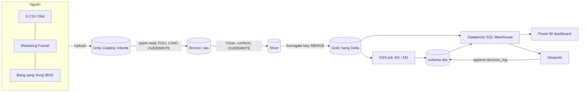
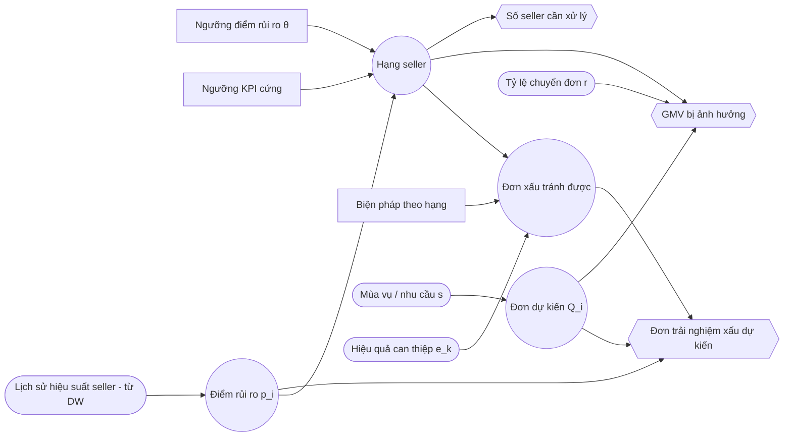

# SPEC — Olist Seller Performance DW & DSS

| Mục | Giá trị |
|---|---|
| Môn | CO4031 Kho dữ liệu và Hệ hỗ trợ Quyết định — HK261 |
| Phiên bản | v0.9 — 05/11/2026 |
| Trạng thái | **Phase 2 (thiết kế DW) đã khóa 22/10/2026.** Load và frontend 26/10/2026; sửa MERGE, `decision_log`, GMV và review dùng chung ngày 05/11/2026. Cùng ngày: ETL warehouse Phase 3 chỉ Databricks, không đường local. Bronze/Silver FULL LOAD OVERWRITE, Gold MERGE không xóa theo nguồn, ROLAP, Power BI + Streamlit. S1, S4, S5 đạt (13/10/2026). Phase 1 Cloud đã đo trên Volume (15/10/2026): G1–G5 pass, G6 record 12,3%. T1 chốt 15/10/2026. X=10, N=40. Plan Phase 3 đã ghi; ETL chưa viết. S2, S3, S6 chưa chạy (S2–S3 là kiểm kết nối, không còn chọn công cụ). S6 không chặn Phase 3. Hợp đồng schema: `docs/DESIGN.md`. Sơ đồ: `docs/architecture.md` |
| Nguồn thẩm quyền | `docs/assignment/CO4031_Assignment_HK261.pdf` (gọi tắt **[ĐỀ]**). File phân tích của nhóm chỉ để tham khảo |

Quy ước: **[ĐỀ]** = ghi trong đề · **[SUY LUẬN]** = nhóm suy ra từ L.O./mục tiêu/slide, không phải tiêu chí chấm điểm được công bố · **[GIẢ ĐỊNH]** = chưa kiểm chứng, kiểm tra ở spike S1–S6 hoặc Phase 1. Trang đề ghi theo số in ("Trang x/6").

---

## 1. Tổng quan đề tài

**Tên:** Kho dữ liệu và Hệ hỗ trợ quyết định quản lý hiệu suất người bán trên sàn Olist (*Olist Seller Performance DW & DSS*). Chi tiết so sánh: `TOPIC_EVALUATION.md`.

| Thành phần | Nội dung |
|---|---|
| Bối cảnh | Olist kết nối nhiều seller nhỏ với các marketplace ở Brazil; seller tự bàn giao hàng cho đối tác vận chuyển. Seller xử lý chậm hoặc chất lượng kém gây giao trễ và review xấu cho cả sàn |
| Bài toán quyết định | Mỗi tháng, chọn **chính sách phân hạng seller** (bộ ngưỡng) để xếp seller vào mức can thiệp: *Bình thường / Theo dõi / Cảnh báo + hỗ trợ / Tạm ngưng hiển thị* |
| Decision maker | Trưởng bộ phận Quản lý chất lượng người bán (Seller Quality / Marketplace Ops Manager) |
| Alternatives | P0 không can thiệp · P1 ngưỡng KPI cố định · P2 ngưỡng theo điểm rủi ro dự báo · các biến thể ngưỡng của P1/P2 |
| Principle of choice / KPI | Tối thiểu **số đơn trải nghiệm xấu dự kiến** tháng tới. Đơn trải nghiệm xấu = review ≤ 2 **hoặc** giao trễ so với ngày hẹn. 1.278 đơn nhiều seller **không xóa**. Điểm review giữ trên `fact_order`. Measure review của seller loại đơn `n_sellers` > 1 và `shared_review_type` = `cross_seller` (luật tạm 05/11/2026). Nhánh `late_flag` vẫn tính khi review bị loại. `gmv` của seller = `sum(price)`, không cộng freight, trừ đơn `canceled` hoặc `unavailable`. Ràng buộc **GMV bị ảnh hưởng ≤ 10%** và **số seller cần xử lý ≤ 40**/tháng (X, N đã chốt 15/10/2026) |
| Phạm vi | Đơn Olist có `order_purchase_timestamp` từ 2016-09-04 21:15:19 đến 2018-10-17 17:30:18 (Volume, 15/10/2026) + Marketing Funnel; medallion trên Databricks (Bronze → Silver → Gold), chỉ batch, Bronze/Silver FULL LOAD OVERWRITE, Gold MERGE; data mart Kimball chủ đề "hiệu suất seller & hoàn tất đơn" nằm ở Gold; OLAP ROLAP qua SQL Warehouse, dashboard Power BI; DSS mô hình rủi ro + mô phỏng chính sách, đọc Gold và ghi `dss.*`, giao diện Streamlit. Tháng thưa (2016-09, 2016-10, 2016-12, 2017-01, 2018-09, 2018-10; không có 2016-11) giữ trong kho, ghi vào hạn chế |
| Ngoài phạm vi | Tối ưu lợi nhuận (không có dữ liệu chi phí); phân tích NLP nội dung review; dự báo nhu cầu toàn sàn; triển khai production. Hướng phát triển: incremental (watermark), CDF, Auto Loader, streaming, CDC, Kafka, Lakehouse Federation, Reverse ETL |

**Đáp ứng mục 3.1 [ĐỀ, Trang 3]:** (a) Gold layer là DW, nguồn duy nhất cho OLAP và DSS; (b) dữ liệu Kaggle, license CC BY-NC-SA 4.0, ~100 nghìn đơn, 9 bảng + nguồn bổ sung; (c) quyết định cụ thể, lặp lại hằng tháng, có KPI đo được.

---

## 2. Yêu cầu và truy vết (RTM)

Mức: **BB** = bắt buộc [ĐỀ] · **BB\*** = nhóm tự đặt là bắt buộc [SUY LUẬN] · **NC** = nên có · **ĐC** = điểm cộng. Trạng thái: ☐ chưa làm · ◐ đang làm · ⏸ chờ dữ liệu, hoặc deferred / future work khi có lý do · ☑ xong.

| Mã | Nội dung | Mức | Nguồn | Phase | Sản phẩm đầu ra | TT |
|---|---|---|---|---|---|---|
| R01 | Phân tích nghiệp vụ, bài toán quyết định cụ thể (decision maker, alternatives, principle of choice) | BB | Mục 1.1 (mục tiêu 1), 3.1(c); Trang 2–3 | 0–1 | `TOPIC_EVALUATION.md`, SPEC §1 | ☑ |
| R02 | DW là cốt lõi, phục vụ phân tích và ra quyết định | BB | 3.1(a); Trang 3 | 2–3 | `DESIGN.md`, DDL trong `src/etl/` | ◐ |
| R03 | Nguồn dữ liệu hợp lệ, ghi license và quy mô | BB | 3.1(b); Trang 3 | 0 | `data/README.md` | ☑ |
| R04 | Thiết kế DW đa chiều (star/snowflake) | BB | 1.1 (mục tiêu 2); Trang 2 | 2 | `DESIGN.md` | ☑ |
| R05 | Thiết kế quy trình ETL | BB | 1.1 (mục tiêu 2); Trang 2 | 2 | `DESIGN.md` (ETL mapping) | ☑ |
| R06 | Hiện thực DW trên Delta Lake (bronze/silver/gold) | BB | 1.1 (mục tiêu 3); Trang 2 | 3 | Unity Catalog schemas + DDL trong `src/etl/` | ☐ |
| R07 | Hiện thực ETL medallion chạy được end-to-end (Bronze ingest → Silver clean/conform → Gold MERGE) | BB | 1.1 (mục tiêu 3); Trang 2 | 3 | `src/etl/` | ☐ |
| R08 | Hiện thực OLAP | BB | 1.1 (mục tiêu 3); Trang 2 | 4 | `src/sql/olap_queries/`, `src/sql/views/` | ☑ |
| R09 | Frontend: dashboard / giao diện truy vấn | BB | 1.1 (mục tiêu 3); Trang 2 | 4 | `src/frontend/` | ☐ |
| R10 | Thành phần DSS dựa trên DW đã xây | BB | 1.1 (mục tiêu 4); Trang 2 | 5 | `src/dss/` | ◐ |
| R11 | Đánh giá kết quả | BB | 1.1 (mục tiêu 5); Trang 2 | 6 | `docs/report/` | ☐ |
| R12 | Hạn chế và hướng phát triển | BB | 1.1 (mục tiêu 5); Trang 2 | 6–7 | `docs/report/` | ☐ |
| R13 | Thuyết trình: trực tiếp 15' + 5' Q&A, hoặc video 10–15' (YouTube unlisted/Drive); mọi thành viên trình bày | BB | 1.1 (mục tiêu 6), 4.1–4.3; Trang 4–5 | 7 | Slide, video | ☐ |
| R14 | Nhóm 2–3 SV, mỗi người vai trò rõ; điểm cá nhân điều chỉnh theo peer review | BB | 1.3; Trang 2–3 | 0→7 | `README.md`, `PROGRESS_LOG.md` | ◐ |
| R15 | Báo cáo PDF | BB | 5.1(1); Trang 5 | 7 | `docs/report/` → PDF | ☐ |
| R16 | Mã nguồn `src/` (SQL, Python, frontend, ETL), ưu tiên GitHub truy cập được. Git folder Databricks đã nối repo (S5, 13/10/2026) | BB | 5.1(2); Trang 5 | 0→7 | `src/`, repo GitHub | ◐ |
| R17 | Dữ liệu mẫu `data/` (GitHub/Drive) | BB | 5.1(3); Trang 5 | 0 | `data/sample/` | ☑ |
| R18 | Slide thuyết trình PDF | BB | 5.1(4); Trang 5 | 7 | Slide PDF | ☐ |
| R19 | Link video trên trang bìa báo cáo (nếu nhóm thuyết trình bằng video) | BB (có điều kiện) | 4.3, 5.1(5); Trang 5 | 7 | Bìa báo cáo | ☐ |
| R20 | Nộp 1 file ZIP qua LMS trước 23:59 15/11/2026 | BB | 5.1, 5.2; Trang 5 | 7 | ZIP | ☐ |
| R21 | Báo cáo thể hiện các L.O.1.1–4.2 (khái niệm, vai trò DW trong DSS, thiết kế DW, các pha quyết định, mô hình hóa, phát triển DSS) | BB\* | 1.2 Bảng 1; Trang 2 | 7 | `docs/report/` | ☐ |
| R22 | Kiến trúc tổng thể source → Volume → Bronze → Silver → Gold (DW) → OLAP → DSS; cách tiếp cận DW có lý do | BB\* | L.O.1.2, 2.1 | 2 | SPEC §4, `DESIGN.md` | ☑ |
| R23 | Khai báo granularity cho từng fact | BB\* | L.O.2.2; slide Ch2 | 2 | `DESIGN.md` | ☑ |
| R24 | ≥ 2 dimension có hierarchy | BB\* | L.O.2.3; slide Ch2 | 2 | `DESIGN.md` | ☑ |
| R25 | Đủ 5 phép OLAP (slice, dice, drill-down, roll-up, pivot), mỗi phép trả lời 1 câu hỏi nghiệp vụ | BB\* | Mục tiêu 3; slide Ch2–3 | 4 | `src/sql/olap_queries/`, `src/frontend/` | ☑ |
| R26 | ROLAP qua Databricks SQL Warehouse. Power BI đọc Gold. Streamlit là giao diện truy vấn và DSS. HOLAP và MOLAP không dùng | NC | slide Ch2–3 | 0–2 | SPEC §5, §7 | ☑ |
| R27 | Làm sạch dữ liệu + kiểm thử chất lượng (Delta constraints, đếm dòng, đối soát tổng, RI, unique grain). Pytest trên sample không thuộc DoD Phase 3 (R46) | BB\* | Mục tiêu 3; slide Ch1–2 | 3 | `src/etl/` | ◐ |
| R28 | Incremental load theo watermark, append, CDF, Auto Loader — **deferred / future work**. Đề cho phép incremental hoặc full refresh. Dataset tĩnh nên full refresh: Bronze/Silver FULL LOAD OVERWRITE; Gold `MERGE` theo grain | NC | slide Ch2 | — | SPEC §6, DESIGN §9 | ⏸ |
| R29 | Data dictionary, metadata, source-to-target mapping | NC | slide Ch2-cont, Ch6 | 2 | `DESIGN.md` | ☑ |
| R30 | Tích hợp thật nhiều bảng/nguồn, có bằng chứng | BB\* | 3.1(a) + lý do bỏ DataCo | 1–3 | SPEC §3, `DESIGN.md`, `src/etl/` | ◐ |
| R31 | DSS đọc dữ liệu chỉ từ Gold (`gold.*`), ghi kết quả vào `dss.*`, không đọc CSV thô | BB\* | Diễn giải mục tiêu 4 | 5 | `src/sql/views/`, `src/dss/` | ◐ |
| R32 | DSS đủ 3 subsystem: data, model, UI | BB\* | L.O.4.2 | 5 | `src/dss/`, `src/frontend/` | ◐ |
| R33 | ≥ 1 mô hình định lượng, nêu loại (static/dynamic; certainty/risk/uncertainty) | BB\* | L.O.3.3 | 5 | `src/dss/` | ◐ |
| R34 | Chức năng what-if | BB\* | L.O.3.3; slide Ch6 | 5 | `src/dss/`, `src/frontend/` | ◐ |
| R35 | Sensitivity analysis và goal seeking | ĐC | slide Ch6–7 | 5 | `src/dss/` | ◐ |
| R36 | Influence diagram + bảng decision/uncontrollable/result variables | BB\* | L.O.3.3; slide Ch7 | 5 | SPEC §8, báo cáo | ☑ |
| R37 | Ánh xạ chức năng DSS ↔ pha intelligence/design/choice/implementation | BB\* | L.O.3.2 | 5 | SPEC §8, báo cáo | ☑ |
| R38 | Phân loại DSS | BB\* | L.O.3.1 | 5 | SPEC §8 | ☑ |
| R39 | Phương pháp phát triển (SDLC/prototyping), rủi ro dự án | NC | L.O.4.1 | 7 | Báo cáo | ☐ |
| R40 | Lịch chạy ETL tự động bằng Databricks Jobs (S4 đạt 13/10/2026: Free Edition tạo được Job và lưu lịch; ETL chưa gắn vào Job) | ĐC | slide Ch2 (batch ETL) | 3 | `src/etl/` | ◐ |
| R41 | Surrogate key + SCD Type 2 cho ≥ 1 dimension (`dim_seller` nếu làm điểm cộng) | ĐC | Kimball (TLTK [2]) | 2–3 | `src/etl/` | ☐ |
| R42 | Aggregate / view trên Gold cho OLAP (không partition vì dữ liệu nhỏ) | NC | slide Ch1–2 | 3–4 | `src/sql/views/` | ☐ |
| R43 | Knowledge subsystem: luật khuyến nghị hành động | ĐC | slide Ch6 | 5 | `src/dss/` | ☐ |
| R44 | Đánh giá mô hình (metric, backtest) | NC | slide Ch7 | 5–6 | `src/dss/`, báo cáo | ☐ |
| R45 | Hợp đồng giữa các layer (Bronze FULL LOAD OVERWRITE, metadata `_ingest_ts` và `_source_file`; Silver FULL LOAD OVERWRITE, làm sạch/conform; Gold bảng Delta star schema, `MERGE` theo grain; downstream chỉ đọc Gold) | BB\* | [SUY LUẬN] / hợp đồng medallion | 2–3 | SPEC §4–6, `DESIGN.md` | ☑ |
| R46 | Khả năng tái lập cho người chấm (README hướng dẫn, chạy local trên sample). Không thuộc DoD Phase 3 | NC | [SUY LUẬN] / tái lập cho người chấm | 0, 6, 7 | README, `src/tests/`, chạy local `data/sample/` | ☐ |
| R47 | Metadata/lineage: comment bảng/cột Gold trong Unity Catalog | ĐC | [SUY LUẬN] / metadata | 3 | DDL Gold trong `src/etl/03_gold_dims.py`, `04_gold_facts.py`, `05_gold_seller_monthly.py` | ☐ |

**Đối chiếu đề (PDF) ↔ file phân tích** — không có mâu thuẫn trực tiếp về yêu cầu; các điểm cần lưu ý (làm theo PDF):
1. *Số trang:* file phân tích ghi "số trang PDF cũng là số in" — đúng với slide nhưng **không đúng với file đề** (trang PDF 2 = "Trang 1/6"). SPEC dùng số in.
2. *"Quy mô đủ lớn" (3.1b):* câu trong đề có thể hiểu chỉ áp cho dữ liệu doanh nghiệp; file phân tích áp cho mọi nguồn. Nhóm vẫn nêu quy mô thực tế (cách an toàn).
3. *5 phép OLAP, granularity, influence diagram, what-if, 3 subsystem DSS:* **đề không ghi trực tiếp**; file phân tích xếp phần lớn là "nên có". SPEC nâng thành BB\* theo yêu cầu nội bộ nhóm — không phải tiêu chí chấm điểm công bố.
4. *Thư mục OLAP:* file phân tích dùng `src/olap/`; repo dùng `src/sql/olap_queries/` (chỉ khác cách tổ chức).
5. *Lịch:* slide Ch0/Introduction có mốc khác; theo đề (ban hành 10/09/2026) như file phân tích đã chọn.
6. *DBMS:* SPEC v0.1 chốt PostgreSQL (schema `staging` / `dw` / `dss`). File phân tích không chọn DBMS; đề PDF không quy định công cụ hay DBMS (file phân tích, Phần 1). Databricks được phép. Khái niệm staging trên slide ánh xạ sang Bronze; Gold là DW. Quyết định PostgreSQL ngày 10/10/2026 được thay cùng ngày bởi Databricks (xem §10).

---

## 3. Dữ liệu nguồn

| Bảng Olist | Vai trò |
|---|---|
| `orders` | Header đơn, trạng thái, 5 mốc thời gian → fact mức đơn, dim_date (role-playing) |
| `order_items` | Dòng hàng: product, seller, `shipping_limit_date`, price, freight → fact mức item |
| `order_reviews` | Điểm review → measure của fact mức đơn |
| `order_payments` | Phương thức, trả góp, giá trị → measure fact đơn, dim_payment_type, đối soát |
| `customers` | `customer_id` (theo đơn, kèm địa chỉ) → cột địa chỉ trên `fact_order`. `customer_unique_id` (theo người) → `dim_customer` |
| `sellers` | → dim_seller |
| `products` + `product_category_name_translation` | → dim_product (hierarchy danh mục) |
| `geolocation` | zip prefix → lat/lng → khoảng cách seller–khách, chuẩn hóa thành phố/bang |

| Nguồn bổ sung (dự kiến) | Lý do |
|---|---|
| Marketing Funnel by Olist (`closed_deals`, nối qua `seller_id`; license CC BY-NC-SA 4.0) | Thuộc tính seller: business_segment, lead_type, ngày ký → hierarchy/thuộc tính dim_seller, biến "tuổi" seller cho mô hình |
| Bảng bang (UF) → vùng: `data/external/ibge_state_region.csv` (snapshot API IBGE 15/10/2026, 27 dòng) | Cấp "Vùng" cho hierarchy địa lý. Nối `state_code` với `customer_state` / `seller_state` |

**Đưa nguồn lên lakehouse:** 9 CSV Olist và 2 CSV Marketing Funnel nằm trong một Unity Catalog Volume. Spike S1 (13/10/2026) đọc `olist_orders_dataset.csv` bằng `spark.read` (header, mọi cột `string`): 99.441 dòng. Catalog `olist_catalog`. Đường dẫn `/Volumes/olist_catalog/bronze/raw/` (`olist/`, `funnel/`). Bảng bang → vùng có bản local `data/external/ibge_state_region.csv` (27 dòng, đếm 15/10/2026) và nhóm xác nhận đã nằm ở `/Volumes/olist_catalog/bronze/raw/ref/`, không đặt trong `funnel/`. Phiên thiết kế 15/10/2026 không đọc lại Volume nên không ghi số dòng mới trên Volume. Các bước: `data/README.md` §5.

**Bằng chứng tích hợp nhiều bảng/nguồn (R30):** (1) mỗi fact cần ≥ 4 bảng nguồn để nạp; (2) bảng source-to-target mapping trong `DESIGN.md` ghi nguồn từng cột; (3) bảng `gold.etl_audit` ghi số dòng đọc/nạp/loại theo từng nguồn; (4) measure phái sinh liên nguồn (khoảng cách cần geolocation × customers × sellers; điểm rủi ro cần items × reviews × orders).

**Vấn đề chất lượng dữ liệu** (đo trên Volume, `SOURCE=volume`, 15/10/2026, `01_profiling.py`):

| Vấn đề | Số đo | Hướng xử lý |
|---|---|---|
| geolocation nhiều dòng/zip prefix, tọa độ ngoài Brazil | 1.000.163 dòng; 19.015 zip prefix; 17.972 zip có hơn một dòng; tối đa 1.146 dòng/zip; trung bình 52,598633 dòng/zip; 31 điểm ngoài bbox; 0 lat/lng NULL | `silver.geolocation_zip`: một dòng mỗi prefix, `percentile_approx` 0.5, bbox lat [-34, 6], lng [-74, -28]. 31 điểm ngoài bbox đã đo với khung này. Fallback `silver.geolocation_city` theo (`city_norm`, state). Khách và seller: zip → city → null, `geo_match_level`, không điền 0. Haversine ở item; trung bình seller-tháng bỏ null |
| Tên thành phố lệch chính tả/dấu | `geolocation_city`: 8.010 distinct_lower, 5.968 sau khi bỏ dấu, 73.437 dòng có dấu. `customer_city` 4.119 / `seller_city` 611: không đổi sau khi bỏ dấu | `city_norm`: lowercase, bỏ dấu, trim. Dùng cho khách, seller, geolocation và Gold |
| Hai loại khóa khách hàng | 99.441 `customer_id` phân biệt trên 99.441 dòng; 96.096 `customer_unique_id` | Silver giữ `customer_id`. `dim_customer` một dòng mỗi `customer_unique_id`, không địa chỉ. Địa chỉ của `customer_id` đặt trên `fact_order` |
| Category thiếu / thiếu bản dịch | 610 / 32.951 product thiếu `product_category_name`; 2 category không có dòng dịch | Product vẫn giữ khóa. LEFT JOIN translation. `category_pt = COALESCE(product_category_name, 'Unknown')`. `category_en = COALESCE(bản dịch, product_category_name, 'Unknown')`. Không null ở hai cột này. `pc_gamer` là ví dụ minh họa, chưa đo trên Volume: thiếu dịch → `'pc_gamer'`. `category_group` cùng nhãn `'Unknown'` khi thiếu tên, 8 nhóm ở DESIGN §3.4 |
| Timestamp thiếu hoặc sai thứ tự | Orders 99.441. NULL: `order_approved_at` 160, `order_delivered_carrier_date` 1.783, `order_delivered_customer_date` 2.965. Đảo: carrier trước approved 1.359; carrier trước purchase 166; customer trước carrier 23. G2: 96.469 / 96.478 đơn `delivered` có cả hai mốc giao | Cột chính thức thành NULL khi đảo; giữ `raw_*`; `ts_inversion_flag`; so sánh đảo trên `raw_*`; loại khỏi measure thời gian; notebook DQ in số dòng cờ bằng 1, không lưu cột audit. `late_flag` so bằng ngày. Đơn `canceled` hoặc `unavailable` thì null và ở ngoài mẫu. Thiếu một mốc thì null. `seller_ship_late_flag` so bằng timestamp. Đơn `canceled` hoặc `unavailable` thì cờ null. Carrier thật sự thiếu và hạn trước `snapshot_date` thì cờ = 1; hạn từ ngày chốt trở đi thì null. `snapshot_date` = `DATE '2018-10-17'` trong config. Công thức đầy đủ ở DESIGN §3.6 |
| Review trùng / đơn nhiều review | 99.224 dòng; 789 `review_id` gắn nhiều đơn; 814 dòng thừa; 547 đơn có hơn một dòng review trên file thô. Điểm ≤ 2: 14.575 / 99.224 (G4). Đỉnh tháng 3/2018 khoảng 1,6% là [GIẢ ĐỊNH], không đo lại 05/11/2026 | `silver.order_reviews` grain (`review_id`, `order_id`): cast, bỏ dòng trùng y hệt, rồi chọn một dòng nếu cùng khóa khác giá trị. Số nhóm lệch in ở notebook, chỉ cảnh báo. `silver.order_reviews_dedup` giữ review mới nhất mỗi `order_id` (DESIGN §2.3) và gắn `shared_review_type` (`none` / `same_seller` / `cross_seller`). [GIẢ ĐỊNH] Olist chưa xác nhận nguyên nhân review dùng chung. Measure review của seller loại `cross_seller`. KPI sàn giữ `cross_seller`. Mẫu tỷ lệ review là `COUNT(DISTINCT order_id)`. Luật cuối chờ sensitivity top-40 sau Gold. Giữ review tạo trước ngày nhận. 99.224 − 814 = 98.410 là số `review_id` nếu chỉ khử theo `review_id`; số dòng hai bảng Silver và số đơn theo `shared_review_type` pending |
| Payment lạ | `not_defined` 3; `payment_value` = 0: 9; `payment_installments` = 0: 2. 387 / 98.665 đơn lệch abs(price + freight − payment) > 0,01 | `not_defined` hoặc rỗng → null, fact trỏ `payment_type_key = -1` (nhãn `'Unknown'`). Giữ giá trị 0. Không xóa đơn lệch. Loại chính: nhóm theo (`order_id`, `payment_type`), hạng tổng `payment_value` giảm, rồi `payment_sequential` nhỏ nhất, rồi tên tăng dần |
| Zip prefix đọc dạng chuỗi | 0 dòng zip ngắn hơn 5 ký tự trên customer, seller, geolocation; min_length = 5 | Tiếp tục đọc mọi id/zip dạng chuỗi |
| 2016 thưa, cuối 2018 bị cắt | 25 tháng có đơn; 19 tháng ≥ 1.000 đơn (G5), liền 2017-02 → 2018-08. Thưa: 2016-09=4, 2016-10=324, 2016-12=1, 2017-01=800, 2018-09=16, 2018-10=4. Không có 2016-11. Purchase min/max: 2016-09-04 21:15:19 → 2018-10-17 17:30:18 | Giữ toàn bộ cửa sổ trong kho. Tháng thưa ghi vào hạn chế, không cắt khỏi Bronze/Silver/Gold |
| Đơn có nhiều seller | 1.278 / 98.666 đơn có items (1,2953%, G3). 0 item orphan | Không xóa đơn. Cờ là `n_sellers` > 1. `review_score` giữ trên `fact_order`. Measure review của seller loại các đơn này. Nhánh `late_flag` vẫn tính. `gmv` = `sum(price)` phần không hủy, không cộng freight. `n_orders_valid` và `n_items_valid` vẫn tính phần không hủy. `n_orders_placed` và `n_items_placed` đếm mọi status |

**Câu hỏi phân tích ↔ KPI** (chốt 15/10/2026; SQL thuộc Phase 4):

| # | Câu hỏi | KPI | Dimension |
|---|---|---|---|
| 1 | Tỷ lệ seller bàn giao trễ khi gộp Thành phố → Bang → Vùng: vấn đề mang tính vùng hay cục bộ? | `late_ship_rate` = `late_ship_count / late_ship_eligible`. Mẫu là item có `seller_ship_late_flag` khác null. Đơn `canceled` hoặc `unavailable` không vào mẫu | seller (vùng, bang, thành phố); thời gian |
| 2 | Tỷ lệ review ≤ 2 theo Năm → Quý → Tháng → Ngày: tháng nào nổi so với các tháng quanh đó? | KPI sàn. Tỷ lệ review ≤ 2. Mẫu là `COUNT(DISTINCT order_id)` có `negative_review_flag` khác null, kể cả `shared_review_type` = `cross_seller` và đơn nhiều seller | thời gian (ngày) |
| 3 | Cố định một nhóm danh mục: seller nào có tỷ lệ giao trễ cao nhất? | Tỷ lệ giao trễ so với ngày hẹn | sản phẩm (nhóm danh mục); seller |
| 4 | Khách vùng Norte + Nordeste, Q1–Q2/2018, hàng cồng kềnh: tỷ lệ trễ và review ≤ 2 theo bang seller? | Tỷ lệ trễ (kể cả đơn nhiều seller). Tỷ lệ review ≤ 2 là measure seller: loại `n_sellers` > 1 và `cross_seller`. Mẫu review là `COUNT(DISTINCT order_id)`. Vùng khách lấy trên `fact_order` | địa lý khách; thời gian; sản phẩm; bang seller |
| 5 | Bảng Bang seller × Quý (tỷ lệ bàn giao trễ) xoay thành Nhóm danh mục × Quý: nguồn gây trễ nằm ở đâu? | `late_ship_rate`, cùng mẫu câu 1 | bang seller; quý; nhóm danh mục |
| 6 | Tỷ lệ đơn trải nghiệm xấu theo seller-tháng là bao nhiêu, khi nhánh review loại đơn nhiều seller và `cross_seller`, còn nhánh giao trễ vẫn tính? | `bad_experience_rate` trên snapshot seller, không copy cờ mức đơn. Mẫu là `COUNT(DISTINCT order_id)` | seller; tháng |
| 7 | GMV của seller bị gắn cờ có vượt trần 10% GMV kỳ không? | % `gmv` bị ảnh hưởng so với X=10. `gmv` = `sum(price)` đã loại đơn `canceled` và `unavailable`. Freight không vào `gmv` | seller; tháng |
| 8 | Số seller bị gắn cờ mỗi tháng có nằm trong trần N=40 không? | Số seller gắn cờ so với N=40 | seller; tháng |
| 9 | Seller có `closed_deals` khác seller không có funnel ở tỷ lệ trải nghiệm xấu không? | Tỷ lệ trải nghiệm xấu; số seller | seller (có/không funnel); tháng |
| 10 | Các tháng thưa (2016-09, 2016-10, 2016-12, 2017-01, 2018-09, 2018-10) có kéo lệch KPI cả kỳ so với 2017-02–2018-08 không? | Tỷ lệ trải nghiệm xấu; số đơn | thời gian (tháng) |

---

## 4. Kiến trúc hệ thống

Sơ đồ đầy đủ: `docs/architecture.md`.

- **Cách tiếp cận:** *bottom-up, một data mart* theo Kimball cho chủ đề "hiệu suất seller & hoàn tất đơn", đặt ở **Gold**, dimension dùng chung (conformed) để mở rộng sau. Lý do: nhóm 2–3 người, ~5 tuần, một quyết định trọng tâm → EDW top-down không khả thi. Gold vẫn là star schema nên vẫn đáp ứng mục tiêu 2–4 và điều kiện 3.1(a).
- **Lưu trữ:** Databricks Free Edition (đăng ký bằng email cá nhân), Delta Lake, Unity Catalog. Catalog `olist_catalog` (S1, 13/10/2026). Schema: `bronze`, `silver`, `gold`, `dss`. Chỉ **batch**.
- **Hợp đồng layer (R45):** Bronze FULL LOAD OVERWRITE, metadata `_ingest_ts` và `_source_file`. Silver FULL LOAD OVERWRITE, làm sạch và conform, dedup trong file. Gold là bảng Delta, star schema, `MERGE` theo grain: chỉ `WHEN MATCHED THEN UPDATE` và `WHEN NOT MATCHED THEN INSERT`. Không `WHEN NOT MATCHED BY SOURCE THEN DELETE`. Job DSS đọc Gold và ghi `dss.seller_risk_score`, `dss.policy_scenario`. Power BI và Streamlit đọc Gold và `dss` qua SQL Warehouse. Streamlit chỉ ghi thêm `dss.decision_log` (append). Streamlit không sở hữu schema `dss` ngoài các dòng đó. Job ETL Gold không ghi `dss.decision_log`.
- **Lệch có chủ đích:** mô hình DSS huấn luyện trên Gold, không trên Silver, để DSS dựa trên DW theo mục tiêu 4 của đề.
- **Tái lập (R46):** người chấm chạy lại trên `data/sample/` vẫn là việc của S6, Phase 6 và Phase 7. ETL warehouse Phase 3 chỉ Databricks (quyết định 05/11/2026): notebook `src/etl/` không có nhánh `USE_SAMPLE`.

**Ánh xạ medallion ↔ khái niệm DW trên slide**

| Khái niệm slide | Layer trong dự án |
|---|---|
| Staging area | Bronze — raw, FULL LOAD OVERWRITE, kèm `_ingest_ts`, `_source_file` |
| Integration (làm sạch, conform) | Silver — cast kiểu, dedupe trong file, chuẩn hóa, FULL LOAD OVERWRITE |
| Data Warehouse / data mart | Gold — fact constellation, star schema, bảng Delta, data mart Kimball bottom-up, `MERGE` theo grain |
| Metadata | Comment bảng/cột Gold trên Unity Catalog (R47); nhật ký nạp `gold.etl_audit` |
| Presentation | Power BI dashboard đọc Gold qua SQL Warehouse (ROLAP); Streamlit đọc Gold và `dss` |

**Công nghệ** (đề không ràng buộc công nghệ). Tính năng của Databricks Free Edition chưa được nhóm kiểm chứng đều mang nhãn **[GIẢ ĐỊNH]** và gắn spike. Quyết định PostgreSQL ngày 10/10/2026 được thay cùng ngày bởi kiến trúc medallion trên Databricks.

| Hạng mục | Đã chốt | Còn mở (spike) | Không dùng + lý do |
|---|---|---|---|
| Nền tảng | Databricks Free Edition, Delta Lake, Unity Catalog, schema `bronze` / `silver` / `gold` / `dss`. CSV ở Volume `/Volumes/olist_catalog/bronze/raw/`. Chỉ batch. Catalog `olist_catalog` (S1, 13/10/2026) | SQL warehouse từ máy local (S2) | PostgreSQL, psycopg, schema `staging` / `dw`: Gold đảm nhận vai trò DW, tránh hai kho. DuckDB: phương án local từng xét, không dùng; đường tái lập local là pyspark + delta-spark |
| Xử lý | PySpark + Spark SQL. Notebook lưu trong repo dạng `.py` để diff. Bronze/Silver FULL LOAD OVERWRITE. Gold idempotent bằng Delta `MERGE`. Databricks Jobs có trên Free Edition (S4, 13/10/2026: job `s4_smoke`, Serverless, Run now thành công, lịch lưu được và đang Paused). Git folder nối GitHub (S5, 13/10/2026: `olist-dw-dss`, nhánh `main`) | — | Streaming, CDC, Kafka, Lakehouse Federation, Reverse ETL: ngoài phạm vi, để hướng phát triển. Incremental, append, CDF, Auto Loader: future work (R28). ETL không dùng pandas + SQLAlchemy + psycopg |
| DSS | Python (scikit-learn / statsmodels). Feature view chỉ trên `gold.*`. Kết quả ghi `dss.*`. Huấn luyện trên Gold. UI là Streamlit, đọc Gold và `dss` | Kết nối SQL Warehouse từ máy local (**[GIẢ ĐỊNH]**, S2) | Đọc `data/raw` hoặc `read_csv` trong `src/dss/`: vi phạm mục tiêu 4 |
| OLAP frontend | Power BI: dashboard, đọc Gold qua SQL Warehouse. Streamlit: giao diện truy vấn và DSS, không phải dashboard OLAP | Kết nối Power BI tới SQL Warehouse (**[GIẢ ĐỊNH]**, S3) | Databricks AI/BI Dashboard: không chọn (26/10/2026) |
| Loại OLAP | ROLAP qua SQL Warehouse trên bảng Gold (26/10/2026) | — | HOLAP và MOLAP |
| Tái lập | ETL warehouse Phase 3 chỉ Databricks. Đường local trên `data/sample/` thuộc R46 (S6, Phase 6, Phase 7), không thuộc DoD Phase 3 | pyspark + delta-spark local chạy được hay không (S6) | — |
| Kiểm thử | Phase 3: Delta constraints (`NOT NULL`, `CHECK`) và đối soát in ở notebook trên Databricks. Pytest local trên sample không thuộc DoD Phase 3 | pytest trên sample khi làm R46 | — |

Chỉ xử lý batch. Nếu một spike không đạt, ghi hai phương án vào PROGRESS_LOG và SPEC §10 rồi chờ nhóm — không tự chọn.

---

## 5. Thiết kế DW sơ bộ (chi tiết: `DESIGN.md`)

**Lược đồ:** fact constellation (3 fact dùng chung dimension), các dimension dạng star (denormalized). Data mart này nằm ở schema `gold`.

| Fact | Loại | **Granularity** | Measures chính | Dimensions |
|---|---|---|---|---|
| `fact_order_item` | Transaction | **1 dòng = 1 item của 1 đơn** (`order_id`, `order_item_id`) | price, freight_value, seller_ship_late_flag, seller_handling_days, delivery_days, delay_days, late_delivery_flag, distance_km | date (purchase, shipping_limit), customer, seller, product, order_status |
| `fact_order` | Accumulating snapshot | **1 dòng = 1 đơn hàng** | items_value, freight_total, payment_total, n_items, n_sellers, delivery_days, estimated_days, delay_days, late_flag, review_score, shared_review_type, negative_review_flag, bad_experience_flag | date (purchase, approved, delivered_carrier, delivered_customer, estimated), customer, địa chỉ khách của đơn (zip, thành phố, bang, vùng), order_status, payment_type |
| `fact_seller_monthly` | Periodic snapshot | **1 dòng = 1 seller × 1 tháng có ít nhất một item** | n_orders_placed, n_orders_valid, n_items_placed, n_items_valid, gmv, aov, late_ship_count, late_ship_eligible, late_ship_rate, late_delivery_count, late_delivery_eligible, late_delivery_rate, review_score_sum, review_count, avg_review, negative_review_count, negative_review_eligible, negative_review_rate, bad_experience_count, bad_experience_eligible, bad_experience_rate, cancel_count, cancel_eligible, cancel_rate, handling_days_sum, handling_days_count, avg_handling_days | month, seller |

Công thức ở DESIGN §3.6. `gmv` = `sum(price)`, không cộng freight, loại đơn `canceled` và `unavailable`. `cancel_rate` = `cancel_count / n_orders_placed`. `late_ship_rate` = `late_ship_count / late_ship_eligible`. `aov` và mọi `*_rate` không SUM. `bad_experience_count` / `bad_experience_eligible` trên snapshot seller không copy cờ mức đơn. Nhánh review của seller loại đơn `n_sellers` > 1 và `shared_review_type` = `cross_seller`. Nhánh `late_flag` vẫn vào mẫu. KPI sàn giữ điểm `cross_seller`. Mẫu tỷ lệ review là `COUNT(DISTINCT order_id)`.

| Dimension | Thuộc tính chính | Hierarchy |
|---|---|---|
| `dim_date` (role-playing) | ngày, thứ, cuối tuần | **Năm → Quý → Tháng → Ngày** |
| `dim_month` (shrunken của dim_date) | tháng, quý, năm | Năm → Quý → Tháng |
| `dim_customer` | customer_unique_id | Người mua. Địa chỉ không nằm ở đây |
| `dim_seller` | seller_id, city, state, region, business_segment, lead_type, ngày ký | **Vùng → Bang → Thành phố**; Phân khúc → Seller |
| `dim_product` | category_pt, category_en, category_group, khối lượng, thể tích, size_band | **Nhóm danh mục → Danh mục → Sản phẩm** |
| `dim_order_status`, `dim_payment_type` | trạng thái; phương thức thanh toán | — |

- Surrogate key cho mọi dimension. Khóa mới cấp theo `ORDER BY` natural key tăng dần để rerun ra cùng key. Member `-1`, nhãn hiển thị `'Unknown'`. Thiết kế Phase 3 mặc định **SCD Type 1** trên mọi dimension. `dim_seller` SCD2-ready (`effective_from`, `effective_to`, `is_current`) nhưng vẫn một dòng mỗi `seller_id`, vì nguồn không có lịch sử. SCD Type 2 thật (nhiều phiên bản) vẫn là **điểm cộng** (R41), chưa làm.
- Địa chỉ khách gắn với đơn (`customer_id`) và đặt trên `fact_order`. `dim_customer` chỉ là người.
- **Vị trí vật lý:** `olist_catalog.gold.fact_order_item`, `olist_catalog.gold.fact_order`, `olist_catalog.gold.fact_seller_monthly`, và các dimension `olist_catalog.gold.dim_*` liệt kê ở bảng trên. Catalog `olist_catalog` (S1, 13/10/2026). Bảng chưa tạo.
- **Thiết kế vật lý Delta:** dữ liệu nhỏ (~100 nghìn đơn) nên không partition. Nếu partition sau này thì partition theo cột dùng để lọc, không theo cột cardinality cao.
- **Loại OLAP: ROLAP** (R26, 26/10/2026). SQL Warehouse truy vấn trực tiếp bảng Gold. Power BI là dashboard. HOLAP và MOLAP không dùng.

---

## 6. ETL

Chỉ batch. Notebook/pipeline lưu ở `src/etl/` dạng `.py`.

| Bước | Nội dung |
|---|---|
| Bronze | Đọc CSV từ Volume bằng `spark.read` (mọi id/zip dạng chuỗi), FULL LOAD OVERWRITE, mọi cột nghiệp vụ STRING as-is, thêm `_ingest_ts`, `_source_file` |
| Silver | FULL LOAD OVERWRITE. Cast kiểu; `silver.geolocation_zip` một prefix và `silver.geolocation_city` làm fallback. `silver.order_reviews` grain (`review_id`, `order_id`): bỏ dòng trùng y hệt và chọn một dòng khi cùng khóa khác giá trị. Số nhóm lệch in ở notebook DQ, chỉ cảnh báo, không ghi `gold.etl_audit`. `silver.order_reviews_dedup` một `order_id` theo DESIGN §2.3, rồi gắn `shared_review_type`. Không chọn bản giữa các lần nạp. Chuẩn hóa thành phố; dịch category; map state → region |
| Gold | Bảng Delta, không phải view. Tra surrogate key, member `-1` nhãn `'Unknown'`. Dimension SCD Type 1. `dim_seller` có cột SCD2 nhưng không sinh phiên bản. Lịch sử SCD2 (R41) chưa làm. Nạp 7 dimension và 3 fact bằng Delta `MERGE` theo grain, idempotent: chỉ `WHEN MATCHED THEN UPDATE` và `WHEN NOT MATCHED THEN INSERT`. Không `WHEN NOT MATCHED BY SOURCE THEN DELETE` |
| `snapshot_date` | Hằng số `DATE '2018-10-17'` trong config. Không suy từ watermark. Mỗi lần MERGE Gold tính lại `seller_ship_late_flag` cho mọi item |
| `gold.etl_audit` | `audit_id`, `run_id`, `layer`, `target_table`, `source_name`, `rows_read`, `rows_loaded`, `rows_rejected`, `rows_unknown_fk`, `loaded_at`. Cảnh báo geo, translation, conflict, đảo timestamp, đối soát giá: notebook in kết quả, không lưu cột riêng |
| Lịch chạy | Databricks Jobs: setup → bronze → silver → gold dims → gold facts → `fact_seller_monthly` → dss. Job ETL Phase 3 dừng ở `fact_seller_monthly`; task `dss` thuộc Phase 5. S4 đạt 13/10/2026. Spike dùng job `s4_smoke` (Serverless); lịch đã lưu và đang Paused. Job ETL gắn ở Phase 3 |
| Future work | Incremental theo watermark, append, CDF, Auto Loader (R28). Không làm trong ETL hiện tại |
| Kiểm thử DQ | Delta constraints (`NOT NULL`, `CHECK` miền giá trị ở DESIGN §9) và đối soát số dòng, tổng, in ở notebook trên Databricks. Pytest local trên `data/sample/` không thuộc DoD Phase 3 (R46: S6, Phase 6, Phase 7). `gold.etl_audit` lưu các số đếm ở dòng trên. Notebook in `rows_dropped_by_dedup` và kiểm `rows_read = rows_loaded + rows_dropped_by_dedup + rows_rejected` trong cùng `run_id`. Σprice nguồn = Σprice fact in ở notebook, cùng `run_id`. Không orphan FK. Grain không trùng. Ngưỡng tỷ lệ giữ G2: đơn `delivered` thiếu một mốc giao ≤ 5% |

---

## 7. OLAP và frontend

Truy vấn viết bằng Spark SQL trên Gold. OLAP là ROLAP qua Databricks SQL Warehouse. Dashboard là Power BI. Giao diện truy vấn và DSS là Streamlit. Kết nối từ máy local vẫn chờ S2 và S3.

| Phép | Câu hỏi nghiệp vụ | Truy vấn / màn hình |
|---|---|---|
| Roll-up | Tỷ lệ seller bàn giao trễ khi gộp Thành phố → Bang → Vùng của seller: vấn đề mang tính vùng hay cục bộ? | Spark SQL trên `gold.fact_order_item` × `gold.dim_seller`, `ROLLUP(region, state, city)` |
| Drill-down | Tỷ lệ review tiêu cực theo Năm → Quý → Tháng → Ngày: tháng nào nổi so với các tháng quanh đó? | Spark SQL trên `gold.fact_order` × `gold.dim_date` |
| Slice | Cố định 1 nhóm danh mục: seller nào có tỷ lệ giao trễ cao nhất? | Spark SQL `WHERE category_group = :g` trên Gold |
| Dice | Khách vùng Norte + Nordeste, Q1–Q2/2018, hàng cồng kềnh: tỷ lệ trễ và review xấu theo bang seller | Spark SQL lọc vùng khách trên `fact_order`, quý, và `size_band` |
| Pivot | Bảng Bang seller × Quý (tỷ lệ bàn giao trễ) xoay thành Nhóm danh mục × Quý để tìm nguồn gây trễ | Spark SQL `PIVOT` trên Gold |

**Danh sách màn hình.** Power BI: (1) Tổng quan KPI · (2) OLAP Explorer (5 phép) · (3) Hồ sơ seller (drill tới seller). Streamlit đọc Gold và `dss` qua SQL Warehouse (kết nối là **[GIẢ ĐỊNH]**, S2): (4) DSS – Điểm rủi ro · (5) DSS – What-if chính sách · (6) DSS – Goal seeking & sensitivity · (7) Quyết định & xuất danh sách. Mục 7 ghi thêm một dòng `dss.decision_log` qua SQL Warehouse. Streamlit không ghi `dss.seller_risk_score` hay `dss.policy_scenario`. Streamlit cũng là chỗ truy vấn ad-hoc trên Gold.

---

## 8. DSS

**Phân loại:** *compound DSS* = **data-driven** (OLAP trên DW) + **model-driven** (mô hình rủi ro + mô phỏng chính sách); thêm **knowledge-driven** nhẹ (luật khuyến nghị, ĐC). Hỗ trợ quyết định bán cấu trúc, lặp lại hằng tháng.

| Subsystem | Hiện thực |
|---|---|
| Data | Feature view (ví dụ `dss.v_seller_features`) xây **chỉ trên `gold.*`** (`gold.fact_seller_monthly` + dimension Gold). Job DSS ghi `dss.seller_risk_score` và `dss.policy_scenario`. Streamlit ghi thêm `dss.decision_log` qua SQL Warehouse, một dòng mới cho mỗi quyết định đã chốt |
| Model | M1 mô hình rủi ro; M2 mô phỏng chính sách; goal seeking; sensitivity |
| UI | Trang 4–7: Streamlit local đọc Gold và `dss` qua SQL Warehouse (kết nối **[GIẢ ĐỊNH]**, kiểm tra S2): truy vấn, chỉnh tham số, so sánh phương án, xuất quyết định. Chỉ mục 7 ghi `dss.decision_log` |

**Lệch có chủ đích:** mô hình huấn luyện trên Gold, không trên Silver, để DSS dựa trên DW theo mục tiêu 4 của đề.

**Mô hình định lượng**

| Mô hình | Mô tả | Loại |
|---|---|---|
| M1 Điểm rủi ro seller | Logistic regression (baseline) ước lượng p_i = xác suất một đơn của seller i ở tháng t+1 là "trải nghiệm xấu", từ đặc trưng các tháng ≤ t trong `fact_seller_monthly` (`late_ship_rate` 3 tháng, `avg_review`, `n_orders_valid`, khoảng cách TB, nhóm danh mục, vùng, tuổi seller). Volume và ngưỡng số đơn tối thiểu dùng `n_orders_valid`, vì `cancel_rate` đã đo việc hủy riêng. Train/test chia theo thời gian | Static, **under risk** (xác suất) |
| M2 Mô phỏng chính sách | Với chính sách π (ngưỡng): xếp hạng seller → hiệu quả giả định e_k theo hạng → tính **đơn xấu dự kiến** = Σ p_i·Q_i·(1−e_k(i)), **GMV bị ảnh hưởng** của seller bị tạm ngưng (có tỷ lệ chuyển đơn r sang seller khác), **số seller cần xử lý** | Static một kỳ, **under risk**; e_k, r là tham số **uncertainty** → xử lý bằng kịch bản và sensitivity |

**Biến của mô hình**

| Loại | Biến |
|---|---|
| Decision variables | Ngưỡng điểm rủi ro cho từng hạng (θ₁, θ₂, θ₃); ngưỡng KPI cứng (late_ship_rate, avg_review); `min_orders`: số đơn hợp lệ (`n_orders_valid`) tối thiểu của seller trong tháng để được xếp hạng. Là tham số DSS, mặc định 5, người dùng chỉnh được; xem lại sau khi profile phân phối `n_orders_valid` trên Gold. Biện pháp cho từng hạng |
| Uncontrollable variables | Nhu cầu tháng tới / hệ số mùa vụ s (Q_i = Q̄_i·s); hiệu quả can thiệp e_k; tỷ lệ chuyển đơn r khi tạm ngưng; hiệu suất vận chuyển; cơ cấu danh mục và địa lý |
| Intermediate | p_i (từ M1), đơn dự kiến Q_i, hạng của seller |
| Result variables | Số/tỷ lệ đơn trải nghiệm xấu dự kiến; GMV bị ảnh hưởng (%); số seller mỗi hạng; tỷ lệ giao trễ dự kiến |

**What-if:** chỉnh θ, e_k, r, s → kết quả cập nhật; lưu và so sánh ≥ 3 kịch bản (P0, P1, P2). **Goal seeking:** tìm θ nhỏ nhất sao cho GMV bị ảnh hưởng ≤ X% (bisection). **Sensitivity:** biểu đồ tornado khi e_k, r, s thay đổi ±20%.

**Influence diagram** (bản cuối 10/11/2026. Cột view và bảng `dss`: DESIGN §6.6. Tham số quy ước: `src/dss/params.py`. □ quyết định · ⬭ không kiểm soát · ○ trung gian · ⬡ kết quả)

**Ánh xạ chức năng ↔ pha ra quyết định**

| Pha | Chức năng |
|---|---|
| Intelligence | Dashboard KPI, OLAP 5 phép, cảnh báo seller suy giảm → xác định vấn đề và mức độ |
| Design | Influence diagram; M1 huấn luyện/đánh giá; định nghĩa phương án P0/P1/P2; mô phỏng M2 |
| Choice | What-if so sánh phương án, goal seeking θ, sensitivity; chọn theo principle of choice |
| Implementation | Xuất danh sách seller theo hạng (CSV). Streamlit ghi thêm `dss.decision_log` qua SQL Warehouse. Tháng sau so sánh dự báo vs thực tế (backtest) |

**Tự kiểm:** DSS có mô hình định lượng + what-if + đọc từ Gold (DW) → **đạt** yêu cầu DSS (không phải dashboard mô tả). Nếu cắt M1/M2 thì phải đánh dấu "chưa đạt yêu cầu DSS".

---

## 9. Bản đồ file/thư mục

| Đường dẫn | Mục đích | Phase | TT |
|---|---|---|---|
| `README.md` | Tổng quan, cách chạy (Databricks và local trên sample), thứ tự đọc | 0 | ☑ |
| `.gitignore`, `.env.example` | Bỏ qua dữ liệu/secret/cache và thư mục Spark local; mẫu cấu hình Databricks (token để trống) | 0 | ☑ |
| `docs/assignment/` | PDF đề + file phân tích đề | 0 | ☑ |
| `docs/TOPIC_EVALUATION.md` | Feasibility + chọn đề tài | 0 | ☑ (T1 chốt 15/10/2026; G1–G6 đã đo trên Volume) |
| `docs/SPEC.md` | Đặc tả + RTM (file này) | 0 | ☑ (v0.9: ETL warehouse Phase 3 chỉ Databricks, 05/11/2026. Còn mở: thuyết trình, vai trò, S2–S3, S6) |
| `docs/PLAN.md` | Kế hoạch phase | 0 | ☑ |
| `docs/DESIGN.md` | Schema, ETL mapping, data dictionary | 2 | ☑ (thiết kế Phase 2 khóa 22/10/2026; load 26/10/2026; sửa hợp đồng 05/11/2026. DDL thuộc Phase 3) |
| `docs/architecture.md` | Sơ đồ kiến trúc: object, load, transform, data model | 2 | ☑ (26/10/2026; Job Phase 3 dừng ở `fact_seller_monthly`, 05/11/2026) |
| `docs/PROGRESS_LOG.md` | Nhật ký tiến độ | 0→7 | ◐ |
| `docs/report/` | Nháp báo cáo, hình | 6–7 | ☐ |
| `data/README.md` | Nguồn, license, cách tải, mô tả file, upload Volume | 0 | ☑ |
| `data/raw/` · `data/external/` · `data/sample/` | Dữ liệu gốc · bổ sung · mẫu (local và nộp bài) | 0–1 | ☑ Olist + Funnel + sample + `ibge_state_region.csv` (local 27 dòng; nhóm xác nhận đã ở Volume `ref/`). Không dùng lịch ngày lễ |
| `src/notebooks/00_verify_and_sample.py` | Kiểm tra file tải về + tạo mẫu giữ khóa | 0 | ☑ |
| `src/notebooks/` | Profiling trên Bronze; notebook lưu `.py` | 1 | ☑ `01_profiling.py` chạy trên Volume 15/10/2026 |
| `src/etl/` | Notebook Phase 3, gồm DDL schema, Silver, Gold và `etl_audit`. `olist_etl.job.yml` là skeleton, chưa deploy | 3 | ☐ |
| `src/sql/olap_queries/` | Năm câu OLAP trên Gold. Chạy SQL Warehouse 07/11/2026 | 4 | ☑ |
| `src/sql/views/` | `v_seller_features` cho DSS. Chưa tạo trên warehouse. View tổng hợp OLAP (R42) chưa viết | 4–5 | ◐ |
| `src/dss/` | M1, M2, goal seek, sensitivity; đọc Gold, ghi `dss.*`. Job chưa chạy trên workspace. Không làm R43 | 5 | ◐ |
| `src/frontend/` | Power BI (dashboard, chưa nối) và Streamlit `dss_app.py` (truy vấn / DSS). S2 chưa đạt | 4–5 | ◐ |
| `src/tests/` | Pytest local trên sample khi làm R46. Không thuộc DoD Phase 3 | 6 | ☐ |

---

## 10. Rủi ro và quyết định

| Rủi ro | Ảnh hưởng | Giảm thiểu |
|---|---|---|
| Chưa tải được dữ liệu | Chặn Phase 1 | Đã qua (10/10/2026): Olist và Marketing Funnel đã có trong repo local |
| Giới hạn Databricks Free Edition (SQL Warehouse) — **[GIẢ ĐỊNH]** cho đến S2–S3. Unity Catalog, Volume, Jobs và Git folder đã kiểm (S1, S4, S5, 13/10/2026). Công cụ đã chốt: Power BI và Streamlit, ROLAP | Không kết nối được từ máy local | S2, S3; đường local pyspark + delta-spark trên `data/sample/` (R46); nếu fail thì ghi 2 phương án và chờ nhóm |
| Mất tài khoản Free Edition (email cá nhân) | Mất workspace, người chấm không vào được | Mã trong Git; lưu screenshot và output làm bằng chứng; README hướng dẫn chạy local (R46) |
| Người chấm không chạy lại được trên cloud | Khó chấm ETL/DSS | R46: chạy local trên sample; hướng dẫn trong README; nộp kèm output/screenshot |
| Đường cong học Spark | Trễ Phase 3 | Chỉ batch; dữ liệu nhỏ; notebook `.py` trên Databricks. S6 không chặn Phase 3 |
| Kết nối từ ngoài vào Free Edition (Python local, Power BI, Streamlit) | OLAP hoặc DSS UI không đọc được Gold | S2 và S3; nếu fail thì ghi 2 phương án và chờ nhóm, không tự đổi công cụ |
| Seller thưa (G1 không đạt) | M1 nhiễu | G1 đạt 173 seller (15/10/2026). Giữ ngưỡng ≥ 10 item/tháng trong ≥ 6 tháng |
| DSS bị cắt vì trễ tiến độ | Hụt L.O.3.3/4.2 | M2 + what-if là phần tối thiểu, làm trước; M1 bắt đầu bằng baseline đơn giản |
| Chương 6–8 dạy sau giữa kỳ | Thiếu lý thuyết DSS khi cần | Đọc trước slide Ch6–7 trong tuần 8 |
| Thay đổi phạm vi | Trễ hạn | Khóa phạm vi sau Phase 1; mọi thay đổi ghi vào PROGRESS_LOG |

| Quyết định hiện hành | Ngày |
|---|---|
| Dùng dataset Olist (bỏ DataCo) | Trước 10/10/2026 |
| Đề tài **T1 Seller Performance** chốt cuối. G1–G5 pass, G6 = 380/3.095 (12,3%), `funnel_as_attribute_only=no`. Không chuyển T2 | 15/10/2026 |
| Trải nghiệm xấu = review ≤ 2 hoặc giao trễ so với ngày hẹn. Measure review của seller loại đơn nhiều seller và `shared_review_type` = `cross_seller`. Nhánh `late_flag` vẫn tính khi review bị loại. KPI sàn giữ điểm trên `fact_order`. Cửa sổ kho: 2016-09-04 → 2018-10-17; tháng thưa giữ trong kho | 05/11/2026 |
| X mặc định = 10% GMV bị ảnh hưởng; N mặc định = 40 seller/tháng | 15/10/2026 |
| Decision maker / quyết định / alternatives / principle of choice giữ như SPEC §1 | 10/10/2026 |
| Nguồn bổ sung Marketing Funnel by Olist (CC BY-NC-SA 4.0) dùng chắc chắn | 10/10/2026 |
| Kiến trúc medallion trên Databricks Free Edition: Bronze (staging) → Silver (làm sạch/conform) → Gold (DW / data mart Kimball, fact constellation, star schema) + schema `dss`. Chỉ batch. PySpark + Spark SQL, notebook `.py`, Delta `MERGE` trên Gold. DSS Python (scikit-learn/statsmodels) đọc Gold, ghi `dss.*`, huấn luyện trên Gold. Lý do: giảng viên cho phép cloud/Databricks và Power BI; nhóm muốn lakehouse; Gold vẫn là DW nên vẫn đáp ứng mục tiêu 2–4 và điều kiện 3.1(a); bỏ PostgreSQL để không giữ hai kho. Cách nạp từng layer nằm ở dòng 05/11/2026 | 10/10/2026 |
| Load đơn giản hóa vì dataset tĩnh và ưu tiên tiến độ. Giữ star schema, `MERGE`, DQ, grain, measure, SCD, surrogate key. Bronze và Silver: batch, FULL LOAD, OVERWRITE; Bronze mọi cột STRING as-is, thêm `_ingest_ts` và `_source_file`. Silver giữ dedup trong file (`order_reviews` `ROW_NUMBER`, `order_reviews_dedup`, `geolocation_zip` một dòng/prefix) và luật làm sạch §7 DESIGN. Nếu file còn nhiều dòng cùng khóa grain, ngoài hai luật đó, giữ một dòng bằng chuỗi ghép các cột nghiệp vụ lớn nhất theo thứ tự từ điển (DESIGN §2.3). Gold: bảng Delta, `MERGE` theo grain, idempotent, chỉ `WHEN MATCHED THEN UPDATE` và `WHEN NOT MATCHED THEN INSERT` trên 3 fact và 7 dimension. Không dùng `WHEN NOT MATCHED BY SOURCE THEN DELETE`. `snapshot_date` = `DATE '2018-10-17'` trong config. `gold.etl_audit` chỉ 10 cột ở §6; `rows_rejected` là dòng bỏ hẳn; cảnh báo và `rows_dropped_by_dedup` in ở notebook. Jobs: setup → bronze → silver → gold dims → gold facts → `fact_seller_monthly` → dss. Job DSS ghi `dss.seller_risk_score` và `dss.policy_scenario`. Streamlit đọc Gold và `dss` qua SQL Warehouse và chỉ ghi thêm `dss.decision_log` (append). Streamlit không sở hữu schema `dss` ngoài các dòng đó. Job ETL Gold không ghi `dss.decision_log`. Power BI là dashboard. OLAP = ROLAP. Incremental, CDF, Auto Loader là future work (R28, ⏸) | 05/11/2026 |
| Catalog `olist_catalog`; Volume `/Volumes/olist_catalog/bronze/raw/` (`olist/` 9 CSV, `funnel/` 2 CSV, `ref/` bảng bang → vùng). `spark.read` trên `olist_orders_dataset.csv`: 99.441 dòng, cột `string` | 13/10/2026 (S1) |
| Databricks Jobs dùng được trên Free Edition: job `s4_smoke`, Serverless, Run now thành công, lịch lưu được (Paused) | 13/10/2026 (S4) |
| Git folder dùng được trên Free Edition: `olist-dw-dss`, nhánh `main`, repo `https://github.com/toann1405/olist-dw-dss.git` | 13/10/2026 (S5) |
| Không dùng lịch ngày lễ Brazil. `dim_date` chỉ lấy ngày, thứ, cuối tuần từ timestamp của đơn. Không có file 2016–2018 được phép đưa vào repo | 15/10/2026 |
| Bảng bang → vùng: `data/external/ibge_state_region.csv`, 27 dòng, snapshot https://servicodados.ibge.gov.br/api/v1/localidades/estados ngày 15/10/2026. Upload Volume vào `ref/`, không vào `funnel/` | 15/10/2026 |
| File `ibge_state_region.csv` đã nằm ở `/Volumes/olist_catalog/bronze/raw/ref/`. Phiên thiết kế không đọc lại Volume nên không ghi số dòng mới | 15/10/2026 |
| SCD Type 1 trên mọi dimension. `dim_seller` SCD2-ready (`effective_from`, `effective_to`, `is_current`) nhưng vẫn một dòng mỗi `seller_id`. R41 chưa làm | 22/10/2026 |
| Member dimension `-1`: natural key null, cột chữ hiển thị `'Unknown'`, số/ngày/cờ null. `not_defined` và category thiếu không tạo member `'unknown'` thứ hai | 15/10/2026 |
| `bad_experience_flag` trên `fact_order` là cờ mức đơn: 1 nếu `negative_review_flag` = 1 hoặc `late_flag` = 1; 0 nếu `late_flag` = 0 và không có review xấu; null nếu `late_flag` null và không có review xấu. Snapshot seller không copy cờ này. Nhánh review của seller loại `n_sellers` > 1 và `cross_seller`. Nhánh `late_flag` vẫn vào mẫu | 05/11/2026 |
| Trễ giao khách so bằng ngày (`TO_DATE`). Trễ bàn giao seller so bằng timestamp | 15/10/2026 |
| `category_group`: 8 nhóm trong DESIGN §3.4. `eletroportateis` thuộc `electronics_it_telephony`. Tên không có trong bảng ánh xạ rơi vào `services_others` | 15/10/2026 |
| `size_band`: bulky khi ≥ 10 kg hoặc ≥ 30.000 cm³; medium khi ≥ 2 kg hoặc ≥ 8.000 cm³; còn lại small; thiếu hoặc ≤ 0 thì `'Unknown'`. Ngưỡng là quy ước nhóm, không phải phân vị đã đo | 15/10/2026 |
| Địa chỉ khách gắn với đơn (`customer_id`), đặt trên `fact_order` (zip, thành phố, bang, vùng). `dim_customer` chỉ giữ người (`customer_unique_id`) | 22/10/2026 |
| Đơn nhiều seller (1.278 / 98.666) không xóa. Cờ là `n_sellers` > 1. `review_score` giữ trên `fact_order`. Measure review của seller loại các đơn này. Nhánh `late_flag` vẫn tính. `gmv` = `sum(price)` phần không hủy, không cộng freight. `n_orders_valid` và `n_items_valid` tính phần không hủy. `n_orders_placed` và `n_items_placed` đếm mọi status | 05/11/2026 |
| `late_flag` grain đơn. So `TO_DATE(delivered_customer_date)` với `TO_DATE(estimated_delivery_date)`; trễ khi hiệu > 0 ngày. Thiếu một mốc, hoặc đơn `canceled` / `unavailable`, thì null và ở ngoài mẫu `late_delivery_*`. Không SUM bản copy trên item | 22/10/2026 |
| `gmv` trên `fact_seller_monthly` = `sum(price)` item của seller trong tháng `order_purchase_timestamp`, loại đơn `order_status` thuộc `canceled` hoặc `unavailable`, kể cả đơn nhiều seller. `freight_value` và `freight_total` là measure riêng, không cộng vào `gmv`. GMV đo nhu cầu đặt mua; dataset không có dữ liệu hoàn hoặc trả hàng. `items_value` trên `fact_order` không áp bộ lọc này | 22/10/2026 |
| Đếm trên `fact_seller_monthly`: `n_orders_placed` và `n_items_placed` gồm mọi status; `n_orders_valid` và `n_items_valid` loại `canceled` và `unavailable`. `n_items_valid` cùng tập với `gmv`. `aov` = `gmv / n_orders_valid` khi mẫu > 0, else null. `cancel_eligible` = `n_orders_placed`, nên `cancel_rate` lấy mẫu đó. Không cộng `n_orders_placed` hay `n_orders_valid` qua seller, vì đơn nhiều seller bị đếm hai lần | 22/10/2026 |
| `seller_ship_late_flag` grain item. Đơn `canceled` hoặc `unavailable` → null, chỉ vào `cancel_rate`. Hạn null, hạn sớm hơn ngày mua, hoặc carrier chính thức null vì đảo → null. Có carrier: `1` nếu carrier > hạn, else `0`. Carrier thật sự thiếu và hạn trước `snapshot_date` → `1`; hạn từ `snapshot_date` trở đi → null. `snapshot_date` là hằng số `DATE '2018-10-17'` trong config, không suy từ watermark. Mỗi lần MERGE Gold tính lại cờ cho mọi item. Đơn nhiều seller dùng chung một mốc carrier | 26/10/2026 |
| M1: đặc trưng volume và ngưỡng số đơn tối thiểu dùng `n_orders_valid`. `cancel_rate` đã đo việc hủy riêng | 22/10/2026 |
| Tháng của `fact_seller_monthly` là tháng `order_purchase_timestamp`. Gold giữ mọi seller-tháng có ít nhất một item, không lọc theo số đơn. `min_orders` mặc định 5 là tham số DSS (số `n_orders_valid` tối thiểu để xếp hạng), người dùng chỉnh được, xem lại sau khi profile phân phối trên Gold. Ngưỡng G1 (≥ 10 item/tháng trong ≥ 6 tháng) chỉ để chọn tập train M1 | 22/10/2026 |
| Một deal trên `dim_seller`: `won_date` sớm nhất, hòa thì `mql_id` tăng dần | 15/10/2026 |
| Thanh toán chính: nhóm (`order_id`, `payment_type`), hạng `SUM(payment_value)` giảm, rồi `payment_sequential` nhỏ nhất, rồi tên tăng dần. Không có dòng hợp lệ thì `-1` | 15/10/2026 |
| Review, luật tạm [GIẢ ĐỊNH] (Olist chưa xác nhận review dùng chung). `silver.order_reviews`: một dòng mỗi (`review_id`, `order_id`), `ROW_NUMBER() OVER (PARTITION BY review_id, order_id ORDER BY review_answer_timestamp DESC NULLS LAST, review_creation_date DESC NULLS LAST) = 1`. Số nhóm lệch in ở notebook DQ, chỉ cảnh báo, không ghi audit. `silver.order_reviews_dedup`: một dòng mỗi `order_id`, `ROW_NUMBER() OVER (PARTITION BY order_id ORDER BY review_answer_timestamp DESC NULLS LAST, review_creation_date DESC NULLS LAST, review_id) = 1` (`review_id` tăng dần chỉ để phá hòa). Không chọn bản giữa các lần nạp theo cột ingest. Không có `_batch_id`. `shared_review_type`: `none` (một đơn), `same_seller` (nhiều đơn, đúng một seller), `cross_seller` (nhiều đơn, không đúng một seller); null khi không có review. `fact_order` giữ điểm kể cả `cross_seller`. Measure review của seller loại `cross_seller` và `n_sellers` > 1. KPI sàn giữ `cross_seller`. Mẫu `COUNT(DISTINCT order_id)`. Review bị loại không tắt `late_flag`. Đã đo 789 `review_id` gắn nhiều đơn và 814 dòng thừa. Đỉnh tháng 3/2018 khoảng 1,6% là [GIẢ ĐỊNH]. Luật cuối chờ sensitivity top-40 sau Gold | 05/11/2026 |
| `silver.geolocation_zip`: một dòng mỗi prefix. Lat/lng = `percentile_approx` 0.5 sau bbox lat [-34, 6], lng [-74, -28]. `silver.geolocation_city` fallback theo (`city_norm`, state). Khách và seller: zip → city → null, `geo_match_level`, không điền 0. `distance_km` là haversine ở mức item; trung bình seller-tháng bỏ null | 22/10/2026 |
| `dim_product`: LEFT JOIN translation. `category_pt` và `category_en` = `COALESCE` về `'Unknown'` khi thiếu tên, cùng chữ với dòng `-1`, `category_group` và `size_band`. `pc_gamer` là ví dụ minh họa, chưa đo trên Volume. DQ chỉ cảnh báo: translation unique; `dim_product` trừ dòng `-1` bằng `silver.products`; đếm sản phẩm `'Unknown'` và số category thiếu bản dịch | 22/10/2026 |
| ETL warehouse Phase 3 chỉ Databricks. Notebook `src/etl/` không có nhánh `USE_SAMPLE`, không đọc `data/sample/` hay `data/raw/`, không có pytest local. Job Phase 3 là setup → bronze → silver → gold dims → gold facts → `fact_seller_monthly`. Không có task `dss`. DQ Phase 3 là Delta constraints và cảnh báo in ở notebook. Pytest local trên sample thuộc R46 (S6, Phase 6, Phase 7), không phải DoD Phase 3. R46 giữ mở | 05/11/2026 |

### Lịch sử quyết định

| Quyết định đã bị thay | Ngày gốc | Thay ngày |
|---|---|---|
| Đề tài T1 có điều kiện, nếu G1–G6 không đạt thì chuyển T2 | 10/10/2026 | 15/10/2026 |
| Trải nghiệm xấu: measure không tính 1.278 đơn nhiều seller | 15/10/2026 | 22/10/2026 |
| Kiến trúc fact constellation kèm ROLAP | 10/10/2026 | superseded 10/10, ROLAP reinstated 26/10 |
| Stack PostgreSQL + pandas + SQLAlchemy + psycopg | 10/10/2026 | 10/10/2026 |
| `bad_experience_flag` null cả cờ khi đơn nhiều seller | 15/10/2026 | 22/10/2026 |
| Địa chỉ `dim_customer` lấy từ đơn mua mới nhất | 15/10/2026 | 22/10/2026 |
| Đơn nhiều seller: `bad_experience_flag` null cả cờ; đếm bằng `n_orders` và `n_items` | 22/10/2026 | 22/10/2026 |
| `seller_ship_late_flag` so với ngày chốt viết thành `DATE '2018-10-17'`, và câu `snapshot_date` không gắn `watermark_cutoff_ts` | 22/10/2026 | superseded 22/10, reinstated 26/10 |
| Review Silver grain (`order_id`, `review_id`) và một review mỗi đơn chọn không qua `silver.order_reviews_dedup` | 15/10/2026 | 22/10/2026 |
| Cửa sổ review không có `NULLS LAST`, hoặc chỉ bỏ dòng trùng y hệt | 22/10/2026 | 22/10/2026 |
| Khung kinh độ geolocation cạnh đông −34 | 22/10/2026 | 22/10/2026 |
| Fallback category viết `'unknown'` | 22/10/2026 | 22/10/2026 |
| Bronze append-only và cột `_batch_id` | 10/10/2026 | superseded 26/10 |
| Chọn bản Silver giữa các lần nạp theo `_ingest_ts` và `_batch_id` | 22/10/2026 | superseded 26/10 |
| `snapshot_date` = `TO_DATE(watermark_cutoff_ts)`; mỗi lần nạp chỉ tính lại `seller_ship_late_flag` còn null hoặc đơn chưa có carrier | 22/10/2026 | superseded 26/10 |
| Cửa sổ review phá hòa bằng `_ingest_ts` và `_batch_id` giảm dần | 22/10/2026 | superseded 26/10 |
| `gold.etl_audit` lưu cột cảnh báo (geo, translation, conflict, watermark, đối soát giá) | 22/10/2026 | superseded 26/10 |
| Frontend OLAP và loại OLAP còn mở (Power BI / AI/BI / Streamlit; ROLAP hoặc HOLAP) | 10/10/2026 | superseded 26/10 |
| Incremental load theo watermark trong phạm vi Phase 3 (R28) | 15/10/2026 | superseded 26/10 |
| Gold `MERGE` có `WHEN NOT MATCHED BY SOURCE THEN DELETE`, trừ member `-1` | 26/10/2026 | superseded 05/11 |
| `review_score` và `negative_review_flag` null trên `fact_order` khi đơn nhiều seller hoặc review dùng chung nhiều seller, nên KPI sàn cũng mất các đơn đó. Không có cột `shared_review_type` | 22/10/2026 | superseded 05/11 |
| Review dùng chung ra khỏi mọi measure review, không có `shared_review_type`, không tách KPI sàn khỏi measure seller | 26/10/2026 | superseded 05/11 |

| Còn mở | Ghi chú |
|---|---|
| Thuyết trình trực tiếp hay video | Đăng ký với giảng viên |
| Phân vai thành viên | Nhóm tự điền README |
| Kết quả S2, S3, S6 | Chưa chạy. Công cụ và ROLAP đã chốt 26/10/2026. S2 và S3 chỉ kiểm kết nối. Nếu không đạt: 2 phương án, chờ nhóm |
