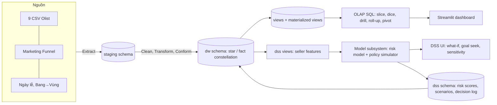

# SPEC — Olist Seller Performance DW & DSS

| Mục | Giá trị |
|---|---|
| Môn | CO4031 Kho dữ liệu và Hệ hỗ trợ Quyết định — HK261 |
| Phiên bản | v0.1 — 10/10/2026 (Phase 0) |
| Trạng thái | **Đề tài và công nghệ: đã chốt (đề tài có điều kiện G1–G6).** Dữ liệu: **đã tải** (Olist `data/raw/` + Marketing Funnel `data/external/`, 10/10/2026) |
| Nguồn thẩm quyền | `docs/assignment/CO4031_Assignment_HK261.pdf` (gọi tắt **[ĐỀ]**). File phân tích của nhóm chỉ để tham khảo |

Quy ước: **[ĐỀ]** = ghi trong đề · **[SUY LUẬN]** = nhóm suy ra từ L.O./mục tiêu/slide, không phải tiêu chí chấm điểm được công bố · **[GIẢ ĐỊNH]** = chưa kiểm chứng trên dữ liệu, kiểm tra ở Phase 1. Trang đề ghi theo số in ("Trang x/6").

---

## 1. Tổng quan đề tài

**Tên:** Kho dữ liệu và Hệ hỗ trợ quyết định quản lý hiệu suất người bán trên sàn Olist (*Olist Seller Performance DW & DSS*). Chi tiết so sánh: `TOPIC_EVALUATION.md`.

| Thành phần | Nội dung |
|---|---|
| Bối cảnh | Olist kết nối nhiều seller nhỏ với các marketplace ở Brazil; seller tự bàn giao hàng cho đối tác vận chuyển. Seller xử lý chậm hoặc chất lượng kém gây giao trễ và review xấu cho cả sàn |
| Bài toán quyết định | Mỗi tháng, chọn **chính sách phân hạng seller** (bộ ngưỡng) để xếp seller vào mức can thiệp: *Bình thường / Theo dõi / Cảnh báo + hỗ trợ / Tạm ngưng hiển thị* |
| Decision maker | Trưởng bộ phận Quản lý chất lượng người bán (Seller Quality / Marketplace Ops Manager) |
| Alternatives | P0 không can thiệp · P1 ngưỡng KPI cố định · P2 ngưỡng theo điểm rủi ro dự báo · các biến thể ngưỡng của P1/P2 |
| Principle of choice / KPI | Tối thiểu **số đơn trải nghiệm xấu dự kiến** tháng tới (đơn có review ≤ 2 hoặc giao trễ hẹn), ràng buộc **GMV bị ảnh hưởng ≤ X%** và **số seller cần xử lý ≤ N** (X, N là tham số của decision maker) |
| Phạm vi | Đơn 2016–2018 của dataset Olist + Marketing Funnel; data mart chủ đề "hiệu suất seller & hoàn tất đơn"; OLAP dashboard; DSS mô hình rủi ro + mô phỏng chính sách |
| Ngoài phạm vi | Tối ưu lợi nhuận (không có dữ liệu chi phí); phân tích NLP nội dung review; dự báo nhu cầu toàn sàn; streaming/real-time; triển khai production |

**Đáp ứng mục 3.1 [ĐỀ, Trang 3]:** (a) DW là nguồn duy nhất cho OLAP và DSS; (b) dữ liệu Kaggle, license CC BY-NC-SA 4.0, ~100 nghìn đơn, 9 bảng + nguồn bổ sung; (c) quyết định cụ thể, lặp lại hằng tháng, có KPI đo được.

---

## 2. Yêu cầu và truy vết (RTM)

Mức: **BB** = bắt buộc [ĐỀ] · **BB\*** = nhóm tự đặt là bắt buộc [SUY LUẬN] · **NC** = nên có · **ĐC** = điểm cộng. Trạng thái: ☐ chưa làm · ◐ đang làm · ⏸ chờ dữ liệu · ☑ xong.

| Mã | Nội dung | Mức | Nguồn | Phase | Sản phẩm đầu ra | TT |
|---|---|---|---|---|---|---|
| R01 | Phân tích nghiệp vụ, bài toán quyết định cụ thể (decision maker, alternatives, principle of choice) | BB | Mục 1.1 (mục tiêu 1), 3.1(c); Trang 2–3 | 0–1 | `TOPIC_EVALUATION.md`, SPEC §1 | ☑ |
| R02 | DW là cốt lõi, phục vụ phân tích và ra quyết định | BB | 3.1(a); Trang 3 | 2–3 | `DESIGN.md`, `src/sql/ddl/` | ☐ |
| R03 | Nguồn dữ liệu hợp lệ, ghi license và quy mô | BB | 3.1(b); Trang 3 | 0 | `data/README.md` | ☑ |
| R04 | Thiết kế DW đa chiều (star/snowflake) | BB | 1.1 (mục tiêu 2); Trang 2 | 2 | `DESIGN.md` | ☐ |
| R05 | Thiết kế quy trình ETL | BB | 1.1 (mục tiêu 2); Trang 2 | 2 | `DESIGN.md` (ETL mapping) | ☐ |
| R06 | Hiện thực cơ sở dữ liệu (staging + DW) | BB | 1.1 (mục tiêu 3); Trang 2 | 3 | `src/sql/ddl/` | ☐ |
| R07 | Hiện thực ETL chạy được end-to-end | BB | 1.1 (mục tiêu 3); Trang 2 | 3 | `src/etl/` | ☐ |
| R08 | Hiện thực OLAP | BB | 1.1 (mục tiêu 3); Trang 2 | 4 | `src/sql/olap_queries/`, `src/sql/views/` | ☐ |
| R09 | Frontend: dashboard / giao diện truy vấn | BB | 1.1 (mục tiêu 3); Trang 2 | 4 | `src/frontend/` | ☐ |
| R10 | Thành phần DSS dựa trên DW đã xây | BB | 1.1 (mục tiêu 4); Trang 2 | 5 | `src/dss/` | ☐ |
| R11 | Đánh giá kết quả | BB | 1.1 (mục tiêu 5); Trang 2 | 6 | `docs/report/` | ☐ |
| R12 | Hạn chế và hướng phát triển | BB | 1.1 (mục tiêu 5); Trang 2 | 6–7 | `docs/report/` | ☐ |
| R13 | Thuyết trình: trực tiếp 15' + 5' Q&A, hoặc video 10–15' (YouTube unlisted/Drive); mọi thành viên trình bày | BB | 1.1 (mục tiêu 6), 4.1–4.3; Trang 4–5 | 7 | Slide, video | ☐ |
| R14 | Nhóm 2–3 SV, mỗi người vai trò rõ; điểm cá nhân điều chỉnh theo peer review | BB | 1.3; Trang 2–3 | 0→7 | `README.md`, `PROGRESS_LOG.md` | ◐ |
| R15 | Báo cáo PDF | BB | 5.1(1); Trang 5 | 7 | `docs/report/` → PDF | ☐ |
| R16 | Mã nguồn `src/` (SQL, Python, frontend, ETL), ưu tiên GitHub truy cập được | BB | 5.1(2); Trang 5 | 0→7 | `src/`, repo GitHub | ◐ |
| R17 | Dữ liệu mẫu `data/` (GitHub/Drive) | BB | 5.1(3); Trang 5 | 0 | `data/sample/` | ☑ |
| R18 | Slide thuyết trình PDF | BB | 5.1(4); Trang 5 | 7 | Slide PDF | ☐ |
| R19 | Link video trên trang bìa báo cáo (nếu nhóm thuyết trình bằng video) | BB (có điều kiện) | 4.3, 5.1(5); Trang 5 | 7 | Bìa báo cáo | ☐ |
| R20 | Nộp 1 file ZIP qua LMS trước 23:59 15/11/2026 | BB | 5.1, 5.2; Trang 5 | 7 | ZIP | ☐ |
| R21 | Báo cáo thể hiện các L.O.1.1–4.2 (khái niệm, vai trò DW trong DSS, thiết kế DW, các pha quyết định, mô hình hóa, phát triển DSS) | BB\* | 1.2 Bảng 1; Trang 2 | 7 | `docs/report/` | ☐ |
| R22 | Kiến trúc tổng thể source → staging → DW → OLAP → DSS; cách tiếp cận DW có lý do | BB\* | L.O.1.2, 2.1 | 2 | SPEC §4, `DESIGN.md` | ◐ |
| R23 | Khai báo granularity cho từng fact | BB\* | L.O.2.2; slide Ch2 | 2 | `DESIGN.md` | ◐ |
| R24 | ≥ 2 dimension có hierarchy | BB\* | L.O.2.3; slide Ch2 | 2 | `DESIGN.md` | ◐ |
| R25 | Đủ 5 phép OLAP (slice, dice, drill-down, roll-up, pivot), mỗi phép trả lời 1 câu hỏi nghiệp vụ | BB\* | Mục tiêu 3; slide Ch2–3 | 4 | `src/sql/olap_queries/`, `src/frontend/` | ☐ |
| R26 | Chọn ROLAP/MOLAP/HOLAP có lý do | NC | slide Ch2–3 | 2 | SPEC §5 | ◐ |
| R27 | Làm sạch dữ liệu + kiểm thử chất lượng (đếm dòng, đối soát tổng, RI, unique grain) | BB\* | Mục tiêu 3; slide Ch1–2 | 3 | `src/etl/`, `src/tests/` | ☐ |
| R28 | Incremental load (watermark) | NC | slide Ch2 | 3 | `src/etl/` | ☐ |
| R29 | Data dictionary, metadata, source-to-target mapping | NC | slide Ch2-cont, Ch6 | 2 | `DESIGN.md` | ☐ |
| R30 | Tích hợp thật nhiều bảng/nguồn, có bằng chứng | BB\* | 3.1(a) + lý do bỏ DataCo | 1–3 | SPEC §3, `DESIGN.md`, `src/etl/` | ◐ |
| R31 | DSS đọc dữ liệu từ DW (view/bảng DW), không đọc CSV thô | BB\* | Diễn giải mục tiêu 4 | 5 | `src/sql/views/`, `src/dss/` | ☐ |
| R32 | DSS đủ 3 subsystem: data, model, UI | BB\* | L.O.4.2 | 5 | `src/dss/`, `src/frontend/` | ☐ |
| R33 | ≥ 1 mô hình định lượng, nêu loại (static/dynamic; certainty/risk/uncertainty) | BB\* | L.O.3.3 | 5 | `src/dss/` | ☐ |
| R34 | Chức năng what-if | BB\* | L.O.3.3; slide Ch6 | 5 | `src/dss/`, `src/frontend/` | ☐ |
| R35 | Sensitivity analysis và goal seeking | ĐC | slide Ch6–7 | 5 | `src/dss/` | ☐ |
| R36 | Influence diagram + bảng decision/uncontrollable/result variables | BB\* | L.O.3.3; slide Ch7 | 5 | SPEC §8, báo cáo | ◐ |
| R37 | Ánh xạ chức năng DSS ↔ pha intelligence/design/choice/implementation | BB\* | L.O.3.2 | 5 | SPEC §8, báo cáo | ◐ |
| R38 | Phân loại DSS | BB\* | L.O.3.1 | 5 | SPEC §8 | ◐ |
| R39 | Phương pháp phát triển (SDLC/prototyping), rủi ro dự án | NC | L.O.4.1 | 7 | Báo cáo | ☐ |
| R40 | Lịch chạy ETL tự động | ĐC | slide Ch2 (batch ETL) | 3 | `src/etl/` | ☐ |
| R41 | Surrogate key + SCD Type 2 cho ≥ 1 dimension | ĐC | Kimball (TLTK [2]) | 2–3 | `src/sql/ddl/`, `src/etl/` | ☐ |
| R42 | Aggregate / materialized view / index | NC | slide Ch1–2 | 3–4 | `src/sql/views/` | ☐ |
| R43 | Knowledge subsystem: luật khuyến nghị hành động | ĐC | slide Ch6 | 5 | `src/dss/` | ☐ |
| R44 | Đánh giá mô hình (metric, backtest) | NC | slide Ch7 | 5–6 | `src/dss/`, báo cáo | ☐ |

**Đối chiếu đề (PDF) ↔ file phân tích** — không có mâu thuẫn trực tiếp về yêu cầu; các điểm cần lưu ý (làm theo PDF):
1. *Số trang:* file phân tích ghi "số trang PDF cũng là số in" — đúng với slide nhưng **không đúng với file đề** (trang PDF 2 = "Trang 1/6"). SPEC dùng số in.
2. *"Quy mô đủ lớn" (3.1b):* câu trong đề có thể hiểu chỉ áp cho dữ liệu doanh nghiệp; file phân tích áp cho mọi nguồn. Nhóm vẫn nêu quy mô thực tế (cách an toàn).
3. *5 phép OLAP, granularity, influence diagram, what-if, 3 subsystem DSS:* **đề không ghi trực tiếp**; file phân tích xếp phần lớn là "nên có". SPEC nâng thành BB\* theo yêu cầu nội bộ nhóm — không phải tiêu chí chấm điểm công bố.
4. *Thư mục OLAP:* file phân tích dùng `src/olap/`; repo dùng `src/sql/olap_queries/` (chỉ khác cách tổ chức).
5. *Lịch:* slide Ch0/Introduction có mốc khác; theo đề (ban hành 10/09/2026) như file phân tích đã chọn.

---

## 3. Dữ liệu nguồn

| Bảng Olist | Vai trò |
|---|---|
| `orders` | Header đơn, trạng thái, 5 mốc thời gian → fact mức đơn, dim_date (role-playing) |
| `order_items` | Dòng hàng: product, seller, `shipping_limit_date`, price, freight → fact mức item |
| `order_reviews` | Điểm review → measure của fact mức đơn |
| `order_payments` | Phương thức, trả góp, giá trị → measure fact đơn, dim_payment_type, đối soát |
| `customers` | Hai khóa: `customer_id` (theo đơn), `customer_unique_id` (theo người) → dim_customer |
| `sellers` | → dim_seller |
| `products` + `product_category_name_translation` | → dim_product (hierarchy danh mục) |
| `geolocation` | zip prefix → lat/lng → khoảng cách seller–khách, chuẩn hóa thành phố/bang |

| Nguồn bổ sung (dự kiến) | Lý do |
|---|---|
| Marketing Funnel by Olist (`closed_deals`, nối qua `seller_id`; license CC BY-NC-SA 4.0) | Thuộc tính seller: business_segment, lead_type, ngày ký → hierarchy/thuộc tính dim_seller, biến "tuổi" seller cho mô hình |
| Lịch ngày lễ Brazil 2016–2018 | Cờ ngày lễ / mùa cao điểm trong dim_date — biến không kiểm soát được |
| Bảng bang (UF) → vùng (IBGE) | Cấp "Vùng" cho hierarchy địa lý |

**Bằng chứng tích hợp nhiều bảng/nguồn (R30):** (1) mỗi fact cần ≥ 4 bảng nguồn để nạp; (2) bảng source-to-target mapping trong `DESIGN.md` ghi nguồn từng cột; (3) bảng `dw.etl_audit` ghi số dòng đọc/nạp/loại theo từng nguồn; (4) measure phái sinh liên nguồn (khoảng cách cần geolocation × customers × sellers; điểm rủi ro cần items × reviews × orders).

**Vấn đề chất lượng dữ liệu cần xử lý** (tất cả **[GIẢ ĐỊNH], kiểm tra ở Phase 1**):

| Vấn đề | Hướng xử lý |
|---|---|
| geolocation nhiều dòng/zip prefix, có tọa độ ngoài Brazil | Lọc theo bounding box Brazil, lấy trung vị lat/lng và mode city/state theo zip prefix |
| Tên thành phố lệch chính tả/dấu | Chuẩn hóa: lowercase, bỏ dấu, trim |
| Hai loại khóa khách hàng | dim_customer theo `customer_unique_id`; map `customer_id` → key qua staging |
| Category tiếng Bồ Đào Nha, có product thiếu category / thiếu bản dịch | Join bảng dịch; thiếu → `unknown`; thêm `category_group` do nhóm định nghĩa |
| Timestamp thiếu (đơn hủy/chưa giao) hoặc sai thứ tự | Giữ NULL + cờ; loại khỏi measure thời gian; ghi số dòng vào audit |
| Review trùng `review_id` / đơn nhiều review | Giữ review mới nhất theo `review_answer_timestamp` |
| Payment `not_defined`, giá trị 0, trả góp 0 | Gắn "unknown"; đối soát tổng payment vs price + freight |
| Zip prefix mất số 0 đầu nếu đọc dạng số | Đọc mọi id/zip dạng chuỗi |
| 2016 thưa, cuối 2018 bị cắt | Giới hạn cửa sổ phân tích/mô hình theo tháng đủ dữ liệu (G5) |
| Đơn có nhiều seller | Quy trách nhiệm review cho mọi seller trong đơn hoặc loại (chốt theo G3) |

---

## 4. Kiến trúc hệ thống

- **Cách tiếp cận:** *bottom-up, một data mart* theo Kimball cho chủ đề "hiệu suất seller & hoàn tất đơn", dimension dùng chung (conformed) để mở rộng sau. Lý do: nhóm 2–3 người, ~5 tuần, một quyết định trọng tâm → EDW top-down không khả thi.
- **Lưu trữ:** một database PostgreSQL, 3 schema `staging`, `dw`, `dss`.

**Công nghệ — đã chốt 10/10/2026** (đề không ràng buộc công nghệ)

| Lớp | Đã chốt | Phương án thay thế (không dùng) |
|---|---|---|
| DBMS | PostgreSQL (staging / dw / dss cùng một database, tách schema); cài local hoặc Docker | DuckDB |
| ETL | Python 3.11+ + pandas + SQLAlchemy + psycopg; SQL cho bước transform/load | — |
| OLAP | ROLAP: SQL (`GROUP BY ROLLUP/CUBE`, `FILTER`, crosstab) trên star schema + materialized views | Power BI Desktop kết nối PostgreSQL |
| Frontend + DSS UI | Streamlit (một app, nhiều trang) | Power BI cho phần OLAP |
| Mô hình | scikit-learn, statsmodels | — |
| Kiểm thử / lịch | pytest; cron / Windows Task Scheduler | — |

Không dùng Spark/Kafka/Hadoop/Airflow cluster: dữ liệu ~100 nghìn đơn vừa trong một PostgreSQL; công cụ enterprise chỉ tăng rủi ro tiến độ.

---

## 5. Thiết kế DW sơ bộ (chi tiết: `DESIGN.md`)

**Lược đồ:** fact constellation (3 fact dùng chung dimension), các dimension dạng star (denormalized).

| Fact | Loại | **Granularity** | Measures chính | Dimensions |
|---|---|---|---|---|
| `fact_order_item` | Transaction | **1 dòng = 1 item của 1 đơn** (`order_id`, `order_item_id`) | price, freight_value, seller_ship_late_flag, seller_handling_days, delivery_days, delay_days, late_delivery_flag, distance_km | date (purchase, shipping_limit), customer, seller, product, order_status |
| `fact_order` | Accumulating snapshot | **1 dòng = 1 đơn hàng** | items_value, freight_total, payment_total, n_items, n_sellers, delivery_days, estimated_days, delay_days, late_flag, review_score, negative_review_flag | date (purchase, approved, delivered_carrier, delivered_customer, estimated), customer, order_status, payment_type |
| `fact_seller_monthly` | Periodic snapshot | **1 dòng = 1 seller × 1 tháng có hoạt động** | n_orders, n_items, gmv, late_ship_rate, late_delivery_rate, avg_review, negative_review_rate, cancel_rate, avg_handling_days | month, seller |

| Dimension | Thuộc tính chính | Hierarchy |
|---|---|---|
| `dim_date` (role-playing) | ngày, thứ, cuối tuần, ngày lễ, mùa cao điểm | **Năm → Quý → Tháng → Ngày** |
| `dim_month` (shrunken của dim_date) | tháng, quý, năm | Năm → Quý → Tháng |
| `dim_customer` | customer_unique_id, zip prefix, city, state, region | **Vùng → Bang → Thành phố** |
| `dim_seller` | seller_id, city, state, region, business_segment, lead_type, ngày ký | **Vùng → Bang → Thành phố**; Phân khúc → Seller |
| `dim_product` | category_pt, category_en, category_group, khối lượng, thể tích, size_band | **Nhóm danh mục → Danh mục → Sản phẩm** |
| `dim_order_status`, `dim_payment_type` | trạng thái; phương thức thanh toán | — |

- Surrogate key cho mọi dimension; member `-1 = Unknown`. SCD Type 2 cho `dim_seller` (thuộc tính từ funnel) là **điểm cộng** (R41).
- **OLAP: ROLAP.** Lý do: dữ liệu vừa phải, SQL trên star schema đủ nhanh; dùng materialized view cho các tổng hợp thường dùng (gần ý tưởng HOLAP nhưng vẫn lưu quan hệ). MOLAP cần cube engine riêng, không cần thiết ở quy mô này.

---

## 6. ETL

| Bước | Nội dung |
|---|---|
| Extract | Đọc CSV (mọi id/zip dạng chuỗi) → `staging.*` nguyên trạng + `batch_id`, `load_ts`, `source_file` |
| Clean | Quy tắc ở §3: chuẩn hóa thành phố, dedupe geolocation/review, parse timestamp, cờ bất thường, xử lý NULL |
| Transform | Dịch category + category_group; bang → vùng; khoảng cách Haversine; cờ trễ; tách customer key; tra surrogate key |
| Load | Dimensions trước (upsert, SCD), rồi `fact_order_item`, `fact_order`, cuối cùng `fact_seller_monthly` (tính lại các tháng bị ảnh hưởng) |
| Incremental | Watermark theo `order_purchase_timestamp`; demo bằng cách nạp lần đầu đến tháng T, sau đó nạp tiếp từng tháng; `fact_order` cập nhật mốc thời gian khi đơn thay đổi trạng thái |
| Lịch chạy | Lệnh CLI `full` / `incremental`; demo lịch hằng ngày bằng cron/Task Scheduler (ĐC) |
| Kiểm thử DQ | pytest + `dw.etl_audit`: số dòng nguồn = nạp + loại; Σprice nguồn = Σprice fact; không orphan FK; grain không trùng; tỷ lệ NULL trong ngưỡng |

---

## 7. OLAP và frontend

| Phép | Câu hỏi nghiệp vụ | Truy vấn / màn hình |
|---|---|---|
| Roll-up | Tỷ lệ seller bàn giao trễ khi gộp Thành phố → Bang → Vùng của seller: vấn đề mang tính vùng hay cục bộ? | `fact_order_item` × `dim_seller`, `ROLLUP(region, state, city)` |
| Drill-down | Tỷ lệ review tiêu cực theo Năm → Quý → Tháng → Ngày: đỉnh có rơi vào mùa cao điểm (ví dụ Black Friday 11/2017 [GIẢ ĐỊNH]) không? | `fact_order` × `dim_date` |
| Slice | Cố định 1 nhóm danh mục: seller nào có tỷ lệ giao trễ cao nhất? | `WHERE category_group = :g` |
| Dice | Khách vùng Norte + Nordeste, Q1–Q2/2018, hàng cồng kềnh: tỷ lệ trễ và review xấu theo bang seller | Lọc đồng thời 3 dimension |
| Pivot | Bảng Bang seller × Quý (tỷ lệ bàn giao trễ) xoay thành Nhóm danh mục × Quý để tìm nguồn gây trễ | crosstab / pivot trên UI |

**Màn hình Streamlit:** (1) Tổng quan KPI · (2) OLAP Explorer (5 phép) · (3) Hồ sơ seller (drill tới seller) · (4) DSS – Điểm rủi ro · (5) DSS – What-if chính sách · (6) DSS – Goal seeking & sensitivity · (7) Quyết định & xuất danh sách.

---

## 8. DSS

**Phân loại:** *compound DSS* = **data-driven** (OLAP trên DW) + **model-driven** (mô hình rủi ro + mô phỏng chính sách); thêm **knowledge-driven** nhẹ (luật khuyến nghị, ĐC). Hỗ trợ quyết định bán cấu trúc, lặp lại hằng tháng.

| Subsystem | Hiện thực |
|---|---|
| Data | Views `dss.v_seller_features` đọc **chỉ từ `dw`** (`fact_seller_monthly` + dims); kết quả ghi lại `dss.seller_risk_score`, `dss.policy_scenario`, `dss.decision_log` |
| Model | M1 mô hình rủi ro; M2 mô phỏng chính sách; goal seeking; sensitivity |
| UI | Trang 4–7 của Streamlit: chỉnh tham số, so sánh phương án, xuất quyết định |

**Mô hình định lượng**

| Mô hình | Mô tả | Loại |
|---|---|---|
| M1 Điểm rủi ro seller | Logistic regression (baseline) ước lượng p_i = xác suất một đơn của seller i ở tháng t+1 là "trải nghiệm xấu", từ đặc trưng các tháng ≤ t trong `fact_seller_monthly` (late_ship_rate 3 tháng, avg_review, volume, khoảng cách TB, nhóm danh mục, vùng, tuổi seller). Train/test chia theo thời gian | Static, **under risk** (xác suất) |
| M2 Mô phỏng chính sách | Với chính sách π (ngưỡng): xếp hạng seller → hiệu quả giả định e_k theo hạng → tính **đơn xấu dự kiến** = Σ p_i·Q_i·(1−e_k(i)), **GMV bị ảnh hưởng** của seller bị tạm ngưng (có tỷ lệ chuyển đơn r sang seller khác), **số seller cần xử lý** | Static một kỳ, **under risk**; e_k, r là tham số **uncertainty** → xử lý bằng kịch bản và sensitivity |

**Biến của mô hình**

| Loại | Biến |
|---|---|
| Decision variables | Ngưỡng điểm rủi ro cho từng hạng (θ₁, θ₂, θ₃); ngưỡng KPI cứng (late_ship_rate, avg_review); số đơn tối thiểu để xét; biện pháp cho từng hạng |
| Uncontrollable variables | Nhu cầu tháng tới / hệ số mùa vụ s (Q_i = Q̄_i·s); hiệu quả can thiệp e_k; tỷ lệ chuyển đơn r khi tạm ngưng; hiệu suất vận chuyển; cơ cấu danh mục và địa lý |
| Intermediate | p_i (từ M1), đơn dự kiến Q_i, hạng của seller |
| Result variables | Số/tỷ lệ đơn trải nghiệm xấu dự kiến; GMV bị ảnh hưởng (%); số seller mỗi hạng; tỷ lệ giao trễ dự kiến |

**What-if:** chỉnh θ, e_k, r, s → kết quả cập nhật; lưu và so sánh ≥ 3 kịch bản (P0, P1, P2). **Goal seeking:** tìm θ nhỏ nhất sao cho GMV bị ảnh hưởng ≤ X% (bisection). **Sensitivity:** biểu đồ tornado khi e_k, r, s thay đổi ±20%.

**Influence diagram** (□ quyết định · ⬭ không kiểm soát · ○ trung gian · ⬡ kết quả)

**Ánh xạ chức năng ↔ pha ra quyết định**

| Pha | Chức năng |
|---|---|
| Intelligence | Dashboard KPI, OLAP 5 phép, cảnh báo seller suy giảm → xác định vấn đề và mức độ |
| Design | Influence diagram; M1 huấn luyện/đánh giá; định nghĩa phương án P0/P1/P2; mô phỏng M2 |
| Choice | What-if so sánh phương án, goal seeking θ, sensitivity; chọn theo principle of choice |
| Implementation | Xuất danh sách seller theo hạng (CSV), ghi `dss.decision_log`; tháng sau so sánh dự báo vs thực tế (backtest) |

**Tự kiểm:** DSS có mô hình định lượng + what-if + đọc từ DW → **đạt** yêu cầu DSS (không phải dashboard mô tả). Nếu cắt M1/M2 thì phải đánh dấu "chưa đạt yêu cầu DSS".

---

## 9. Bản đồ file/thư mục

| Đường dẫn | Mục đích | Phase | TT |
|---|---|---|---|
| `README.md` | Tổng quan, cách chạy, thứ tự đọc | 0 | ☑ |
| `.gitignore`, `.env.example` | Bỏ qua dữ liệu/secret/cache; mẫu cấu hình | 0 | ☑ |
| `docs/assignment/` | PDF đề + file phân tích đề | 0 | ☑ |
| `docs/TOPIC_EVALUATION.md` | Feasibility + chọn đề tài | 0 | ☑ (chốt có điều kiện; G1–G6 = Phase 1) |
| `docs/SPEC.md` | Đặc tả + RTM (file này) | 0 | ☑ (mục còn mở: X, N, định nghĩa trải nghiệm xấu, thuyết trình, vai trò) |
| `docs/PLAN.md` | Kế hoạch phase | 0 | ☑ |
| `docs/DESIGN.md` | Schema, ETL mapping, data dictionary | 2 | ☐ (khung) |
| `docs/PROGRESS_LOG.md` | Nhật ký tiến độ | 0→7 | ◐ |
| `docs/report/` | Nháp báo cáo, hình | 6–7 | ☐ |
| `data/README.md` | Nguồn, license, cách tải, mô tả file | 0 | ☑ |
| `data/raw/` · `data/external/` · `data/sample/` | Dữ liệu gốc · bổ sung · mẫu | 0–1 | ☑ Olist + Funnel + sample (ngày lễ / bang→vùng: Phase 1) |
| `src/notebooks/00_verify_and_sample.py` | Kiểm tra file tải về + tạo mẫu giữ khóa (thêm vì bước tải chưa xong — nhóm chạy 1 lệnh sau khi tải) | 0 | ☑ |
| `src/notebooks/` | EDA, profiling, cổng G1–G6 | 1 | ☐ |
| `src/sql/ddl/` · `src/sql/views/` · `src/sql/olap_queries/` | DDL staging/dw/dss · views & materialized views · 5 truy vấn OLAP | 3–4 | ☐ |
| `src/etl/` | Pipeline staging → DW | 3 | ☐ |
| `src/dss/` | M1, M2, goal seek, sensitivity, rules | 5 | ☐ |
| `src/frontend/` | Streamlit app | 4–5 | ☐ |
| `src/tests/` | Test ETL & DQ | 3–6 | ☐ |

---

## 10. Rủi ro và quyết định

| Rủi ro | Ảnh hưởng | Giảm thiểu |
|---|---|---|
| Chưa tải được dữ liệu | Chặn Phase 1 | Tải tay ngay (data/README) — ưu tiên số 1 |
| Seller thưa (G1 không đạt) | M1 nhiễu | Gộp theo quý, ngưỡng số đơn tối thiểu; dự phòng chuyển sang T2 dùng lại DW |
| DSS bị cắt vì trễ tiến độ | Hụt L.O.3.3/4.2 | M2 + what-if là phần tối thiểu, làm trước; M1 bắt đầu bằng baseline đơn giản |
| Chương 6–8 dạy sau giữa kỳ | Thiếu lý thuyết DSS khi cần | Đọc trước slide Ch6–7 trong tuần 8 |
| Thay đổi phạm vi | Trễ hạn | Khóa phạm vi sau Phase 1; mọi thay đổi ghi vào PROGRESS_LOG |

| Quyết định đã chốt | Ngày |
|---|---|
| Dùng dataset Olist (bỏ DataCo) | Trước 10/10/2026 |
| Đề tài **T1 Seller Performance** (có điều kiện: chốt cuối khi G1–G6 đạt; nếu không đạt → T2 Delivery Promise, dùng lại cùng DW) | 10/10/2026 |
| Decision maker / quyết định / alternatives / principle of choice giữ như SPEC §1 | 10/10/2026 |
| Kiến trúc: bottom-up data mart, fact constellation (`fact_order_item`, `fact_order`, `fact_seller_monthly`), ROLAP | 10/10/2026 |
| Stack: PostgreSQL (staging/dw/dss cùng 1 DB, tách schema) + Python 3.11+ (pandas, SQLAlchemy, psycopg) + Streamlit + scikit-learn/statsmodels + pytest | 10/10/2026 |
| Nguồn bổ sung Marketing Funnel by Olist (CC BY-NC-SA 4.0) dùng chắc chắn | 10/10/2026 |

| Còn mở | Ghi chú |
|---|---|
| Giá trị mặc định X (% GMV), N (seller/tháng), định nghĩa "trải nghiệm xấu" | Phase 1 |
| Thuyết trình trực tiếp hay video | Đăng ký với giảng viên |
| Phân vai thành viên | Nhóm tự điền README |
| Ngày lễ Brazil 2016–2018 và bảng bang→vùng IBGE | Kiểm tra license và lập ở Phase 1 |
