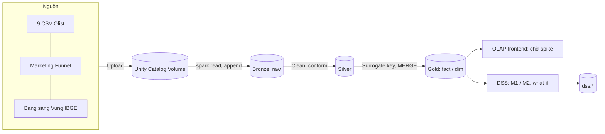

# SPEC — Olist Seller Performance DW & DSS

| Mục | Giá trị |
|---|---|
| Môn | CO4031 Kho dữ liệu và Hệ hỗ trợ Quyết định — HK261 |
| Phiên bản | v0.6 — 22/10/2026 |
| Trạng thái | **Kiến trúc Databricks medallion.** S1, S4, S5 đạt (13/10/2026). Phase 1 Cloud đã đo trên Volume (15/10/2026): G1–G5 pass, G6 record 12,3%. T1 chốt. X=10, N=40. Phase 2 thiết kế đã khóa trong `docs/DESIGN.md`, bổ sung 22/10/2026 (đơn nhiều seller, cờ trễ, SCD2-ready, địa chỉ khách trên `fact_order`, `gmv` loại đơn hủy, đếm placed/valid, `snapshot_date`). S2, S3, S6 chưa chạy. Frontend OLAP chờ S2–S3. Bảng bang → vùng ở `data/external/ibge_state_region.csv` và đã nằm ở `/Volumes/olist_catalog/bronze/raw/ref/` (nhóm xác nhận 15/10/2026; phiên thiết kế không đọc lại Volume) |
| Nguồn thẩm quyền | `docs/assignment/CO4031_Assignment_HK261.pdf` (gọi tắt **[ĐỀ]**). File phân tích của nhóm chỉ để tham khảo |

Quy ước: **[ĐỀ]** = ghi trong đề · **[SUY LUẬN]** = nhóm suy ra từ L.O./mục tiêu/slide, không phải tiêu chí chấm điểm được công bố · **[GIẢ ĐỊNH]** = chưa kiểm chứng, kiểm tra ở spike S1–S6 hoặc Phase 1. Trang đề ghi theo số in ("Trang x/6").

---

## 1. Tổng quan đề tài

**Tên:** Kho dữ liệu và Hệ hỗ trợ quyết định quản lý hiệu suất người bán trên sàn Olist (*Olist Seller Performance DW & DSS*). Chi tiết so sánh: `TOPIC_EVALUATION.md`.

| Thành phần | Nội dung |
|---|---|
| Bối cảnh | Olist kết nối nhiều seller nhỏ với các marketplace ở Brazil; seller tự bàn giao hàng cho đối tác vận chuyển. Seller xử lý chậm hoặc chất lượng kém gây giao trễ và review xấu cho cả sàn |
| Bài toán quyết định | Mỗi tháng, chọn **chính sách phân hạng seller** (bộ ngưỡng) để xếp seller vào mức can thiệp: *Bình thường / Theo dõi / Cảnh báo + hỗ trợ / Tạm ngưng hiển thị* |
| Decision maker | Trưởng bộ phận Quản lý chất lượng người bán (Seller Quality / Marketplace Ops Manager) |
| Alternatives | P0 không can thiệp · P1 ngưỡng KPI cố định · P2 ngưỡng theo điểm rủi ro dự báo · các biến thể ngưỡng của P1/P2 |
| Principle of choice / KPI | Tối thiểu **số đơn trải nghiệm xấu dự kiến** tháng tới. Đơn trải nghiệm xấu = review ≤ 2 **hoặc** giao trễ so với ngày hẹn. 1.278 đơn nhiều seller **không xóa**; `review_score` và `negative_review_flag` để null nên đơn ra khỏi mẫu review (G3, 15/10/2026; cách gắn cờ chốt 22/10/2026). Nhánh `late_flag` của `bad_experience_flag` vẫn tính. `gmv` vẫn cộng `price` của các đơn đó, trừ đơn `canceled` hoặc `unavailable`. Ràng buộc **GMV bị ảnh hưởng ≤ 10%** và **số seller cần xử lý ≤ 40**/tháng (X, N là tham số; mặc định nhóm chốt 15/10/2026) |
| Phạm vi | Đơn Olist có `order_purchase_timestamp` từ 2016-09-04 21:15:19 đến 2018-10-17 17:30:18 (Volume, 15/10/2026) + Marketing Funnel; medallion trên Databricks (Bronze → Silver → Gold), chỉ batch; data mart Kimball chủ đề "hiệu suất seller & hoàn tất đơn" nằm ở Gold; OLAP (frontend chờ spike); DSS mô hình rủi ro + mô phỏng chính sách, đọc Gold và ghi `dss.*`. Tháng thưa (2016-09, 2016-10, 2016-12, 2017-01, 2018-09, 2018-10; không có 2016-11) giữ trong kho, ghi vào hạn chế |
| Ngoài phạm vi | Tối ưu lợi nhuận (không có dữ liệu chi phí); phân tích NLP nội dung review; dự báo nhu cầu toàn sàn; triển khai production. Hướng phát triển: streaming, CDC, Kafka, Lakehouse Federation, Reverse ETL |

**Đáp ứng mục 3.1 [ĐỀ, Trang 3]:** (a) Gold layer là DW, nguồn duy nhất cho OLAP và DSS; (b) dữ liệu Kaggle, license CC BY-NC-SA 4.0, ~100 nghìn đơn, 9 bảng + nguồn bổ sung; (c) quyết định cụ thể, lặp lại hằng tháng, có KPI đo được.

---

## 2. Yêu cầu và truy vết (RTM)

Mức: **BB** = bắt buộc [ĐỀ] · **BB\*** = nhóm tự đặt là bắt buộc [SUY LUẬN] · **NC** = nên có · **ĐC** = điểm cộng. Trạng thái: ☐ chưa làm · ◐ đang làm · ⏸ chờ dữ liệu · ☑ xong.

| Mã | Nội dung | Mức | Nguồn | Phase | Sản phẩm đầu ra | TT |
|---|---|---|---|---|---|---|
| R01 | Phân tích nghiệp vụ, bài toán quyết định cụ thể (decision maker, alternatives, principle of choice) | BB | Mục 1.1 (mục tiêu 1), 3.1(c); Trang 2–3 | 0–1 | `TOPIC_EVALUATION.md`, SPEC §1 | ☑ |
| R02 | DW là cốt lõi, phục vụ phân tích và ra quyết định | BB | 3.1(a); Trang 3 | 2–3 | `DESIGN.md`, `src/sql/ddl/` | ◐ |
| R03 | Nguồn dữ liệu hợp lệ, ghi license và quy mô | BB | 3.1(b); Trang 3 | 0 | `data/README.md` | ☑ |
| R04 | Thiết kế DW đa chiều (star/snowflake) | BB | 1.1 (mục tiêu 2); Trang 2 | 2 | `DESIGN.md` | ☑ |
| R05 | Thiết kế quy trình ETL | BB | 1.1 (mục tiêu 2); Trang 2 | 2 | `DESIGN.md` (ETL mapping) | ☑ |
| R06 | Hiện thực DW trên Delta Lake (bronze/silver/gold) | BB | 1.1 (mục tiêu 3); Trang 2 | 3 | Unity Catalog schemas + DDL trong `src/sql/ddl/` | ☐ |
| R07 | Hiện thực ETL medallion chạy được end-to-end (Bronze ingest → Silver clean/conform → Gold MERGE) | BB | 1.1 (mục tiêu 3); Trang 2 | 3 | `src/etl/` | ☐ |
| R08 | Hiện thực OLAP | BB | 1.1 (mục tiêu 3); Trang 2 | 4 | `src/sql/olap_queries/`, `src/sql/views/` | ☐ |
| R09 | Frontend: dashboard / giao diện truy vấn | BB | 1.1 (mục tiêu 3); Trang 2 | 4 | `src/frontend/` | ☐ |
| R10 | Thành phần DSS dựa trên DW đã xây | BB | 1.1 (mục tiêu 4); Trang 2 | 5 | `src/dss/` | ☐ |
| R11 | Đánh giá kết quả | BB | 1.1 (mục tiêu 5); Trang 2 | 6 | `docs/report/` | ☐ |
| R12 | Hạn chế và hướng phát triển | BB | 1.1 (mục tiêu 5); Trang 2 | 6–7 | `docs/report/` | ☐ |
| R13 | Thuyết trình: trực tiếp 15' + 5' Q&A, hoặc video 10–15' (YouTube unlisted/Drive); mọi thành viên trình bày | BB | 1.1 (mục tiêu 6), 4.1–4.3; Trang 4–5 | 7 | Slide, video | ☐ |
| R14 | Nhóm 2–3 SV, mỗi người vai trò rõ; điểm cá nhân điều chỉnh theo peer review | BB | 1.3; Trang 2–3 | 0→7 | `README.md`, `PROGRESS_LOG.md` | ◐ |
| R15 | Báo cáo PDF | BB | 5.1(1); Trang 5 | 7 | `docs/report/` → PDF | ☐ |
| R16 | Mã nguồn `src/` (SQL, Python, frontend, ETL), ưu tiên GitHub truy cập được. Git folder Databricks đã nối repo (S5, 13/10/2026) | BB | 5.1(2); Trang 5 | 0→7 | `src/`, repo GitHub | ◐ |
| R17 | Dữ liệu mẫu `data/` (GitHub/Drive) | BB | 5.1(3); Trang 5 | 0 | `data/sample/` | ☑ |
| R18 | Slide thuyết trình PDF | BB | 5.1(4); Trang 5 | 7 | Slide PDF | ☐ |
| R19 | Link video trên trang bìa báo cáo (nếu nhóm thuyết trình bằng video) | BB (có điều kiện) | 4.3, 5.1(5); Trang 5 | 7 | Bìa báo cáo | ☐ |
| R20 | Nộp 1 file ZIP qua LMS trước 23:59 15/11/2026 | BB | 5.1, 5.2; Trang 5 | 7 | ZIP | ☐ |
| R21 | Báo cáo thể hiện các L.O.1.1–4.2 (khái niệm, vai trò DW trong DSS, thiết kế DW, các pha quyết định, mô hình hóa, phát triển DSS) | BB\* | 1.2 Bảng 1; Trang 2 | 7 | `docs/report/` | ☐ |
| R22 | Kiến trúc tổng thể source → Volume → Bronze → Silver → Gold (DW) → OLAP → DSS; cách tiếp cận DW có lý do | BB\* | L.O.1.2, 2.1 | 2 | SPEC §4, `DESIGN.md` | ☑ |
| R23 | Khai báo granularity cho từng fact | BB\* | L.O.2.2; slide Ch2 | 2 | `DESIGN.md` | ☑ |
| R24 | ≥ 2 dimension có hierarchy | BB\* | L.O.2.3; slide Ch2 | 2 | `DESIGN.md` | ☑ |
| R25 | Đủ 5 phép OLAP (slice, dice, drill-down, roll-up, pivot), mỗi phép trả lời 1 câu hỏi nghiệp vụ | BB\* | Mục tiêu 3; slide Ch2–3 | 4 | `src/sql/olap_queries/`, `src/frontend/` | ☐ |
| R26 | Chọn ROLAP hoặc HOLAP có lý do — loại OLAP còn mở, chốt sau spike cùng frontend | NC | slide Ch2–3 | 0–2 | SPEC §5 | ◐ |
| R27 | Làm sạch dữ liệu + kiểm thử chất lượng (Delta constraints, đếm dòng, đối soát tổng, RI, unique grain, pytest trên sample) | BB\* | Mục tiêu 3; slide Ch1–2 | 3 | `src/etl/`, `src/tests/` | ◐ |
| R28 | Incremental load (watermark `order_purchase_timestamp`, Delta MERGE) | NC | slide Ch2 | 3 | `src/etl/` | ☐ |
| R29 | Data dictionary, metadata, source-to-target mapping | NC | slide Ch2-cont, Ch6 | 2 | `DESIGN.md` | ☑ |
| R30 | Tích hợp thật nhiều bảng/nguồn, có bằng chứng | BB\* | 3.1(a) + lý do bỏ DataCo | 1–3 | SPEC §3, `DESIGN.md`, `src/etl/` | ◐ |
| R31 | DSS đọc dữ liệu chỉ từ Gold (`gold.*`), ghi kết quả vào `dss.*`, không đọc CSV thô | BB\* | Diễn giải mục tiêu 4 | 5 | `src/sql/views/`, `src/dss/` | ☐ |
| R32 | DSS đủ 3 subsystem: data, model, UI | BB\* | L.O.4.2 | 5 | `src/dss/`, `src/frontend/` | ☐ |
| R33 | ≥ 1 mô hình định lượng, nêu loại (static/dynamic; certainty/risk/uncertainty) | BB\* | L.O.3.3 | 5 | `src/dss/` | ☐ |
| R34 | Chức năng what-if | BB\* | L.O.3.3; slide Ch6 | 5 | `src/dss/`, `src/frontend/` | ☐ |
| R35 | Sensitivity analysis và goal seeking | ĐC | slide Ch6–7 | 5 | `src/dss/` | ☐ |
| R36 | Influence diagram + bảng decision/uncontrollable/result variables | BB\* | L.O.3.3; slide Ch7 | 5 | SPEC §8, báo cáo | ◐ |
| R37 | Ánh xạ chức năng DSS ↔ pha intelligence/design/choice/implementation | BB\* | L.O.3.2 | 5 | SPEC §8, báo cáo | ◐ |
| R38 | Phân loại DSS | BB\* | L.O.3.1 | 5 | SPEC §8 | ◐ |
| R39 | Phương pháp phát triển (SDLC/prototyping), rủi ro dự án | NC | L.O.4.1 | 7 | Báo cáo | ☐ |
| R40 | Lịch chạy ETL tự động bằng Databricks Jobs (S4 đạt 13/10/2026: Free Edition tạo được Job và lưu lịch; ETL chưa gắn vào Job) | ĐC | slide Ch2 (batch ETL) | 3 | `src/etl/` | ◐ |
| R41 | Surrogate key + SCD Type 2 cho ≥ 1 dimension (`dim_seller` nếu làm điểm cộng) | ĐC | Kimball (TLTK [2]) | 2–3 | `src/sql/ddl/`, `src/etl/` | ☐ |
| R42 | Aggregate / view trên Gold cho OLAP (không partition vì dữ liệu nhỏ) | NC | slide Ch1–2 | 3–4 | `src/sql/views/` | ☐ |
| R43 | Knowledge subsystem: luật khuyến nghị hành động | ĐC | slide Ch6 | 5 | `src/dss/` | ☐ |
| R44 | Đánh giá mô hình (metric, backtest) | NC | slide Ch7 | 5–6 | `src/dss/`, báo cáo | ☐ |
| R45 | Hợp đồng giữa các layer (Bronze append-only có metadata; Silver làm sạch/conform; Gold chỉ chứa star schema; downstream chỉ đọc Gold) | BB\* | [SUY LUẬN] / hợp đồng medallion | 2–3 | SPEC §4–6, `DESIGN.md` | ☑ |
| R46 | Khả năng tái lập cho người chấm (README hướng dẫn, chạy local trên sample) | NC | [SUY LUẬN] / tái lập cho người chấm | 0, 3, 6 | README, `src/tests/`, chạy local `data/sample/` | ☐ |
| R47 | Metadata/lineage: comment bảng/cột Gold trong Unity Catalog | ĐC | [SUY LUẬN] / metadata | 3 | DDL trong `src/sql/ddl/` | ☐ |

**Đối chiếu đề (PDF) ↔ file phân tích** — không có mâu thuẫn trực tiếp về yêu cầu; các điểm cần lưu ý (làm theo PDF):
1. *Số trang:* file phân tích ghi "số trang PDF cũng là số in" — đúng với slide nhưng **không đúng với file đề** (trang PDF 2 = "Trang 1/6"). SPEC dùng số in.
2. *"Quy mô đủ lớn" (3.1b):* câu trong đề có thể hiểu chỉ áp cho dữ liệu doanh nghiệp; file phân tích áp cho mọi nguồn. Nhóm vẫn nêu quy mô thực tế (cách an toàn).
3. *5 phép OLAP, granularity, influence diagram, what-if, 3 subsystem DSS:* **đề không ghi trực tiếp**; file phân tích xếp phần lớn là "nên có". SPEC nâng thành BB\* theo yêu cầu nội bộ nhóm — không phải tiêu chí chấm điểm công bố.
4. *Thư mục OLAP:* file phân tích dùng `src/olap/`; repo dùng `src/sql/olap_queries/` (chỉ khác cách tổ chức).
5. *Lịch:* slide Ch0/Introduction có mốc khác; theo đề (ban hành 10/09/2026) như file phân tích đã chọn.
6. *DBMS:* SPEC v0.1 chốt PostgreSQL (schema `staging` / `dw` / `dss`). File phân tích không chọn DBMS; đề PDF không quy định công cụ hay DBMS (file phân tích, Phần 1). Databricks được phép. Khái niệm staging trên slide ánh xạ sang Bronze; Gold là DW. Quyết định PostgreSQL **thay thế ngày 10/10/2026** (xem §10).

---

## 3. Dữ liệu nguồn

| Bảng Olist | Vai trò |
|---|---|
| `orders` | Header đơn, trạng thái, 5 mốc thời gian → fact mức đơn, dim_date (role-playing) |
| `order_items` | Dòng hàng: product, seller, `shipping_limit_date`, price, freight → fact mức item |
| `order_reviews` | Điểm review → measure của fact mức đơn |
| `order_payments` | Phương thức, trả góp, giá trị → measure fact đơn, dim_payment_type, đối soát |
| `customers` | `customer_id` (theo đơn, kèm địa chỉ) → cột địa chỉ trên `fact_order`. `customer_unique_id` (theo người) → `dim_customer` |
| `sellers` | → dim_seller |
| `products` + `product_category_name_translation` | → dim_product (hierarchy danh mục) |
| `geolocation` | zip prefix → lat/lng → khoảng cách seller–khách, chuẩn hóa thành phố/bang |

| Nguồn bổ sung (dự kiến) | Lý do |
|---|---|
| Marketing Funnel by Olist (`closed_deals`, nối qua `seller_id`; license CC BY-NC-SA 4.0) | Thuộc tính seller: business_segment, lead_type, ngày ký → hierarchy/thuộc tính dim_seller, biến "tuổi" seller cho mô hình |
| Bảng bang (UF) → vùng: `data/external/ibge_state_region.csv` (snapshot API IBGE 15/10/2026, 27 dòng) | Cấp "Vùng" cho hierarchy địa lý. Nối `state_code` với `customer_state` / `seller_state` |

**Đưa nguồn lên lakehouse:** 9 CSV Olist và 2 CSV Marketing Funnel nằm trong một Unity Catalog Volume. Spike S1 (13/10/2026) đọc `olist_orders_dataset.csv` bằng `spark.read` (header, mọi cột `string`): 99,441 dòng. Catalog `olist_catalog`. Đường dẫn `/Volumes/olist_catalog/bronze/raw/` (`olist/`, `funnel/`). Bảng bang → vùng có bản local `data/external/ibge_state_region.csv` (27 dòng, đếm 15/10/2026) và nhóm xác nhận đã nằm ở `/Volumes/olist_catalog/bronze/raw/ref/`, không đặt trong `funnel/`. Phiên thiết kế 15/10/2026 không đọc lại Volume nên không ghi số dòng mới trên Volume. Các bước: `data/README.md` §5.

**Bằng chứng tích hợp nhiều bảng/nguồn (R30):** (1) mỗi fact cần ≥ 4 bảng nguồn để nạp; (2) bảng source-to-target mapping trong `DESIGN.md` ghi nguồn từng cột; (3) bảng `gold.etl_audit` ghi số dòng đọc/nạp/loại theo từng nguồn; (4) measure phái sinh liên nguồn (khoảng cách cần geolocation × customers × sellers; điểm rủi ro cần items × reviews × orders).

**Vấn đề chất lượng dữ liệu** (đo trên Volume, `SOURCE=volume`, 15/10/2026, `01_profiling.py`):

| Vấn đề | Số đo | Hướng xử lý |
|---|---|---|
| geolocation nhiều dòng/zip prefix, tọa độ ngoài Brazil | 1.000.163 dòng; 19.015 zip prefix; 17.972 zip có hơn một dòng; tối đa 1.146 dòng/zip; trung bình 52,598633 dòng/zip; 31 điểm ngoài bbox; 0 lat/lng NULL | `silver.geolocation_zip`: một dòng mỗi prefix, `percentile_approx` 0.5, bbox lat [-34, 6], lng [-74, -28]. 31 điểm ngoài bbox đã đo với khung này. Fallback `silver.geolocation_city` theo (`city_norm`, state). Khách và seller: zip → city → null, `geo_match_level`, không điền 0. Haversine ở item; trung bình seller-tháng bỏ null |
| Tên thành phố lệch chính tả/dấu | `geolocation_city`: 8.010 distinct_lower, 5.968 sau khi bỏ dấu, 73.437 dòng có dấu. `customer_city` 4.119 / `seller_city` 611: không đổi sau khi bỏ dấu | `city_norm`: lowercase, bỏ dấu, trim. Dùng cho khách, seller, geolocation và Gold |
| Hai loại khóa khách hàng | 99.441 `customer_id` phân biệt trên 99.441 dòng; 96.096 `customer_unique_id` | Silver giữ `customer_id`. `dim_customer` một dòng mỗi `customer_unique_id`, không địa chỉ. Địa chỉ của `customer_id` đặt trên `fact_order` |
| Category thiếu / thiếu bản dịch | 610 / 32.951 product thiếu `product_category_name`; 2 category không có dòng dịch | Product vẫn giữ khóa. LEFT JOIN translation. `category_pt = COALESCE(product_category_name, 'unknown')`. `category_en = COALESCE(bản dịch, product_category_name, 'unknown')`. Không null ở hai cột này. `pc_gamer` thiếu dịch → `'pc_gamer'`. `category_group` vẫn `'Unknown'` khi thiếu tên, 8 nhóm ở DESIGN §3.4 |
| Timestamp thiếu hoặc sai thứ tự | Orders 99.441. NULL: `order_approved_at` 160, `order_delivered_carrier_date` 1.783, `order_delivered_customer_date` 2.965. Đảo: carrier trước approved 1.359; carrier trước purchase 166; customer trước carrier 23. G2: 96.469 / 96.478 đơn `delivered` có cả hai mốc giao | Cột chính thức thành NULL khi đảo; giữ `raw_*`; `ts_inversion_flag`; so sánh đảo trên `raw_*`; loại khỏi measure thời gian; đếm `rows_ts_inverted` trong `gold.etl_audit`. `late_flag` so bằng ngày. Đơn `canceled` hoặc `unavailable` thì null và ở ngoài mẫu. Thiếu một mốc thì null. `seller_ship_late_flag` so bằng timestamp. Đơn `canceled` hoặc `unavailable` thì cờ null. Carrier thật sự thiếu và hạn trước `snapshot_date` thì cờ = 1; hạn từ ngày chốt trở đi thì null. Công thức đầy đủ ở DESIGN §3.6 |
| Review trùng / đơn nhiều review | 99.224 dòng; 789 `review_id` gắn nhiều đơn; 814 dòng thừa; 547 đơn có hơn một dòng review trên file thô. Điểm ≤ 2: 14.575 / 99.224 (G4) | `silver.order_reviews` grain (`review_id`, `order_id`): cast, bỏ dòng trùng y hệt, rồi chọn một dòng nếu cùng khóa khác giá trị. Số nhóm lệch ghi audit, chỉ cảnh báo. `silver.order_reviews_dedup` một dòng mỗi `order_id` theo cửa sổ DESIGN §2.3. `fact_order` chỉ đọc bảng dedupe. Review dùng chung nhiều seller ra khỏi measure review, cùng điều kiện `n_sellers` > 1. Mẫu tỷ lệ review là `COUNT(DISTINCT order_id)`. Giữ review tạo trước ngày nhận. 99.224 − 814 = 98.410 là số `review_id` nếu chỉ khử theo `review_id`; số dòng hai bảng Silver pending |
| Payment lạ | `not_defined` 3; `payment_value` = 0: 9; `payment_installments` = 0: 2. 387 / 98.665 đơn lệch abs(price + freight − payment) > 0,01 | `not_defined` hoặc rỗng → null, fact trỏ `payment_type_key = -1` (nhãn `'Unknown'`). Giữ giá trị 0. Không xóa đơn lệch. Loại chính: nhóm theo (`order_id`, `payment_type`), hạng tổng `payment_value` giảm, rồi `payment_sequential` nhỏ nhất, rồi tên tăng dần |
| Zip prefix đọc dạng chuỗi | 0 dòng zip ngắn hơn 5 ký tự trên customer, seller, geolocation; min_length = 5 | Tiếp tục đọc mọi id/zip dạng chuỗi |
| 2016 thưa, cuối 2018 bị cắt | 25 tháng có đơn; 19 tháng ≥ 1.000 đơn (G5), liền 2017-02 → 2018-08. Thưa: 2016-09=4, 2016-10=324, 2016-12=1, 2017-01=800, 2018-09=16, 2018-10=4. Không có 2016-11. Purchase min/max: 2016-09-04 21:15:19 → 2018-10-17 17:30:18 | Giữ toàn bộ cửa sổ trong kho. Tháng thưa ghi vào hạn chế, không cắt khỏi Bronze/Silver/Gold |
| Đơn có nhiều seller | 1.278 / 98.666 đơn có items (1,2953%, G3). 0 item orphan | Không xóa đơn. Cờ là `n_sellers` > 1, cùng review dùng chung nhiều seller: `review_score` và `negative_review_flag` null. Nhánh `late_flag` của `bad_experience_flag` vẫn tính. `gmv`, `n_orders_valid`, `n_items_valid` vẫn tính phần không hủy của từng seller. `n_orders_placed` và `n_items_placed` đếm mọi status |

**Câu hỏi phân tích ↔ KPI** (chốt 15/10/2026; SQL thuộc Phase 4):

| # | Câu hỏi | KPI | Dimension |
|---|---|---|---|
| 1 | Tỷ lệ seller bàn giao trễ khi gộp Thành phố → Bang → Vùng: vấn đề mang tính vùng hay cục bộ? | `late_ship_rate` = `late_ship_count / late_ship_eligible`. Mẫu là item có `seller_ship_late_flag` khác null. Đơn `canceled` hoặc `unavailable` không vào mẫu | seller (vùng, bang, thành phố); thời gian |
| 2 | Tỷ lệ review ≤ 2 theo Năm → Quý → Tháng → Ngày: tháng nào nổi so với các tháng quanh đó? | Tỷ lệ review ≤ 2. Mẫu là `order_id` có `negative_review_flag` khác null. Đơn nhiều seller và review dùng chung nhiều seller đã null | thời gian (ngày) |
| 3 | Cố định một nhóm danh mục: seller nào có tỷ lệ giao trễ cao nhất? | Tỷ lệ giao trễ so với ngày hẹn | sản phẩm (nhóm danh mục); seller |
| 4 | Khách vùng Norte + Nordeste, Q1–Q2/2018, hàng cồng kềnh: tỷ lệ trễ và review ≤ 2 theo bang seller? | Tỷ lệ trễ (kể cả đơn nhiều seller); tỷ lệ review ≤ 2 (đơn nhiều seller và review dùng chung nhiều seller đã null). Mẫu review đếm `order_id`. Vùng khách lấy trên `fact_order` | địa lý khách; thời gian; sản phẩm; bang seller |
| 5 | Bảng Bang seller × Quý (tỷ lệ bàn giao trễ) xoay thành Nhóm danh mục × Quý: nguồn gây trễ nằm ở đâu? | `late_ship_rate`, cùng mẫu câu 1 | bang seller; quý; nhóm danh mục |
| 6 | Tỷ lệ đơn trải nghiệm xấu theo seller-tháng là bao nhiêu, khi nhánh review loại đơn nhiều seller và review dùng chung nhiều seller, còn nhánh giao trễ vẫn tính? | `bad_experience_rate`. Mẫu là `order_id` có cờ khác null | seller; tháng |
| 7 | GMV của seller bị gắn cờ có vượt trần 10% GMV kỳ không? | % `gmv` bị ảnh hưởng so với X=10. `gmv` là tổng `price` đã loại đơn `canceled` và `unavailable` | seller; tháng |
| 8 | Số seller bị gắn cờ mỗi tháng có nằm trong trần N=40 không? | Số seller gắn cờ so với N=40 | seller; tháng |
| 9 | Seller có `closed_deals` khác seller không có funnel ở tỷ lệ trải nghiệm xấu không? | Tỷ lệ trải nghiệm xấu; số seller | seller (có/không funnel); tháng |
| 10 | Các tháng thưa (2016-09, 2016-10, 2016-12, 2017-01, 2018-09, 2018-10) có kéo lệch KPI cả kỳ so với 2017-02–2018-08 không? | Tỷ lệ trải nghiệm xấu; số đơn | thời gian (tháng) |

---

## 4. Kiến trúc hệ thống

- **Cách tiếp cận:** *bottom-up, một data mart* theo Kimball cho chủ đề "hiệu suất seller & hoàn tất đơn", đặt ở **Gold**, dimension dùng chung (conformed) để mở rộng sau. Lý do: nhóm 2–3 người, ~5 tuần, một quyết định trọng tâm → EDW top-down không khả thi. Gold vẫn là star schema nên vẫn đáp ứng mục tiêu 2–4 và điều kiện 3.1(a).
- **Lưu trữ:** Databricks Free Edition (đăng ký bằng email cá nhân), Delta Lake, Unity Catalog. Catalog `olist_catalog` (S1, 13/10/2026). Schema: `bronze`, `silver`, `gold`, `dss`. Chỉ **batch**.
- **Hợp đồng layer (R45):** Bronze append-only, có metadata ingest. Silver làm sạch và conform. Gold chỉ chứa star schema. OLAP và DSS chỉ đọc Gold. Kết quả mô hình ghi `dss.*`.
- **Lệch có chủ đích:** mô hình DSS huấn luyện trên Gold, không trên Silver, để DSS dựa trên DW theo mục tiêu 4 của đề.
- **Tái lập (R46):** mã transform chạy trên Databricks và chạy local (pyspark + delta-spark) trên `data/sample/`, phòng Free Edition bị giới hạn và để người chấm chạy lại.

**Ánh xạ medallion ↔ khái niệm DW trên slide**

| Khái niệm slide | Layer trong dự án |
|---|---|
| Staging area | Bronze — raw, append-only, kèm `_ingest_ts`, `_source_file`, `_batch_id` |
| Integration (làm sạch, conform) | Silver — cast kiểu, dedupe, chuẩn hóa, dimension conformed |
| Data Warehouse / data mart | Gold — fact constellation, star schema, data mart Kimball bottom-up |
| Metadata | Comment bảng/cột Gold trên Unity Catalog (R47); nhật ký nạp `gold.etl_audit` |
| Presentation | Frontend OLAP đọc Gold (công cụ chờ spike); đầu ra DSS ở schema `dss` |

**Công nghệ** (đề không ràng buộc công nghệ). Tính năng của Databricks Free Edition chưa được nhóm kiểm chứng đều mang nhãn **[GIẢ ĐỊNH]** và gắn spike. Quyết định PostgreSQL ngày 10/10/2026 được **thay thế ngày 10/10/2026**.

| Hạng mục | Đã chốt | Còn mở (spike) | Không dùng + lý do |
|---|---|---|---|
| Nền tảng | Databricks Free Edition, Delta Lake, Unity Catalog, schema `bronze` / `silver` / `gold` / `dss`. CSV ở Volume `/Volumes/olist_catalog/bronze/raw/`. Chỉ batch. Catalog `olist_catalog` (S1, 13/10/2026) | SQL warehouse từ máy local (S2) | PostgreSQL, psycopg, schema `staging` / `dw`: Gold đảm nhận vai trò DW, tránh hai kho. DuckDB: phương án local từng xét, không dùng; đường tái lập local là pyspark + delta-spark |
| Xử lý | PySpark + Spark SQL. Notebook lưu trong repo dạng `.py` để diff. Load idempotent bằng Delta `MERGE`. Databricks Jobs có trên Free Edition (S4, 13/10/2026: job `s4_smoke`, Serverless, Run now thành công, lịch lưu được và đang Paused). Git folder nối GitHub (S5, 13/10/2026: `olist-dw-dss`, nhánh `main`) | — | Streaming, CDC, Kafka, Lakehouse Federation, Reverse ETL: ngoài phạm vi, để hướng phát triển. ETL không dùng pandas + SQLAlchemy + psycopg |
| DSS | Python (scikit-learn / statsmodels). Feature view chỉ trên `gold.*`. Kết quả ghi `dss.*`. Huấn luyện trên Gold | UI Streamlit local đọc Gold qua SQL warehouse (**[GIẢ ĐỊNH]**, S2) | Đọc `data/raw` hoặc `read_csv` trong `src/dss/`: vi phạm mục tiêu 4 |
| OLAP frontend | — | Power BI Desktop / Databricks AI/BI Dashboard / Streamlit. AI/BI có trên Free Edition hay không là **[GIẢ ĐỊNH]** (chốt cùng S2–S3) | Chưa loại trừ phương án nào trong ba công cụ trên cho đến khi spike xong |
| Loại OLAP | — | ROLAP (SQL warehouse truy vấn trực tiếp Gold) hoặc HOLAP (Power BI Import + Gold), chốt cùng frontend | MOLAP: cần cube engine riêng, không nằm trong hai phương án đang xét |
| Tái lập | Mã transform phải chạy được trên Databricks và local trên `data/sample/` | pyspark + delta-spark local chạy được hay không (S6) | — |
| Kiểm thử | pytest trên sample, đối soát số dòng và tổng, Delta constraints (`NOT NULL`, `CHECK`) | — | — |

Chỉ xử lý batch. Nếu một spike không đạt, ghi hai phương án vào PROGRESS_LOG và SPEC §10 rồi chờ nhóm — không tự chọn.

---

## 5. Thiết kế DW sơ bộ (chi tiết: `DESIGN.md`)

**Lược đồ:** fact constellation (3 fact dùng chung dimension), các dimension dạng star (denormalized). Data mart này nằm ở schema `gold`.

| Fact | Loại | **Granularity** | Measures chính | Dimensions |
|---|---|---|---|---|
| `fact_order_item` | Transaction | **1 dòng = 1 item của 1 đơn** (`order_id`, `order_item_id`) | price, freight_value, seller_ship_late_flag, seller_handling_days, delivery_days, delay_days, late_delivery_flag, distance_km | date (purchase, shipping_limit), customer, seller, product, order_status |
| `fact_order` | Accumulating snapshot | **1 dòng = 1 đơn hàng** | items_value, freight_total, payment_total, n_items, n_sellers, delivery_days, estimated_days, delay_days, late_flag, review_score, negative_review_flag, bad_experience_flag | date (purchase, approved, delivered_carrier, delivered_customer, estimated), customer, địa chỉ khách của đơn (zip, thành phố, bang, vùng), order_status, payment_type |
| `fact_seller_monthly` | Periodic snapshot | **1 dòng = 1 seller × 1 tháng có ít nhất một item** | n_orders_placed, n_orders_valid, n_items_placed, n_items_valid, gmv, aov, late_ship_count, late_ship_eligible, late_ship_rate, late_delivery_count, late_delivery_eligible, late_delivery_rate, review_score_sum, review_count, avg_review, negative_review_count, negative_review_eligible, negative_review_rate, bad_experience_count, bad_experience_eligible, bad_experience_rate, cancel_count, cancel_eligible, cancel_rate, handling_days_sum, handling_days_count, avg_handling_days | month, seller |

Công thức ở DESIGN §3.6. `gmv` loại đơn `canceled` và `unavailable`. `cancel_rate` = `cancel_count / n_orders_placed`. `late_ship_rate` = `late_ship_count / late_ship_eligible`. `aov` và mọi `*_rate` không SUM. `bad_experience_count` / `bad_experience_eligible` là tử và mẫu của cờ trải nghiệm xấu. Nhánh review loại đơn nhiều seller và review dùng chung nhiều seller. Nhánh `late_flag` vẫn vào mẫu. Mẫu tỷ lệ review là `COUNT(DISTINCT order_id)`.

| Dimension | Thuộc tính chính | Hierarchy |
|---|---|---|
| `dim_date` (role-playing) | ngày, thứ, cuối tuần | **Năm → Quý → Tháng → Ngày** |
| `dim_month` (shrunken của dim_date) | tháng, quý, năm | Năm → Quý → Tháng |
| `dim_customer` | customer_unique_id | Người mua. Địa chỉ không nằm ở đây |
| `dim_seller` | seller_id, city, state, region, business_segment, lead_type, ngày ký | **Vùng → Bang → Thành phố**; Phân khúc → Seller |
| `dim_product` | category_pt, category_en, category_group, khối lượng, thể tích, size_band | **Nhóm danh mục → Danh mục → Sản phẩm** |
| `dim_order_status`, `dim_payment_type` | trạng thái; phương thức thanh toán | — |

- Surrogate key cho mọi dimension; member `-1`, nhãn hiển thị `'Unknown'`. Thiết kế Phase 3 mặc định **SCD Type 1** trên mọi dimension. `dim_seller` SCD2-ready (`effective_from`, `effective_to`, `is_current`) nhưng vẫn một dòng mỗi `seller_id`, vì nguồn không có lịch sử. SCD Type 2 thật (nhiều phiên bản) vẫn là **điểm cộng** (R41), chưa làm.
- Địa chỉ khách gắn với đơn (`customer_id`) và đặt trên `fact_order`. `dim_customer` chỉ là người.
- **Vị trí vật lý:** `olist_catalog.gold.fact_order_item`, `olist_catalog.gold.fact_order`, `olist_catalog.gold.fact_seller_monthly`, và các dimension `olist_catalog.gold.dim_*` liệt kê ở bảng trên. Catalog `olist_catalog` (S1, 13/10/2026). Bảng chưa tạo.
- **Thiết kế vật lý Delta:** dữ liệu nhỏ (~100 nghìn đơn) nên không partition. Nếu partition sau này thì partition theo cột dùng để lọc, không theo cột cardinality cao.
- **Loại OLAP: còn mở** (R26), chốt cùng frontend sau spike. Hai phương án: **ROLAP** — SQL warehouse truy vấn trực tiếp Gold; **HOLAP** — Power BI Import cộng với Gold. MOLAP không nằm trong hai phương án này.

---

## 6. ETL

Chỉ batch. Notebook/pipeline lưu ở `src/etl/` dạng `.py`.

| Bước | Nội dung |
|---|---|
| Bronze | Đọc CSV từ Volume bằng `spark.read` (mọi id/zip dạng chuỗi), append-only, thêm `_ingest_ts`, `_source_file`, `_batch_id` |
| Silver | Cast kiểu; `silver.geolocation_zip` một prefix và `silver.geolocation_city` làm fallback. `silver.order_reviews` grain (`review_id`, `order_id`): bỏ dòng trùng y hệt và chọn một dòng khi cùng khóa khác giá trị. `silver.order_reviews_dedup` một `order_id` theo DESIGN §2.3. Chuẩn hóa thành phố; dịch category; map state → region. Dimension nạp SCD Type 1. `dim_seller` có cột SCD2 nhưng không sinh phiên bản. Lịch sử SCD2 (R41) chưa làm |
| Gold | Tra surrogate key, member `-1` nhãn `'Unknown'`; nạp 3 fact bằng Delta `MERGE` |
| Incremental | Tham số `watermark_cutoff_ts` trên `order_purchase_timestamp`. `snapshot_date` = `TO_DATE` của cutoff đó; full load mặc định `DATE '2018-10-17'`. Silver rebuild đơn có ngày mua ≤ cutoff và không sửa `order_status`. `fact_order_item` MERGE đơn mới trong kỳ, và tính lại `seller_ship_late_flag` cho item còn null hoặc đơn chưa có carrier. `fact_order` MERGE đơn mới cộng đơn cũ mà Silver nay có mốc hoặc review trong khi Gold còn `-1` hoặc null, và chỉ đọc review từ `silver.order_reviews_dedup`. `fact_seller_monthly` tính lại tháng của các tập đó. Không bịa trạng thái |
| Lịch chạy | Databricks Jobs có trên Free Edition (S4 đạt 13/10/2026). Job ETL gắn ở Phase 3. Spike dùng job `s4_smoke` (Serverless); lịch đã lưu và đang Paused |
| Kiểm thử DQ | Delta constraints (`NOT NULL`, `CHECK` miền giá trị ở DESIGN §9) + đối soát số dòng và tổng + pytest local trên `data/sample/`. Bảng `gold.etl_audit`: `rows_read = rows_loaded + rows_deduplicated + rows_rejected`; Σprice nguồn = Σprice fact; không orphan FK; grain không trùng. Ngưỡng tỷ lệ giữ G2: đơn `delivered` thiếu một mốc giao ≤ 5% |

---

## 7. OLAP và frontend

Truy vấn viết bằng Spark SQL trên Gold. Công cụ màn hình OLAP chờ spike (S2–S3); chưa chốt Power BI Desktop, Databricks AI/BI Dashboard hay Streamlit.

| Phép | Câu hỏi nghiệp vụ | Truy vấn / màn hình |
|---|---|---|
| Roll-up | Tỷ lệ seller bàn giao trễ khi gộp Thành phố → Bang → Vùng của seller: vấn đề mang tính vùng hay cục bộ? | Spark SQL trên `gold.fact_order_item` × `gold.dim_seller`, `ROLLUP(region, state, city)` |
| Drill-down | Tỷ lệ review tiêu cực theo Năm → Quý → Tháng → Ngày: tháng nào nổi so với các tháng quanh đó? | Spark SQL trên `gold.fact_order` × `gold.dim_date` |
| Slice | Cố định 1 nhóm danh mục: seller nào có tỷ lệ giao trễ cao nhất? | Spark SQL `WHERE category_group = :g` trên Gold |
| Dice | Khách vùng Norte + Nordeste, Q1–Q2/2018, hàng cồng kềnh: tỷ lệ trễ và review xấu theo bang seller | Spark SQL lọc vùng khách trên `fact_order`, quý, và `size_band` |
| Pivot | Bảng Bang seller × Quý (tỷ lệ bàn giao trễ) xoay thành Nhóm danh mục × Quý để tìm nguồn gây trễ | Spark SQL `PIVOT` trên Gold |

**Danh sách màn hình** (công cụ OLAP chờ spike; trang DSS dự kiến Streamlit local — kết nối SQL warehouse là **[GIẢ ĐỊNH]**, S2): (1) Tổng quan KPI · (2) OLAP Explorer (5 phép) · (3) Hồ sơ seller (drill tới seller) · (4) DSS – Điểm rủi ro · (5) DSS – What-if chính sách · (6) DSS – Goal seeking & sensitivity · (7) Quyết định & xuất danh sách.

---

## 8. DSS

**Phân loại:** *compound DSS* = **data-driven** (OLAP trên DW) + **model-driven** (mô hình rủi ro + mô phỏng chính sách); thêm **knowledge-driven** nhẹ (luật khuyến nghị, ĐC). Hỗ trợ quyết định bán cấu trúc, lặp lại hằng tháng.

| Subsystem | Hiện thực |
|---|---|
| Data | Feature view (ví dụ `dss.v_seller_features`) xây **chỉ trên `gold.*`** (`gold.fact_seller_monthly` + dimension Gold); kết quả ghi `dss.seller_risk_score`, `dss.policy_scenario`, `dss.decision_log` |
| Model | M1 mô hình rủi ro; M2 mô phỏng chính sách; goal seeking; sensitivity |
| UI | Trang 4–7: Streamlit local đọc Gold qua SQL warehouse (**[GIẢ ĐỊNH]**, kiểm tra S2): chỉnh tham số, so sánh phương án, xuất quyết định |

**Lệch có chủ đích:** mô hình huấn luyện trên Gold, không trên Silver, để DSS dựa trên DW theo mục tiêu 4 của đề.

**Mô hình định lượng**

| Mô hình | Mô tả | Loại |
|---|---|---|
| M1 Điểm rủi ro seller | Logistic regression (baseline) ước lượng p_i = xác suất một đơn của seller i ở tháng t+1 là "trải nghiệm xấu", từ đặc trưng các tháng ≤ t trong `fact_seller_monthly` (`late_ship_rate` 3 tháng, `avg_review`, `n_orders_valid`, khoảng cách TB, nhóm danh mục, vùng, tuổi seller). Volume và ngưỡng số đơn tối thiểu dùng `n_orders_valid`, vì `cancel_rate` đã đo việc hủy riêng. Train/test chia theo thời gian | Static, **under risk** (xác suất) |
| M2 Mô phỏng chính sách | Với chính sách π (ngưỡng): xếp hạng seller → hiệu quả giả định e_k theo hạng → tính **đơn xấu dự kiến** = Σ p_i·Q_i·(1−e_k(i)), **GMV bị ảnh hưởng** của seller bị tạm ngưng (có tỷ lệ chuyển đơn r sang seller khác), **số seller cần xử lý** | Static một kỳ, **under risk**; e_k, r là tham số **uncertainty** → xử lý bằng kịch bản và sensitivity |

**Biến của mô hình**

| Loại | Biến |
|---|---|
| Decision variables | Ngưỡng điểm rủi ro cho từng hạng (θ₁, θ₂, θ₃); ngưỡng KPI cứng (late_ship_rate, avg_review); `min_orders`: số đơn hợp lệ (`n_orders_valid`) tối thiểu của seller trong tháng để được xếp hạng. Là tham số DSS, mặc định 5, người dùng chỉnh được; xem lại sau khi profile phân phối `n_orders_valid` trên Gold. Biện pháp cho từng hạng |
| Uncontrollable variables | Nhu cầu tháng tới / hệ số mùa vụ s (Q_i = Q̄_i·s); hiệu quả can thiệp e_k; tỷ lệ chuyển đơn r khi tạm ngưng; hiệu suất vận chuyển; cơ cấu danh mục và địa lý |
| Intermediate | p_i (từ M1), đơn dự kiến Q_i, hạng của seller |
| Result variables | Số/tỷ lệ đơn trải nghiệm xấu dự kiến; GMV bị ảnh hưởng (%); số seller mỗi hạng; tỷ lệ giao trễ dự kiến |

**What-if:** chỉnh θ, e_k, r, s → kết quả cập nhật; lưu và so sánh ≥ 3 kịch bản (P0, P1, P2). **Goal seeking:** tìm θ nhỏ nhất sao cho GMV bị ảnh hưởng ≤ X% (bisection). **Sensitivity:** biểu đồ tornado khi e_k, r, s thay đổi ±20%.

**Influence diagram** (□ quyết định · ⬭ không kiểm soát · ○ trung gian · ⬡ kết quả)

**Ánh xạ chức năng ↔ pha ra quyết định**

| Pha | Chức năng |
|---|---|
| Intelligence | Dashboard KPI, OLAP 5 phép, cảnh báo seller suy giảm → xác định vấn đề và mức độ |
| Design | Influence diagram; M1 huấn luyện/đánh giá; định nghĩa phương án P0/P1/P2; mô phỏng M2 |
| Choice | What-if so sánh phương án, goal seeking θ, sensitivity; chọn theo principle of choice |
| Implementation | Xuất danh sách seller theo hạng (CSV), ghi `dss.decision_log`; tháng sau so sánh dự báo vs thực tế (backtest) |

**Tự kiểm:** DSS có mô hình định lượng + what-if + đọc từ Gold (DW) → **đạt** yêu cầu DSS (không phải dashboard mô tả). Nếu cắt M1/M2 thì phải đánh dấu "chưa đạt yêu cầu DSS".

---

## 9. Bản đồ file/thư mục

| Đường dẫn | Mục đích | Phase | TT |
|---|---|---|---|
| `README.md` | Tổng quan, cách chạy (Databricks và local trên sample), thứ tự đọc | 0 | ☑ |
| `.gitignore`, `.env.example` | Bỏ qua dữ liệu/secret/cache và thư mục Spark local; mẫu cấu hình Databricks (token để trống) | 0 | ☑ |
| `docs/assignment/` | PDF đề + file phân tích đề | 0 | ☑ |
| `docs/TOPIC_EVALUATION.md` | Feasibility + chọn đề tài | 0 | ☑ (T1 chốt 15/10/2026; G1–G6 đã đo trên Volume) |
| `docs/SPEC.md` | Đặc tả + RTM (file này) | 0 | ☑ (v0.5: Phase 2 thiết kế đã khóa. Còn mở: thuyết trình, vai trò, frontend OLAP, loại OLAP, S2–S3, S6) |
| `docs/PLAN.md` | Kế hoạch phase | 0 | ☑ |
| `docs/DESIGN.md` | Schema, ETL mapping, data dictionary | 2 | ☑ (thiết kế Phase 2, 15/10/2026. DDL thuộc Phase 3) |
| `docs/PROGRESS_LOG.md` | Nhật ký tiến độ | 0→7 | ◐ |
| `docs/report/` | Nháp báo cáo, hình | 6–7 | ☐ |
| `data/README.md` | Nguồn, license, cách tải, mô tả file, upload Volume | 0 | ☑ |
| `data/raw/` · `data/external/` · `data/sample/` | Dữ liệu gốc · bổ sung · mẫu (local và nộp bài) | 0–1 | ☑ Olist + Funnel + sample + `ibge_state_region.csv` (local 27 dòng; nhóm xác nhận đã ở Volume `ref/`). Không dùng lịch ngày lễ |
| `src/notebooks/00_verify_and_sample.py` | Kiểm tra file tải về + tạo mẫu giữ khóa | 0 | ☑ |
| `src/notebooks/` | Profiling trên Bronze; notebook lưu `.py` | 1 | ☑ `01_profiling.py` chạy trên Volume 15/10/2026 |
| `src/sql/ddl/` · `src/sql/views/` · `src/sql/olap_queries/` | Delta DDL (bronze/silver/gold/dss) · view · truy vấn OLAP Spark SQL trên Gold | 3–4 | ☐ |
| `src/etl/` | Notebook/pipeline Bronze, Silver, Gold | 3 | ☐ |
| `src/dss/` | M1, M2, goal seek, sensitivity, rules; đọc Gold, ghi `dss.*` | 5 | ☐ |
| `src/frontend/` | Frontend OLAP (công cụ chờ spike) và DSS UI | 4–5 | ☐ |
| `src/tests/` | Test ETL và DQ, gồm pytest local trên sample | 3–6 | ☐ |

---

## 10. Rủi ro và quyết định

| Rủi ro | Ảnh hưởng | Giảm thiểu |
|---|---|---|
| Chưa tải được dữ liệu | Chặn Phase 1 | Đã qua (10/10/2026): Olist và Marketing Funnel đã có trong repo local |
| Giới hạn Databricks Free Edition (SQL warehouse, AI/BI) — **[GIẢ ĐỊNH]** cho đến S2–S3. Unity Catalog, Volume, Jobs và Git folder đã kiểm (S1, S4, S5, 13/10/2026) | Không kết nối được từ máy local hoặc không có AI/BI | S2, S3; đường local pyspark + delta-spark trên `data/sample/` (R46); nếu fail thì ghi 2 phương án và chờ nhóm |
| Mất tài khoản Free Edition (email cá nhân) | Mất workspace, người chấm không vào được | Mã trong Git; lưu screenshot và output làm bằng chứng; README hướng dẫn chạy local (R46) |
| Người chấm không chạy lại được trên cloud | Khó chấm ETL/DSS | R46: chạy local trên sample; hướng dẫn trong README; nộp kèm output/screenshot |
| Đường cong học Spark | Trễ Phase 3 | Chỉ batch; dữ liệu nhỏ; notebook `.py`; thử trên sample trước (S6) |
| Kết nối từ ngoài vào Free Edition (Python local, Power BI, Streamlit) | OLAP hoặc DSS UI không đọc được Gold | S2 và S3; nếu fail thì ghi 2 phương án và chờ nhóm, không tự đổi công cụ |
| Seller thưa (G1 không đạt) | M1 nhiễu | G1 đạt 173 seller (15/10/2026). Giữ ngưỡng ≥ 10 item/tháng trong ≥ 6 tháng |
| DSS bị cắt vì trễ tiến độ | Hụt L.O.3.3/4.2 | M2 + what-if là phần tối thiểu, làm trước; M1 bắt đầu bằng baseline đơn giản |
| Chương 6–8 dạy sau giữa kỳ | Thiếu lý thuyết DSS khi cần | Đọc trước slide Ch6–7 trong tuần 8 |
| Thay đổi phạm vi | Trễ hạn | Khóa phạm vi sau Phase 1; mọi thay đổi ghi vào PROGRESS_LOG |

| Quyết định đã chốt | Ngày |
|---|---|
| Dùng dataset Olist (bỏ DataCo) | Trước 10/10/2026 |
| Đề tài **T1 Seller Performance** (có điều kiện: chốt cuối khi G1–G6 đạt; nếu không đạt → T2 Delivery Promise, dùng lại cùng DW) | 10/10/2026 |
| Đề tài **T1 Seller Performance** chốt cuối. G1–G5 pass, G6 = 380/3.095 (12,3%), `funnel_as_attribute_only=no`. Không chuyển T2 | 15/10/2026 |
| Trải nghiệm xấu = review ≤ 2 hoặc giao trễ so với ngày hẹn. Measure không tính 1.278 đơn nhiều seller. Cửa sổ kho: 2016-09-04 → 2018-10-17; tháng thưa giữ trong kho | 15/10/2026 |
| X mặc định = 10% GMV bị ảnh hưởng; N mặc định = 40 seller/tháng | 15/10/2026 |
| Decision maker / quyết định / alternatives / principle of choice giữ như SPEC §1 | 10/10/2026 |
| Kiến trúc: bottom-up data mart, fact constellation (`fact_order_item`, `fact_order`, `fact_seller_monthly`), ROLAP | 10/10/2026 — **thay thế ngày 10/10/2026** (data mart giữ ở Gold; loại OLAP mở lại) |
| Stack: PostgreSQL (staging/dw/dss cùng 1 DB, tách schema) + Python 3.11+ (pandas, SQLAlchemy, psycopg) + Streamlit + scikit-learn/statsmodels + pytest | 10/10/2026 — **thay thế ngày 10/10/2026** |
| Nguồn bổ sung Marketing Funnel by Olist (CC BY-NC-SA 4.0) dùng chắc chắn | 10/10/2026 |
| Kiến trúc medallion trên Databricks Free Edition: Bronze (staging, append-only) → Silver (làm sạch/conform) → Gold (DW / data mart Kimball, fact constellation, star schema) + schema `dss`. Chỉ batch. PySpark + Spark SQL, notebook `.py`, Delta `MERGE`. DSS Python (scikit-learn/statsmodels) đọc Gold, ghi `dss.*`, huấn luyện trên Gold. Lý do: giảng viên cho phép cloud/Databricks và Power BI; nhóm muốn lakehouse; Gold vẫn là DW nên vẫn đáp ứng mục tiêu 2–4 và điều kiện 3.1(a); bỏ PostgreSQL để không giữ hai kho | 10/10/2026 |
| Catalog `olist_catalog`; Volume `/Volumes/olist_catalog/bronze/raw/` (`olist/` 9 CSV, `funnel/` 2 CSV). `spark.read` trên `olist_orders_dataset.csv`: 99,441 dòng, cột `string` | 13/10/2026 (S1) |
| Databricks Jobs dùng được trên Free Edition: job `s4_smoke`, Serverless, Run now thành công, lịch lưu được (Paused) | 13/10/2026 (S4) |
| Git folder dùng được trên Free Edition: `olist-dw-dss`, nhánh `main`, repo `https://github.com/toann1405/olist-dw-dss.git` | 13/10/2026 (S5) |
| Không dùng lịch ngày lễ Brazil. `dim_date` chỉ lấy ngày, thứ, cuối tuần từ timestamp của đơn. Không có file 2016–2018 được phép đưa vào repo | 15/10/2026 |
| Bảng bang → vùng: `data/external/ibge_state_region.csv`, 27 dòng, snapshot https://servicodados.ibge.gov.br/api/v1/localidades/estados ngày 15/10/2026. Upload Volume vào `ref/`, không vào `funnel/` | 15/10/2026 |
| File `ibge_state_region.csv` đã nằm ở `/Volumes/olist_catalog/bronze/raw/ref/`. Phiên thiết kế không đọc lại Volume nên không ghi số dòng mới | 15/10/2026 |
| SCD Type 1 trên mọi dimension. R41 SCD Type 2 cho `dim_seller` vẫn là điểm cộng, chưa làm, vì nguồn không lưu lịch sử thuộc tính | 15/10/2026 |
| `dim_seller` SCD2-ready: có `effective_from`, `effective_to`, `is_current`, nhưng nạp một dòng mỗi `seller_id` (`is_current = 1`, `effective_from = DATE '1900-01-01'` là mốc quy ước). R41 chưa làm | 22/10/2026 |
| Member dimension `-1`: natural key null, cột chữ hiển thị `'Unknown'`, số/ngày/cờ null. `not_defined` và category thiếu không tạo member `'unknown'` thứ hai | 15/10/2026 |
| `bad_experience_flag`: null nếu nhiều seller; 1 nếu review ≤ 2 hoặc trễ ngày; 0 nếu đã giao đúng ngày và không có review xấu; null nếu chưa có cờ trễ và không có review xấu | 15/10/2026 — **phần null cả cờ khi nhiều seller thay thế cùng ngày 22/10/2026**. Nhánh review vẫn loại. Nhánh `late_flag` vẫn tính |
| Trễ giao khách so bằng ngày (`TO_DATE`). Trễ bàn giao seller so bằng timestamp | 15/10/2026 |
| `category_group`: 8 nhóm trong DESIGN §3.4. `eletroportateis` thuộc `electronics_it_telephony`. Tên không có trong bảng ánh xạ rơi vào `services_others` | 15/10/2026 |
| `size_band`: bulky khi ≥ 10 kg hoặc ≥ 30.000 cm³; medium khi ≥ 2 kg hoặc ≥ 8.000 cm³; còn lại small; thiếu hoặc ≤ 0 thì `'Unknown'`. Ngưỡng là quy ước nhóm, không phải phân vị đã đo | 15/10/2026 |
| Địa chỉ `dim_customer`: đơn mới nhất theo `order_purchase_timestamp`, hòa thì `customer_id` tăng dần | 15/10/2026 — **thay thế ngày 22/10/2026** |
| Địa chỉ khách gắn với đơn (`customer_id`), đặt trên `fact_order` (zip, thành phố, bang, vùng). `dim_customer` chỉ giữ người (`customer_unique_id`). Một người có thể đổi địa chỉ theo đơn; nguồn không có một địa chỉ cố định | 22/10/2026 |
| Đơn nhiều seller (1.278 / 98.666) không xóa. Cờ là `n_sellers` > 1, không thêm `is_multi_seller`. GMV, `n_items`, `n_orders` tính đủ theo dòng item. `review_score`, `negative_review_flag`, `bad_experience_flag` null vì review gắn cả đơn; null đưa đơn ra khỏi mẫu | 22/10/2026 — **câu GMV và cột đếm thay thế cùng ngày 22/10/2026**. **Phần null cả `bad_experience_flag` thay thế cùng ngày 22/10/2026**. Phần không xóa đơn và để null review vẫn giữ |
| `late_flag` grain đơn. So `TO_DATE(delivered_customer_date)` với `TO_DATE(estimated_delivery_date)`; trễ khi hiệu > 0 ngày. Thiếu một trong hai ngày thì null. Không SUM bản copy trên item | 22/10/2026 — **bổ sung cùng ngày 22/10/2026**: đơn `canceled` hoặc `unavailable` thì null |
| `seller_ship_late_flag` grain item, so timestamp giữa carrier cấp đơn và `shipping_limit_date` của item. Đơn nhiều seller dùng chung một mốc carrier (hạn chế nguồn). Thiếu carrier thật và `TO_DATE(shipping_limit_date) < DATE '2018-10-17'` thì cờ = 1; hạn từ ngày chốt trở đi thì null. Carrier null vì đảo timestamp thì cờ null. Đơn `canceled` hoặc `unavailable` thì cờ null và được ghi nhận qua `cancel_rate`, vì không có ngày hủy | 22/10/2026 — **thay thế cùng ngày 22/10/2026** (ngày chốt là tham số `snapshot_date`) |
| `gmv` trên `fact_seller_monthly` = `sum(price)` item của seller trong tháng `order_purchase_timestamp`, loại đơn `order_status` thuộc `canceled` hoặc `unavailable`, kể cả đơn nhiều seller. GMV đo nhu cầu đặt mua; dataset không có dữ liệu hoàn hoặc trả hàng. `items_value` trên `fact_order` không áp bộ lọc này | 22/10/2026 |
| Đếm trên `fact_seller_monthly`: `n_orders_placed` và `n_items_placed` gồm mọi status; `n_orders_valid` và `n_items_valid` loại `canceled` và `unavailable`. `n_items_valid` cùng tập với `gmv`. `aov` = `gmv / n_orders_valid` khi mẫu > 0, else null. `cancel_eligible` = `n_orders_placed`, nên `cancel_rate` lấy mẫu đó. Không cộng `n_orders_placed` hay `n_orders_valid` qua seller, vì đơn nhiều seller bị đếm hai lần | 22/10/2026 |
| `seller_ship_late_flag` grain item. Đơn `canceled` hoặc `unavailable` → null và chỉ vào `cancel_rate`, vì dataset không có ngày hủy. `shipping_limit_date` null, hạn sớm hơn `order_purchase_timestamp`, hoặc carrier chính thức null vì đảo timestamp (raw carrier khác null) → null. Carrier chính thức khác null: `1` nếu timestamp carrier > `shipping_limit_date`, else `0`. Carrier thật sự thiếu (official và raw đều null) và `TO_DATE(shipping_limit_date) < snapshot_date` → `1`; hạn từ `snapshot_date` trở đi → null. `snapshot_date` là tham số DATE của lần nạp, không phải cột Gold. Full load của dataset đã đo dùng `DATE '2018-10-17'`, phần ngày của max `order_purchase_timestamp`. Không gán tham số này bằng `watermark_cutoff_ts`. Đơn nhiều seller dùng chung một mốc carrier cấp đơn nên cờ kém tin cậy hơn | 22/10/2026 — **câu tách `snapshot_date` khỏi watermark thay thế cùng ngày 22/10/2026**. Luật cờ giữ |
| `snapshot_date` = `TO_DATE(watermark_cutoff_ts)` của mỗi lần nạp. Full load mặc định `DATE '2018-10-17'`. Mỗi lần nạp tính lại `seller_ship_late_flag` cho item còn null hoặc đơn chưa có carrier chính thức | 22/10/2026 |
| M1: đặc trưng volume và ngưỡng số đơn tối thiểu dùng `n_orders_valid`. `cancel_rate` đã đo việc hủy riêng | 22/10/2026 |
| Tháng của `fact_seller_monthly` là tháng `order_purchase_timestamp`. Gold giữ mọi seller-tháng có ít nhất một item, không lọc theo số đơn. `min_orders` mặc định 5 là tham số DSS (số `n_orders_valid` tối thiểu để xếp hạng), người dùng chỉnh được, xem lại sau khi profile phân phối trên Gold. Ngưỡng G1 (≥ 10 item/tháng trong ≥ 6 tháng) chỉ để chọn tập train M1 | 22/10/2026 |
| `late_flag` và `late_delivery_count` / `late_delivery_eligible` / `late_delivery_rate`: đơn `canceled` hoặc `unavailable` thì cờ null và ở ngoài mẫu. Bản copy trên item lặp cờ của đơn | 22/10/2026 |
| Một deal trên `dim_seller`: `won_date` sớm nhất, hòa thì `mql_id` tăng dần | 15/10/2026 |
| Thanh toán chính: nhóm (`order_id`, `payment_type`), hạng `SUM(payment_value)` giảm, rồi `payment_sequential` nhỏ nhất, rồi tên tăng dần. Không có dòng hợp lệ thì `-1` | 15/10/2026 |
| Review Silver grain (`order_id`, `review_id`). `fact_order` một review mỗi đơn. Incremental theo `watermark_cutoff_ts`, không sửa `order_status` và không bịa trạng thái | 15/10/2026 — **thay thế cùng ngày 22/10/2026** bởi grain (`review_id`, `order_id`) và bảng `silver.order_reviews_dedup` |
| Giữ review có `review_creation_date` trước ngày nhận hàng. Cột đó là ngày Olist gửi khảo sát (khi khách đã nhận hoặc khi tới ngày hẹn), không phải ngày trả lời. `review_answer_timestamp` là lúc khách trả lời. Review xấu khi hàng chưa tới phản ánh giao trễ; xóa sẽ che các đơn trễ | 22/10/2026 |
| 547 đơn có nhiều review: mỗi `order_id` giữ đúng một review, `ROW_NUMBER() OVER (PARTITION BY order_id ORDER BY review_answer_timestamp DESC NULLS LAST, review_creation_date DESC NULLS LAST, review_id ASC) = 1`. Không partition theo `review_id`. Không lấy trung bình điểm. Đây là đánh giá cuối cùng sau khi khách đủ thông tin. Rủi ro mất một review sớm báo trễ được `late_flag` trong `bad_experience_flag` bắt riêng | 22/10/2026 — **cửa sổ và chỗ áp dụng thay thế cùng ngày 22/10/2026** |
| `silver.order_reviews` giữ grain (`review_id`, `order_id`): chỉ cast kiểu và bỏ dòng trùng y hệt. `silver.order_reviews_dedup` đúng một dòng mỗi `order_id`: `ROW_NUMBER() OVER (PARTITION BY order_id ORDER BY review_answer_timestamp DESC, review_creation_date DESC, review_id) = 1`. `fact_order` chỉ đọc `silver.order_reviews_dedup` | 22/10/2026 — **cửa sổ và hòa trong khóa thay thế cùng ngày 22/10/2026** |
| Cùng (`review_id`, `order_id`) khác giá trị: giữ một dòng, `ROW_NUMBER() OVER (PARTITION BY review_id, order_id ORDER BY review_answer_timestamp DESC NULLS LAST, review_creation_date DESC NULLS LAST) = 1`. Số nhóm như vậy ghi `gold.etl_audit.rows_conflict_groups`, chỉ cảnh báo, không fail. `silver.order_reviews_dedup`: `ROW_NUMBER() OVER (PARTITION BY order_id ORDER BY review_answer_timestamp DESC NULLS LAST, review_creation_date DESC NULLS LAST, review_id) = 1` | 22/10/2026 |
| Sau dedupe, `review_id` có seller_set nhiều hơn một seller thì các đơn đó ra khỏi `avg_review`, `negative_review_rate` và nhánh review của `bad_experience_flag`, gộp vào điều kiện `n_sellers` > 1, không thêm cột. Review dùng chung một seller thì tính bình thường. Nhánh `late_flag` vẫn tính cho mọi đơn. Mẫu mọi tỷ lệ review là `COUNT(DISTINCT order_id)`, không đếm `review_id`. [GIẢ ĐỊNH] Olist chưa xác nhận nguyên nhân. Đỉnh tháng 3/2018 khoảng 1,6% review. Cần sensitivity check top-40 sau khi build Gold | 22/10/2026 |
| `silver.geolocation_zip`: một dòng mỗi `geolocation_zip_code_prefix`. Lat/lng = `percentile_approx` 0.5 sau khi bỏ điểm ngoài lat [-34, 6], lng [-74, -28] (khớp `01_profiling.py`; cạnh đông -34 ghi trước đó cùng ngày được thay). `city_norm` (bỏ dấu, lowercase, trim) dùng cho mọi bảng có city. `silver.geolocation_city` là median lat/lng theo (`city_norm`, state) để fallback. Khách và seller gắn tọa độ theo zip → (`city_norm`, state) → null, với `geo_match_level` ∈ {`zip`,`city`,`none`}; không điền 0. `distance_km` là haversine km ở mức item; null nếu một bên thiếu tọa độ; trung bình seller-tháng bỏ null | 22/10/2026 |
| `dim_product`: `products` LEFT JOIN translation trên `product_category_name`. `category_pt = COALESCE(product_category_name, 'unknown')`. `category_en = COALESCE(product_category_name_english, product_category_name, 'unknown')`. Hai cột không null. Ví dụ `pc_gamer` thiếu dịch → `'pc_gamer'`; tên null → `'unknown'`. Không đặt nhãn `portable_kitchen_food_preparers`. DQ chỉ cảnh báo: translation unique theo tên; `dim_product` trừ dòng `-1` bằng `silver.products`; đếm sản phẩm `'unknown'` và số category thiếu bản dịch | 22/10/2026 |

| Còn mở | Ghi chú |
|---|---|
| Thuyết trình trực tiếp hay video | Đăng ký với giảng viên |
| Phân vai thành viên | Nhóm tự điền README |
| Frontend OLAP | Power BI Desktop / Databricks AI/BI Dashboard / Streamlit — chốt sau S2–S3. AI/BI trên Free Edition là **[GIẢ ĐỊNH]** |
| Loại OLAP | ROLAP hoặc HOLAP — chốt cùng frontend |
| Kết quả S2, S3, S6 | Chưa chạy. Nếu không đạt: 2 phương án, chờ nhóm |
