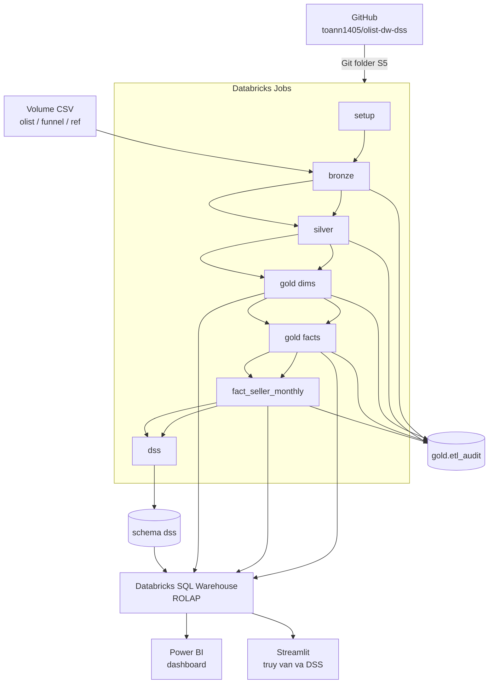

# Sơ đồ kiến trúc

Quyết định 26/10/2026. Lý do và phần không đổi: `docs/DESIGN.md`, mục Decision update. Grain, star schema, measure, SCD và surrogate key không nằm trong sơ đồ này vì không đổi.

## Luồng

## Từng lớp

| Lớp | Object Type | Load | Transformations | Data Model |
|---|---|---|---|---|
| Volume | File CSV trên Unity Catalog | Upload tay. Không phải bước Job | Không đổi nội dung file | 9 CSV Olist, 2 CSV Marketing Funnel, `ibge_state_region.csv` |
| Bronze | Bảng Delta | Batch. FULL LOAD, OVERWRITE (truncate rồi insert) | Mọi cột nghiệp vụ `STRING`, as-is. Thêm `_ingest_ts`, `_source_file`. Không join, không cast nghiệp vụ | Staging. Một dòng CSV của lần nạp hiện tại. 12 bảng |
| Silver | Bảng Delta | Batch. FULL LOAD, OVERWRITE | Cast, chuẩn hóa, luật làm sạch DESIGN §7. Dedup trong file: `order_reviews` bằng `ROW_NUMBER`, `order_reviews_dedup`, `geolocation_zip` một dòng mỗi prefix. Không chọn bản giữa các lần nạp | Integration. Grain sau làm sạch, DESIGN §2.3 |
| Gold dims | Bảng Delta. 7 dimension. Không phải view | `MERGE` theo grain. Idempotent. Member `-1` trước fact | Surrogate key. SCD Type 1. `dim_seller` SCD2-ready, vẫn một dòng mỗi `seller_id` | Star schema, dimension conformed |
| Gold facts | Bảng Delta. `fact_order`, `fact_order_item`. Không phải view | `MERGE` theo grain. Idempotent | Measure DESIGN §3.6. `snapshot_date` = `DATE '2018-10-17'` trong config | `fact_order_item`: transaction. `fact_order`: accumulating snapshot |
| `fact_seller_monthly` | Bảng Delta. Không phải view | `MERGE` theo (`seller_key`, `month_key`). Chạy sau hai fact kia | Gom từ fact item và fact đơn. Tháng là tháng mua | Periodic snapshot. Một seller × một tháng có ít nhất một item |
| `dss` | Bảng Delta đầu ra mô hình. Phase 5 mới thiết kế cột | Job `dss` ghi kết quả. Không do job fact ghi | M1, M2, what-if. Huấn luyện trên Gold | `seller_risk_score`, `policy_scenario`, `decision_log` — tên đã đặt, cột chưa thuộc Phase 2 |
| `gold.etl_audit` | Bảng Delta | Mỗi bước ghi thêm một dòng log cho mỗi bảng đích. Không MERGE đè lịch sử | Chỉ đếm. Cảnh báo geo, translation, conflict, đảo timestamp, đối soát giá: notebook in, không lưu cột | `audit_id`, `run_id`, `layer`, `target_table`, `source_name`, `rows_read`, `rows_loaded`, `rows_rejected`, `rows_unknown_fk`, `loaded_at` |
| SQL Warehouse | Endpoint truy vấn | Không lưu mart | SQL trên bảng Gold | ROLAP |
| Power BI | Dashboard | Đọc. Không ghi kho | Lọc, drill, 5 phép OLAP | Đọc Gold qua SQL Warehouse |
| Streamlit | App local | Đọc. Không ghi kho từ UI | Truy vấn, what-if, goal seek, xuất quyết định | Đọc Gold và `dss` qua SQL Warehouse |
| GitHub | Repo mã nguồn | Không phải lớp dữ liệu | — | Notebook `.py`, SQL, tài liệu. Git folder Databricks đã nối (S5, nhánh `main`) |

## Legend

| Ký hiệu | Nghĩa |
|---|---|
| Bảng Delta | Đối tượng lưu trong Unity Catalog. Fact, dimension và `etl_audit` là bảng, không phải view |
| FULL LOAD, OVERWRITE | Truncate rồi insert ảnh file hiện tại. Nạp lại không cộng dồn dòng |
| `MERGE` | Ghi theo khóa grain. Chạy lại cùng grain không nhân đôi dòng |
| ROLAP | Truy vấn SQL trực tiếp trên bảng Gold qua SQL Warehouse. Không cube MOLAP, không Import HOLAP |
| Mũi tên đậm trong Jobs | Thứ tự: setup → bronze → silver → gold dims → gold facts → `fact_seller_monthly` → dss |
| `gold.etl_audit` | Metadata vận hành. Một dòng mỗi bảng đích mỗi `run_id` |
| Future work | Incremental theo watermark, append, CDF, Auto Loader (R28). Không có trên sơ đồ hiện tại |

Kết nối Power BI (S3) và Streamlit (S2) từ máy local tới SQL Warehouse chưa chạy. Công cụ đã chốt; hai spike chỉ kiểm kết nối.
