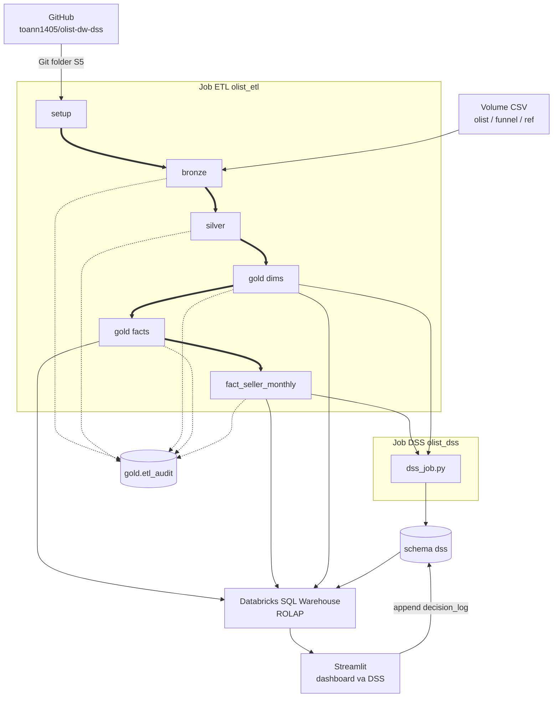

# Sơ đồ kiến trúc

Quyết định 26/10/2026, sửa MERGE và `decision_log` ngày 05/11/2026. Trình bày 10/11/2026: Consumption chỉ còn Streamlit. Power BI là future work. Job ETL Phase 3 dừng ở `fact_seller_monthly`. Job DSS là job serverless **tách riêng** (Phase 5), tháng chấm 2018-08. App: sáu trang. Grain, star schema, SCD và surrogate key không đổi.

## Luồng

## Từng lớp

| Lớp | Object Type | Load | Transformations | Data Model |
|---|---|---|---|---|
| Volume | File CSV trên Unity Catalog | Upload tay. Không phải bước Job | Không đổi nội dung file | 9 CSV Olist, 2 CSV Marketing Funnel, `ibge_state_region.csv` |
| Bronze | Bảng Delta | Batch. FULL LOAD, OVERWRITE (truncate rồi insert) | Mọi cột nghiệp vụ `STRING`, as-is. Thêm `_ingest_ts`, `_source_file`. Không join, không cast nghiệp vụ | Staging. Một dòng CSV của lần nạp hiện tại. 12 bảng |
| Silver | Bảng Delta | Batch. FULL LOAD, OVERWRITE | Cast, chuẩn hóa, luật làm sạch DESIGN §7. Dedup trong file: `order_reviews` bằng `ROW_NUMBER`, `order_reviews_dedup`, `geolocation_zip` một dòng mỗi prefix. Không chọn bản giữa các lần nạp | Integration. Grain sau làm sạch, DESIGN §2.3 |
| Gold dims | Bảng Delta. 7 dimension. Không phải view | `MERGE` theo grain. Chỉ `WHEN MATCHED THEN UPDATE` và `WHEN NOT MATCHED THEN INSERT`. Không `WHEN NOT MATCHED BY SOURCE THEN DELETE` | Surrogate key. SCD Type 1. `dim_seller` SCD2-ready, vẫn một dòng mỗi `seller_id` | Star schema, dimension conformed |
| Gold facts | Bảng Delta. `fact_order`, `fact_order_item`. Không phải view | `MERGE` theo grain. Chỉ `WHEN MATCHED THEN UPDATE` và `WHEN NOT MATCHED THEN INSERT` | Measure DESIGN §3.6. `snapshot_date` = `DATE '2018-10-17'` trong config | `fact_order_item`: transaction. `fact_order`: accumulating snapshot |
| `fact_seller_monthly` | Bảng Delta. Không phải view | `MERGE` theo (`seller_key`, `month_key`), cùng hai nhánh trên, không xóa theo nguồn. Chạy sau hai fact kia | `source_name` = `gold.fact_order_item`. Tháng là tháng mua | Periodic snapshot. Một seller × một tháng có ít nhất một item |
| `dss` | View `v_seller_features` và bảng Delta. Cột ở DESIGN §6.6 | Job DSS **tách khỏi** `olist_etl`. Ghi đè `seller_risk_score` (M1) và `policy_scenario` (M2). Có thể ghi thêm `seller_risk_contrib`, `model_eval`, `model_calibration`. Streamlit append `decision_log`. Job ETL Gold không ghi `dss` | M1 phân loại one-step-ahead; M2 mô phỏng P0/P1/P2. Huấn luyện trên Gold. Tháng chấm 2018-08 | View chỉ đọc `gold.*` |
| `gold.etl_audit` | Bảng Delta | Mỗi bước ghi thêm một dòng log cho mỗi bảng đích. Không MERGE đè lịch sử | Chỉ đếm dòng. `rows_rejected` là dòng bỏ hẳn. Cảnh báo và `rows_dropped_by_dedup` in ở notebook | `audit_id`, `run_id`, `layer`, `target_table`, `source_name`, `rows_read`, `rows_loaded`, `rows_rejected`, `rows_unknown_fk`, `loaded_at` |
| SQL Warehouse | Endpoint truy vấn | Không lưu mart | SQL trên bảng Gold và `dss` | ROLAP |
| Streamlit | App local, sáu trang | Đọc Gold và `dss`. Chỉ ghi thêm `dss.decision_log` (append) | Home; sức khỏe marketplace; GMV và trải nghiệm xấu từ đâu; seller đáng lo; chọn chính sách; dữ liệu và phương pháp | Qua SQL Warehouse. Không ghi `seller_risk_score` hay `policy_scenario`. Job ETL Gold không ghi `decision_log` |
| GitHub | Repo mã nguồn | Không phải lớp dữ liệu | — | Notebook `.py` trong `src/etl/` (DDL nằm trong notebook đó). `olist_etl.job.yml` là skeleton, chưa deploy. Git folder Databricks đã nối (S5, nhánh `main`) |

## Legend

| Nét | Nghĩa |
|---|---|
| `==>` | Thứ tự Job ETL: setup → bronze → silver → gold dims → gold facts → `fact_seller_monthly`. Job DSS là job khác |
| `-->` | Luồng dữ liệu: Volume → bronze, gold dims → job DSS, Gold và `dss` → SQL Warehouse → Streamlit, Streamlit → `dss.decision_log` |
| `-.->` | Ghi `gold.etl_audit`. Một dòng mỗi bảng đích mỗi `run_id` |

App Streamlit đã đọc SQL Warehouse trong các phiên 10–11/11/2026. Checkbox S2 trên RTM vẫn chưa tick. Power BI (S3) là future work, không có object trong luồng hiện tại.
